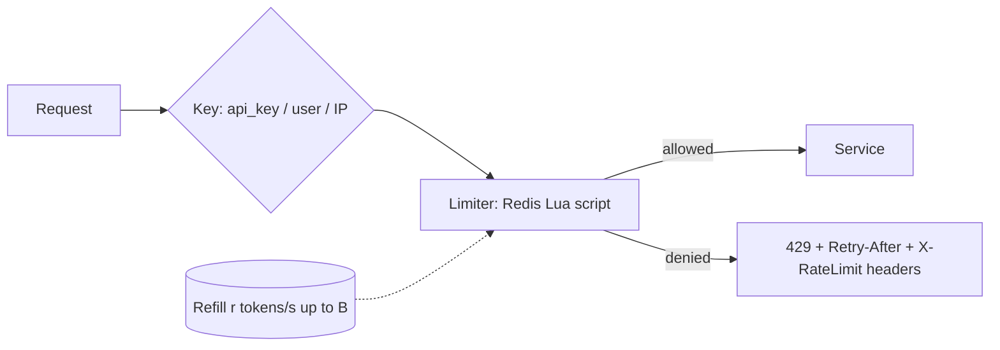

# Rate Limiting

## Core Idea

Rate limiting caps how many requests a client (user, API key, IP, tenant) may make in a time window. It protects capacity from abuse and noisy neighbors, enforces pricing tiers, and slows brute-force attacks. Over-limit requests get **HTTP 429** with `Retry-After`.

## Mechanism

### Algorithms

| Algorithm | How | Bursts | Memory/key | Accuracy |
|---|---|---|---|---|
| **Token bucket** | Bucket of capacity B refills at r tokens/s; each request takes 1 | Allows bursts up to B | 2 values (tokens, last refill) | Exact |
| **Leaky bucket (queue)** | Requests enter a FIFO drained at constant rate | Smooths output; excess dropped | Queue | Exact, adds delay |
| **Fixed window counter** | `INCR key:minute` with TTL | Up to 2× limit at window edges | 1 counter | Edge spikes |
| **Sliding window log** | Store timestamp of each request; count those within window | No edge spike | O(requests) | Exact, memory-heavy |
| **Sliding window counter** | Weighted: `curr + prev × (1 − elapsed/window)` | Minimal | 2 counters | Approximate, good enough |



### Where to enforce
- Edge/CDN/WAF (per IP, coarse DDoS protection).
- API gateway (per key/tenant, product quotas).
- Service level (protect specific expensive endpoints, e.g., login, search).
- Client side (be a good citizen; respect `Retry-After`).

### Distributed rate limiting
With N gateway instances, local counters allow N × limit. Options:
- **Central store (Redis)** with atomic Lua scripts — accurate, adds ~1 network hop.
- **Local limits = global / N** — no coordination, inaccurate when traffic is uneven.
- **Local token buckets with periodic sync** to a central store — approximate, low latency.

### Token bucket in Redis + Lua (atomic)

```lua
-- KEYS[1] = bucket key
-- ARGV[1] = capacity, ARGV[2] = refill_rate (tokens/sec), ARGV[3] = now_ms, ARGV[4] = cost
local capacity = tonumber(ARGV[1])
local rate     = tonumber(ARGV[2])
local now      = tonumber(ARGV[3])
local cost     = tonumber(ARGV[4])

local b = redis.call('HMGET', KEYS[1], 'tokens', 'ts')
local tokens = tonumber(b[1]) or capacity
local ts     = tonumber(b[2]) or now

local elapsed = math.max(0, now - ts) / 1000.0
tokens = math.min(capacity, tokens + elapsed * rate)

local allowed = 0
local retry_after_ms = 0
if tokens >= cost then
  tokens = tokens - cost
  allowed = 1
else
  retry_after_ms = math.ceil((cost - tokens) / rate * 1000)
end

redis.call('HSET', KEYS[1], 'tokens', tokens, 'ts', now)
-- expire idle buckets after the time to refill fully (plus slack)
redis.call('PEXPIRE', KEYS[1], math.ceil(capacity / rate * 1000) + 1000)
return {allowed, math.floor(tokens), retry_after_ms}
```

```python
import time, redis

r = redis.Redis()
TOKEN_BUCKET = r.register_script(open("token_bucket.lua").read())

def allow(key: str, capacity: int = 100, rate: float = 10.0, cost: int = 1):
    now_ms = int(time.time() * 1000)  # prefer Redis TIME if app clocks drift
    allowed, remaining, retry_ms = TOKEN_BUCKET(
        keys=[f"rl:{key}"], args=[capacity, rate, now_ms, cost])
    return bool(allowed), remaining, retry_ms
```

Notes: Lua scripts run atomically in Redis, so there's no read-modify-write race. In Redis Cluster, a script's keys must hash to the same slot (use `{hashtag}`). Clock: passing app time assumes roughly synchronized clocks; calling `redis.call('TIME')` inside the script avoids that (allowed in Redis 5+ with effects replication, the default since 5.0 / only mode in 7.0).

### Sliding window counter (fixed-window pair)

```python
def sliding_allow(user, limit=100, window=60):
    now = time.time()
    cur = int(now // window)
    elapsed = (now % window) / window
    p = r.pipeline()
    p.incr(f"sw:{user}:{cur}")
    p.expire(f"sw:{user}:{cur}", window * 2)
    p.get(f"sw:{user}:{cur-1}")
    cur_count, _, prev = p.execute()
    estimate = int(prev or 0) * (1 - elapsed) + cur_count
    return estimate <= limit  # note: counts rejected requests too; acceptable approximation
```

## Example (assumptions)

Public API tier: 100 req/s sustained, bursts of 200. Token bucket capacity 200, rate 100/s. 1M active keys × ~150-200 B each (key name + 2-field hash + Redis per-key overhead; measure with `MEMORY USAGE`) ≈ 150-200 MB in Redis — still small. At 50k limiter checks/s, a small Redis cluster handles it; on Redis failure, fail open for authenticated paying users but keep a local per-instance limit as a safety net.

## Tradeoffs

| Choice | Tradeoff |
|---|---|
| Fail open vs fail closed when limiter store is down | Availability vs protection (fail closed for login/OTP endpoints) |
| Accuracy vs latency | Central Redis check per request vs local approximations |
| Per IP vs per user | IPs shared by NAT/carriers (false positives) vs requires auth |
| Token vs leaky bucket | Allow bursts vs smooth output |

## Failure Modes

- Redis becomes the bottleneck/SPOF — shard by key, replicate, local fallback.
- Fixed-window edge burst (2× limit across a boundary).
- Hot key for one huge tenant — local pre-aggregation.
- Clients retry immediately on 429 without backoff — amplification.
- Clock skew across app servers corrupts refill math — use Redis server time.

## Security Implications

Rate limits slow credential stuffing, OTP brute force, scraping, and enumeration — limit per account *and* per IP *and* globally for sensitive endpoints. Attackers rotate IPs (botnets, residential proxies), so combine with device fingerprinting, CAPTCHAs, and anomaly detection. Don't trust `X-Forwarded-For` unless set by your own proxy. Limits on expensive operations (search, export, GraphQL cost) prevent application-layer DoS.

## Real-World Usage

- Stripe has published about using token-bucket style limiters plus load shedders.
- NGINX `limit_req` implements a leaky-bucket-style limiter; Envoy supports local and global (external rate limit service) limiting.
- GitHub's REST API exposes `X-RateLimit-Limit/Remaining/Reset` headers.
- Cloudflare wrote about using a sliding window counter approximation.

## Interview Questions

- **Token bucket vs leaky bucket?** Token bucket allows bursts up to capacity while enforcing average rate; leaky bucket enforces a constant output rate.
- **Why Lua in Redis?** Atomic read-modify-write in one round trip; avoids races between concurrent gateway instances.
- **What if Redis is down?** Choose per endpoint: fail open with local limits for general traffic; fail closed for security-sensitive endpoints.
- **Fixed window problem?** A client can send the full limit at the end of one window and again at the start of the next.
- **How to tell the client?** 429, `Retry-After`, and remaining-quota headers.

Implementation patterns (code, config, and failure handling live there; this note covers the concept and tradeoffs): [[Pattern-Retry-with-Backoff]]

## Related

[[System-Design-Index]] · [[API-Gateway]] · [[Fault-Tolerance]] · [[Caching]] · [[Load-Balancing]] · [[Case-Study-Authentication-Platform]] · [[Case-Study-URL-Shortener]]
