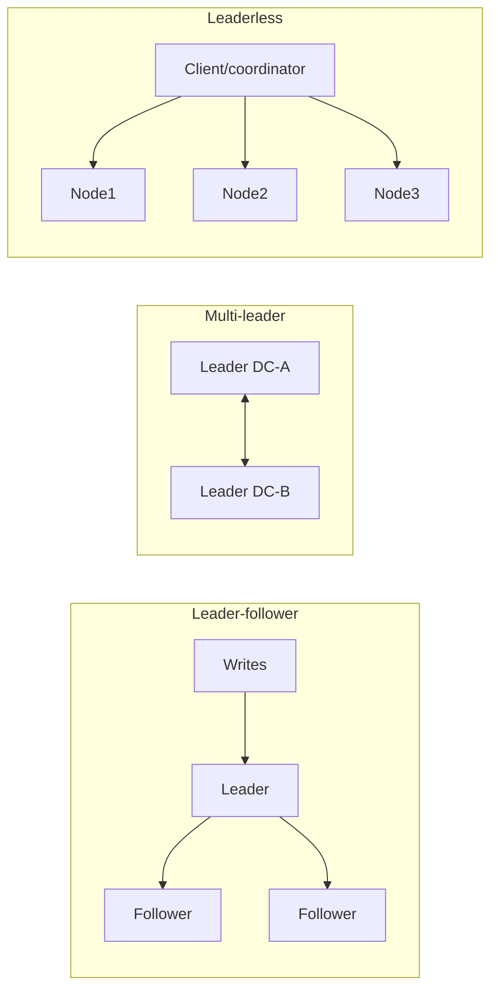

# Replication

## Core Idea

Keep copies of the same data on multiple nodes for **availability** (survive node loss), **read scaling**, and **latency** (copies near users). The hard part is handling changes: who accepts writes, and how copies agree.

## Mechanism

### Leader-follower (single leader)
All writes go to the leader, which streams its log (WAL, binlog) to followers. Reads can go to followers.
- **Synchronous** follower: write acknowledged only after follower confirms — no data loss on leader failure, but a slow follower blocks writes. Common: **semi-sync** (one sync follower, rest async).
- **Asynchronous:** fast, but failover may lose recently acknowledged writes.
- **Failover:** detect leader death (timeout), elect a new leader (most up-to-date follower, ideally via consensus), reconfigure clients, fence the old leader.

### Multi-leader
Several nodes accept writes (typically one per datacenter) and replicate to each other. Good for multi-region write latency and offline clients. Requires **conflict resolution**: last-write-wins (loses data), merge functions, CRDTs, or app-level resolution.

### Leaderless (Dynamo-style)
Client (or a coordinator node) sends writes to all N replicas and waits for W acks; reads query R replicas and take the newest version.
- **Quorum condition:** **R + W > N** guarantees read and write sets overlap in at least one node.
- Common: N=3, W=2, R=2. W=1/R=1 = fast, weak. W=N = slow writes, fragile.
- Repair mechanisms: **read repair** (fix stale replicas on read), **hinted handoff** (another node holds writes for a down node), **anti-entropy** with Merkle trees.
- Caveat: even with R + W > N, sloppy quorums, concurrent writes, and LWW with clock skew mean it is **not** automatically linearizable.

## Example (assumptions) — quorum math

N = 5 replicas.
- W = 3, R = 3: overlap guaranteed (3 + 3 > 5); tolerates 2 node failures for both reads and writes.
- W = 5, R = 1: fast reads, but a single down node blocks writes.
- W = 1, R = 1: max availability, eventual consistency only.
Rule: tolerate f failures for writes needs W ≤ N − f; for reads R ≤ N − f.

## Tradeoffs

| Topology | Write latency | Consistency | Conflict handling | Examples |
|---|---|---|---|---|
| Single leader, async | Low | Eventual on followers; loss on failover | None | MySQL/Postgres async replicas |
| Single leader, sync/semi-sync | Higher | Strong on leader | None | Postgres synchronous_commit, MySQL semi-sync |
| Consensus-based (Raft/Paxos) | Majority RTT | Linearizable | None | etcd, CockroachDB, Spanner |
| Multi-leader | Local | Eventual | Required | Cross-DC MySQL setups, CouchDB |
| Leaderless | Tunable | Tunable/eventual | Required (versions/LWW) | Cassandra, Riak, DynamoDB internals per Dynamo paper lineage |

## Failure Modes

- **Replication lag** -> stale reads, read-your-writes violations, non-monotonic reads.
- **Split brain** on failover: two leaders accept writes. Fix: fencing tokens, STONITH, consensus-based election.
- **Lost writes** on async failover; conflicts when the old leader rejoins.
- Replica falls too far behind and needs a full resync from snapshot.
- Replicating bad data: replication copies `DROP TABLE` too — it is not a backup ([[Disaster-Recovery]]).

## Security Implications

Encrypt replication traffic (it contains every write). Replicas need the same access controls as the primary — a forgotten read replica with weak credentials is a leak. Cross-region replication may breach data-residency rules.

## Real-World Usage

- **PostgreSQL** streaming replication (async default, optional synchronous); **MySQL** binlog replication with semi-sync plugin.
- **Cassandra:** leaderless, per-query consistency levels, hinted handoff, read repair, Merkle-tree repair.
- **Amazon DynamoDB:** internally replicates each partition across 3 AZs; the service later described using Multi-Paxos for leader election within a replication group (DynamoDB USENIX ATC 2022 paper) — so "DynamoDB" and the 2007 "Dynamo" paper differ.
- **Kafka:** each partition has a leader and ISR followers; `acks=all` plus `min.insync.replicas` controls durability.

## Interview Questions

- **Why R + W > N?** Guarantees at least one replica in the read set has the latest acknowledged write.
- **Sync vs async replication?** Sync: no loss, higher latency, availability depends on followers. Async: fast, may lose recent writes on failover.
- **How do you handle multi-leader conflicts?** Avoid them (route each record's writes to one home region), or LWW, or CRDTs, or app-level merge.
- **Is a replica a backup?** No — it faithfully replicates deletes and corruption.

## Related

[[System-Design-Index]] · [[Consistency-Models]] · [[CAP-Theorem]] · [[Consensus-Raft-Paxos]] · [[Sharding-and-Partitioning]] · [[Disaster-Recovery]]
