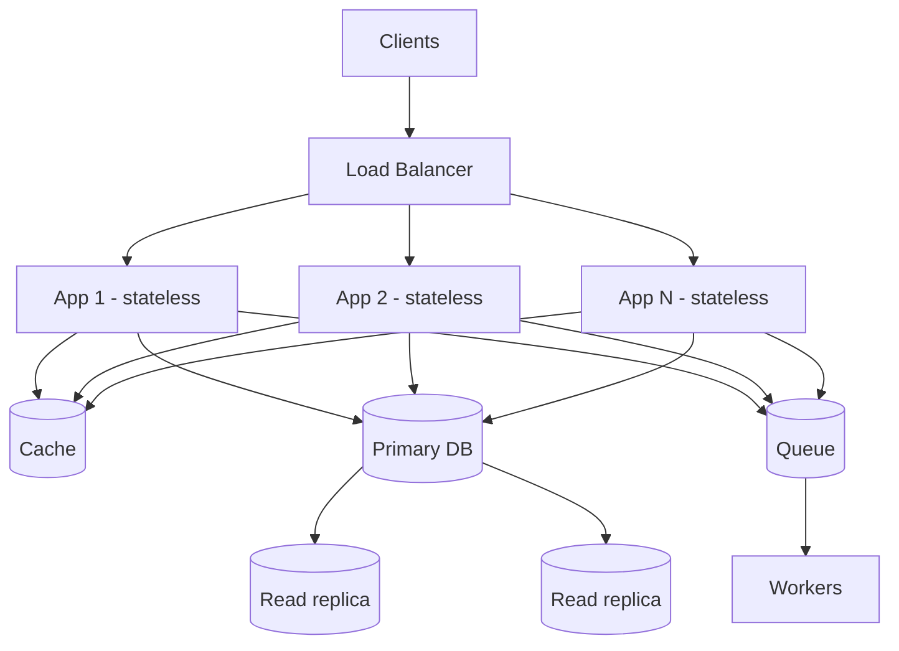

# Scalability

## Core Idea

A system is scalable if adding resources increases capacity roughly proportionally, without a redesign. **Vertical scaling** (bigger machine) is simple but capped and a single point of failure. **Horizontal scaling** (more machines) is theoretically unbounded but requires the work to be divisible: stateless compute, partitioned data, and coordination kept off the hot path.

## Mechanism

The usual scaling ladder:
1. One box -> separate DB from app.
2. Stateless app tier behind a [[Load-Balancing|load balancer]]; sessions move to Redis or signed tokens.
3. [[Caching]] and a [[CDN]] to absorb reads.
4. Read replicas ([[Replication]]).
5. Async work via [[Message-Queues]].
6. [[Sharding-and-Partitioning|Sharding]] when writes or data size exceed one primary.
7. Split by domain ([[Microservices]]) when teams, not machines, are the bottleneck.

**Amdahl's law:** if a fraction *s* of the work is serial, max speedup is 1/s regardless of machines. **Universal Scalability Law** adds a coherence (crosstalk) term — beyond some point, adding nodes *reduces* throughput because of coordination.

## Example (assumptions)

Assume one app server handles 500 RPS at target p99. Peak is 12k RPS -> 24 servers; add N+2 for failure and deploy headroom -> ~26-30. The DB sees 12k × 0.1 cache-miss rate = 1.2k reads/s, which one primary + 2 replicas can plausibly serve; writes at 200/s need no sharding yet.

## Tradeoffs

| Choice | Pros | Cons |
|---|---|---|
| Vertical | No code change, strong consistency trivial | Hardware ceiling, cost grows nonlinearly, SPOF |
| Horizontal (stateless) | Near-linear, fault tolerant | Needs LB, externalized state, more ops |
| Horizontal (data) | Scales writes/storage | Cross-shard queries, rebalancing, hot keys |
| Scale-out via async | Smooths spikes | Eventual consistency, harder debugging |

## Failure Modes

- Hidden state (in-memory sessions, local file uploads) breaks when a second instance appears.
- Shared bottleneck (one DB, one lock, one leader) caps the whole fleet.
- Autoscaling lag: new instances take minutes; spikes arrive in seconds.
- Retry storms multiply load during partial failures.
- Hot keys: data is partitioned but traffic is not uniform.

## Security Implications

More nodes = larger attack surface and more secrets to distribute; use a secrets manager and short-lived credentials. Autoscaling can be abused as a cost-DoS — cap max instances and put [[Rate-Limiting]] in front.

## Real-World Usage

- Stateless web tiers behind AWS ELB/ALB or NGINX with autoscaling groups are the standard pattern.
- Kafka scales consumers by partition count; parallelism per consumer group is capped at the number of partitions.
- Cassandra/DynamoDB scale writes by hash-partitioning keys across nodes.

## Interview Questions

- **Vertical or horizontal first?** Vertical until it's clearly insufficient or availability demands redundancy — it's cheaper in engineering time. Keep the app stateless from day one so horizontal is easy.
- **How do you make a service stateless?** Move session to a shared store or signed tokens, uploads to object storage, caches to a shared cache, and use idempotent handlers.
- **What stops scaling linearly?** Serial sections, shared locks, coordination (consensus), a single-writer DB, and hot partitions.
- **Scale reads vs writes?** Reads: cache, CDN, replicas. Writes: batching, async queues, sharding.

## Related

[[System-Design-Index]] · [[Load-Balancing]] · [[Caching]] · [[Replication]] · [[Sharding-and-Partitioning]] · [[Latency-and-Throughput]] · [[Microservices]]
