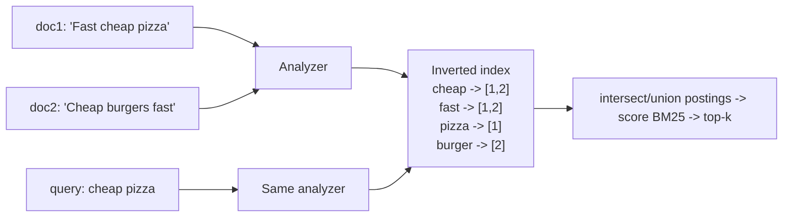

# Search Systems and the Inverted Index

## Core Idea

A relational `LIKE '%term%'` scans every row. Search engines build an **inverted index**: a map from each term to the list of documents (postings) containing it, so a query touches only the postings for its terms. Then they **rank** results by relevance.

## Mechanism

### Indexing pipeline
1. **Analyze:** character filters -> tokenizer -> token filters (lowercase, stop words, stemming/lemmatization, synonyms, n-grams for autocomplete).
2. **Build postings:** term -> [(doc_id, term frequency, positions)], sorted by doc_id and compressed (delta + variable-byte / frame-of-reference encoding).
3. **Segments:** Lucene writes immutable segments; new docs go to a new segment; segments merge in the background; deletes are tombstones until merge.

### Ranking
- **TF-IDF** / **BM25** (Lucene's default since 6.0): rewards term frequency with saturation, rare terms (IDF), and normalizes by document length.
- Boosts: field weights (title > body), recency, popularity.
- Modern stacks add **learning-to-rank** or **vector (semantic) search** with ANN indexes (HNSW), often combined with BM25 (hybrid search).

### Distributed search
- Index split into **shards** (by doc ID hash); each shard has replicas.
- **Scatter-gather:** coordinator sends query to one copy of every shard, each returns top-k with scores, coordinator merges. Deep pagination is expensive (each shard must return from+size) -> use `search_after` cursors.
- **Near-real-time:** new documents become searchable after a refresh (Elasticsearch default 1 s refresh interval), not instantly.

### Keeping search in sync
Search is a **derived** store. Feed it from the source of truth via CDC or the outbox pattern ([[Event-Driven-Architecture]]), with the ability to fully reindex (alias swap: build new index, flip alias).

## Example (assumptions)

E-commerce catalog of 50M products × 2 KB source ≈ 100 GB; index with replicas maybe 2-3× that. 10 primary shards (~10 GB each), 1 replica each. 2k queries/s at peak; each query fans out to 10 shards. Updates via Kafka CDC topic from Postgres; price changes visible within ~2 s.

## Tradeoffs

| Choice | Tradeoff |
|---|---|
| More shards | Parallelism vs per-query fan-out overhead and small-shard waste |
| Short refresh interval | Freshness vs indexing throughput |
| Rich analyzers (n-grams, synonyms) | Recall vs index size and precision |
| Search as source of truth | Simplicity vs durability/consistency risk — avoid |
| Keyword vs vector search | Precision on exact terms vs semantic recall; hybrid often best |

## Failure Modes

- Index drift from source DB (missed CDC events) -> periodic reconciliation / reindex.
- Mapping explosion from dynamic fields (unbounded keys).
- Deep pagination OOM; expensive wildcard/regex queries.
- Hot shard from routing by a skewed key.
- Split brain in older Elasticsearch versions with misconfigured minimum master nodes (fixed by the 7.x cluster coordination redesign).

## Security Implications

Search indexes often bypass the DB's row-level permissions — enforce document-level security (filter by tenant/ACL at query time, or per-tenant indexes). Exposed Elasticsearch/OpenSearch clusters without auth have caused many data leaks — enable auth and TLS, never expose to the internet. Sanitize query DSL passed from users (query injection, expensive queries as DoS).

## Real-World Usage

- **Apache Lucene** is the core library under Elasticsearch, OpenSearch, and Solr.
- Log search: Elasticsearch/OpenSearch (ELK stack); Grafana Loki instead indexes only labels to cut cost.
- Postgres has built-in full-text search (`tsvector`, GIN index) — often enough for modest needs.

## Interview Questions

- **What is an inverted index?** Term -> postings list of documents; queries intersect/union postings instead of scanning documents.
- **How do you keep search consistent with the DB?** CDC/outbox to an indexer, idempotent upserts by doc ID with version, periodic full reindex with alias swap.
- **Why is search near-real-time?** Segments must be refreshed/opened before new docs are visible; trading freshness for throughput.
- **How would you build autocomplete?** Edge n-gram analyzer or completion suggester (FST), or a prefix trie service with popularity weights, cached heavily.

## Related

[[System-Design-Index]] · [[Database-Selection]] · [[Sharding-and-Partitioning]] · [[Event-Driven-Architecture]] · [[Bloom-Filters-and-Probabilistic-Structures]] · [[Case-Study-Log-Aggregation]] · [[Case-Study-SIEM]]
