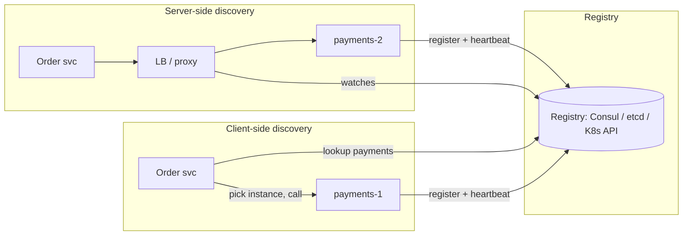

# Service Discovery

## Core Idea

In dynamic environments instances come and go (autoscaling, deploys, failures), so hard-coded IPs don't work. Service discovery maintains a **registry of healthy instances** and a way for callers to resolve a logical name (`payments`) to current endpoints.

## Mechanism

- **Registration:** self-registration (instance calls registry) or third-party (orchestrator registers it, e.g., Kubernetes endpoints controller).
- **Health:** TTL heartbeats or registry-driven health checks; stale entries expire.
- **Client-side discovery:** client queries registry and load-balances itself (Netflix Eureka + Ribbon, gRPC name resolvers). Fewer hops, smarter balancing; logic in every client.
- **Server-side discovery:** client calls a stable address; LB/proxy resolves (Kubernetes Service/kube-proxy, AWS ALB target groups).
- **DNS-based:** names resolve to instance IPs (Consul DNS, K8s headless services). Universal, but TTL caching delays updates.
- **Service mesh:** a sidecar proxy (Envoy) per instance gets endpoints from a control plane (Istio, Linkerd, Consul Connect) and adds mTLS, retries, and telemetry.

## Example (assumptions)

Kubernetes: `payments` Deployment with 6 pods. Service `payments.prod.svc.cluster.local` gets a virtual IP; readiness probes gate which pods appear in EndpointSlices. A rolling deploy replaces pods; callers keep using the same name.

## Tradeoffs

| Approach | Pro | Con |
|---|---|---|
| Client-side | No extra hop, rich LB | Per-language libraries |
| Server-side | Simple clients | Extra hop, LB must be HA |
| DNS | Works everywhere | Caching, limited health semantics |
| Mesh | Uniform mTLS, retries, telemetry | Operational complexity, sidecar overhead |

Registry consistency: etcd/ZooKeeper/Consul (servers) are CP (Raft/ZAB); Eureka favored AP (serve possibly stale lists rather than none). For discovery, stale-but-available is often preferable.

## Failure Modes

- Registry outage: clients should cache last-known endpoints.
- Stale entries route to dead instances -> short TTLs plus client retries on another instance.
- DNS TTL ignored by clients (e.g., JVM caching) -> traffic to old IPs.
- Thundering re-registration after a registry restart.

## Security Implications

A writable registry lets an attacker register a malicious endpoint and intercept traffic — authenticate registration, use ACLs, and verify service identity with mTLS (SPIFFE/SPIRE identities). Registry contents reveal internal topology; restrict read access.

## Real-World Usage

- Kubernetes Services + CoreDNS are the most common discovery mechanism today.
- HashiCorp Consul: registry + health checks + DNS/HTTP API + mesh.
- Netflix Eureka: AP-leaning registry designed for AWS.

## Interview Questions

- **Client- vs server-side discovery?** Client-side avoids a hop and enables smart balancing; server-side keeps clients dumb.
- **Should the registry be CP or AP?** Writes benefit from consistency, but clients should tolerate stale reads and cache — availability of lookups matters most.
- **How does Kubernetes do it?** Pods labeled; Service selects them; EndpointSlices track ready pods; kube-proxy/eBPF routes the ClusterIP; CoreDNS resolves names.

## Related

[[System-Design-Index]] · [[Load-Balancing]] · [[API-Gateway]] · [[Microservices]] · [[Consensus-Raft-Paxos]]
