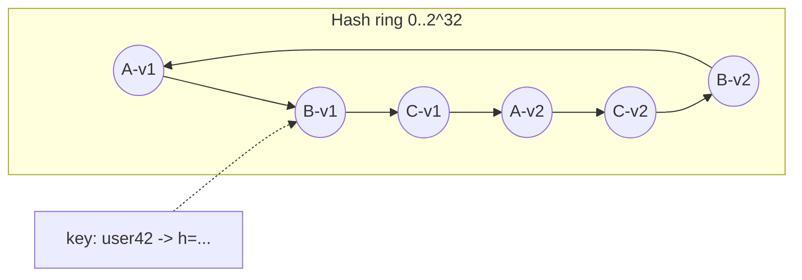

# Sharding and Partitioning

## Core Idea

Split a dataset across nodes so each holds a subset; each partition is usually also replicated. Sharding scales **writes and storage** beyond one machine. The central decision is the **partition key**: it must spread load evenly and keep common queries on one shard.

## Mechanism

### Strategies

| Strategy | How | Good | Bad |
|---|---|---|---|
| **Range** | Key ranges -> shards (a-f, g-m, ...) | Range scans, ordered data | Hot spots on sequential keys (timestamps) |
| **Hash (mod N)** | `hash(key) % N` | Even spread | Changing N moves almost every key |
| **Consistent hashing** | Keys and nodes on a hash ring; key goes to next node clockwise | Adding/removing a node moves ~1/N of keys | Uneven without virtual nodes |
| **Directory/lookup** | A mapping service key -> shard | Flexible moves | Lookup service is critical path + SPOF risk |
| **Geo / entity** | By tenant, region, user | Locality, isolation | Uneven tenant sizes |

### Consistent hashing with virtual nodes

Each physical node owns many points (**vnodes**, e.g. 100-256) on the ring. Benefits: smoother distribution, heterogeneous capacity (more vnodes for bigger nodes), and when a node leaves its load spreads across many nodes rather than one neighbor. Replication: store on the next N distinct physical nodes clockwise.

Alternatives: **rendezvous (HRW) hashing**, **jump consistent hash** (Google; stateless, but only for numbered buckets), and fixed-partition schemes (create many more partitions than nodes, e.g. 4096, and move whole partitions — Kafka, Elasticsearch, Cassandra's token ranges, Redis Cluster's 16384 hash slots).

### Hot keys

A celebrity user or viral item overloads one shard regardless of hashing.
- **Key salting:** write to `key#0..key#9`, read all 10 and merge (for write-hot counters).
- Cache hot reads in front ([[Caching]]).
- Split hot partition (range-based systems auto-split).
- Rate-limit or handle celebrities with a separate path (e.g., pull model for celebrity posts in feeds).

### Secondary indexes

- **Local (document-partitioned):** each shard indexes its own data; queries by the index scatter to all shards.
- **Global (term-partitioned):** index partitioned by indexed value; reads hit one shard, writes update another shard asynchronously (DynamoDB GSIs are eventually consistent).

### Resharding

1. Pre-split into many logical partitions, map them to fewer physical nodes; move partitions, not keys.
2. Online migration: dual-write (or CDC) to new layout, backfill, verify, cut reads over, stop old writes.
3. Throttle migration to protect live traffic.

## Example (assumptions)

Chat messages: 50k writes/s, one Postgres primary handles ~5k writes/s comfortably in this setup -> ≥10 shards; choose 16 physical shards over 1024 logical partitions. Key = `conversation_id` so a conversation's history is one-shard range scan by `(conversation_id, message_ts)`. Growth to 32 shards moves ~half the logical partitions without rehashing keys.

## Tradeoffs

| Concern | Tradeoff |
|---|---|
| Key choice | Locality for queries vs even spread |
| Range vs hash | Scans vs uniformity |
| More shards | More parallelism vs more ops, more cross-shard ops |
| Cross-shard transactions | Correctness vs latency (2PC, sagas) |

## Failure Modes

- Hot partition from skewed key (e.g., `country=IN`, `date=today`).
- Scatter-gather queries whose latency = slowest shard.
- Cross-shard joins/transactions pushed into app code.
- Resharding bugs: double-writes diverge, lost writes at cutover.
- Monotonic IDs as range key -> all inserts hit the last shard.

## Security Implications

Tenant-per-shard gives strong isolation (noisy neighbor, blast radius, per-tenant encryption keys). Shared shards need tenant ID in every query and row-level checks to prevent cross-tenant leaks. Predictable shard keys can let attackers target one shard for DoS.

## Real-World Usage

- **Cassandra** and **DynamoDB**: hash partitioning on partition key; Cassandra uses a token ring with vnodes.
- **Kafka:** topics split into partitions; key hash picks partition; ordering only within a partition.
- **Redis Cluster:** 16384 hash slots (CRC16 of key), `{hashtag}` forces related keys to one slot.
- **MongoDB:** ranged or hashed shard keys with chunk balancing.
- **Vitess** (originated at YouTube): sharding layer for MySQL.

## Interview Questions

- **Why consistent hashing over mod N?** Adding a node remaps ~1/N of keys instead of nearly all.
- **Why virtual nodes?** Even distribution, weighted capacity, load of a failed node spreads across many.
- **How do you pick a shard key?** High cardinality, even access, aligned with the dominant query, doesn't change over the record's life.
- **How to handle a hot key?** Cache, salt/split, isolate, or change the data flow (fan-out on read for celebrities).
- **How do you reshard with zero downtime?** Logical partitions + move partitions, or dual-write + backfill + verified cutover.

## Related

[[System-Design-Index]] · [[Replication]] · [[Database-Selection]] · [[Caching]] · [[Message-Queues]] · [[Case-Study-WhatsApp]] · [[Case-Study-URL-Shortener]]
