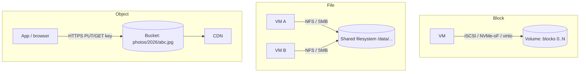

# Storage - Blob vs Block vs File

## Core Idea

Three storage abstractions, each suited to different workloads:
- **Block storage:** raw fixed-size blocks presented as a disk; the OS puts a filesystem on it. Low latency, attached to one host (usually). For databases and boot volumes.
- **File storage:** a shared hierarchical filesystem over the network (NFS, SMB). Multiple hosts mount it. For shared content, legacy apps, home directories.
- **Object (blob) storage:** flat namespace of immutable objects (key -> bytes + metadata) accessed via HTTP API. Virtually unlimited scale, high durability, cheap. For media, backups, data lakes, static assets.

## Mechanism

| | Block | File | Object |
|---|---|---|---|
| Interface | Disk device (read/write block offsets) | POSIX paths, open/read/write/lock | HTTP REST: PUT/GET/DELETE whole objects (range GETs supported) |
| Sharing | Typically one host at a time | Many hosts | Anyone with credentials, globally |
| Mutability | In-place writes | In-place writes | Replace whole object (no in-place edit) |
| Latency | Lowest (sub-ms for SSD-backed) | Low-moderate | Higher (tens of ms typical first byte) |
| Scale | Per-volume limits | Up to large, with metadata limits | Effectively unlimited objects |
| Cost | Higher per GB | Higher per GB | Lowest per GB, tiered (hot/cold/archive) |
| Examples | AWS EBS, GCP Persistent Disk, local NVMe | AWS EFS, Azure Files, NetApp, CephFS | Amazon S3, GCS, Azure Blob, MinIO, Ceph RGW |

### Object storage specifics
- Durability via replication or erasure coding across devices/AZs; Amazon S3 is designed for 11 nines (99.999999999%) of object durability per AWS documentation.
- Amazon S3 provides strong read-after-write consistency for PUTs and DELETEs (since December 2020).
- Large uploads: **multipart upload**; client uploads directly with **pre-signed URLs** so bytes bypass your app servers.
- Lifecycle policies move old objects to colder tiers or delete them.
- Metadata (owner, title, ACL) lives in your DB; the object store holds bytes keyed by an ID.

## Example (assumptions)

Photo app: 2M uploads/day × 2 MB = 4 TB/day. Client requests a pre-signed PUT URL from the API (valid 10 min), uploads directly to object storage, then an event triggers thumbnail workers ([[Message-Queues]]). Metadata row in Postgres: `photo_id, owner_id, object_key, status`. Reads through a [[CDN]]. After 90 days, lifecycle rule moves originals to an infrequent-access tier.

## Tradeoffs

| Need | Choose |
|---|---|
| Database data files, low-latency random IO | Block |
| Many servers need a shared POSIX directory | File |
| Media, backups, logs, data lake, static sites | Object |
| Lowest cost for rarely read data | Object archive tier (retrieval delays/fees) |

## Failure Modes

- Running a database on network file storage -> locking/fsync semantics issues and poor performance.
- Single block volume tied to one AZ — AZ loss = volume unavailable; snapshot/replicate.
- Streaming uploads through app servers -> app tier becomes a bandwidth bottleneck (use pre-signed URLs).
- Hot prefixes/request-rate limits on object stores (S3 documents per-prefix request rates; spread keys if you exceed them).
- Listing huge buckets is slow — keep an index in your DB.

## Security Implications

Public bucket misconfiguration is a leading cause of cloud data leaks — block public access by default, use bucket policies with least privilege, and pre-signed URLs with short expiry and content-type/size conditions. Encrypt at rest (SSE-KMS or client-side) and in transit. Validate uploaded content (type sniffing, malware scan) before serving; serve user content from a separate domain to avoid XSS on your main origin. Object lock/versioning protects against ransomware and accidental deletes.

## Real-World Usage

- Amazon S3 is the de facto object API; many systems (MinIO, Ceph RGW, Cloudflare R2) expose S3-compatible APIs.
- Databases on cloud VMs typically use EBS/Persistent Disk or local NVMe.
- Data lakes store Parquet files on object storage with table formats like Apache Iceberg or Delta Lake.

## Interview Questions

- **Where do you store user-uploaded videos?** Object storage (via pre-signed multipart uploads), metadata in DB, delivery via CDN.
- **Why not store images in the DB?** Bloats DB, backups, and replication; object stores are cheaper and CDN-friendly. Store keys in the DB.
- **Block vs file?** Block for single-host low-latency IO (DBs); file when multiple hosts need shared POSIX access.
- **How is object storage so durable?** Replication/erasure coding across failure domains plus background integrity checks and repair.

## Related

[[System-Design-Index]] · [[CDN]] · [[Database-Selection]] · [[Disaster-Recovery]] · [[Replication]] · [[Case-Study-File-Storage]] · [[Case-Study-YouTube]] · [[Case-Study-Instagram]]
