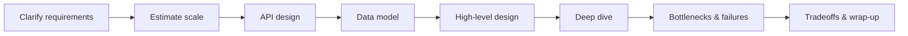

# System Design Index

Start with [[System-Design-Basics]] for the 45-minute round overview, then work through the learning path below.

## Learning Path

1. **Foundations:** [[Scalability]] -> [[Latency-and-Throughput]] -> [[Availability-and-Reliability]]
2. **Correctness under distribution:** [[Consistency-Models]] -> [[CAP-Theorem]] -> [[PACELC]] -> [[Consensus-Raft-Paxos]]
3. **Building blocks:** [[Load-Balancing]] -> [[Caching]] -> [[CDN]] -> [[Storage-Blob-vs-Block-vs-File]] -> [[Database-Selection]]
4. **Data at scale:** [[Replication]] -> [[Sharding-and-Partitioning]] -> [[Search-Systems-Inverted-Index]] -> [[Bloom-Filters-and-Probabilistic-Structures]]
5. **Async & architecture:** [[Message-Queues]] -> [[Event-Driven-Architecture]] -> [[Microservices]] -> [[Service-Discovery]] -> [[API-Gateway]] -> [[API-Design-REST-gRPC-GraphQL]]
6. **Resilience & correctness patterns:** [[Rate-Limiting]] -> [[Idempotency]] -> [[Distributed-Locks]] -> [[Fault-Tolerance]] -> [[Disaster-Recovery]]
7. **Operating it:** [[Observability]]
8. **Apply:** case studies (below).

- [ ] Finish foundations (1-2)
- [ ] Finish building blocks (3-4)
- [ ] Finish async & patterns (5-6)
- [ ] Do 5 case studies end-to-end on a whiteboard, timed at 45 min

## The Interview Framework

| Step | Time (45 min round, suggested) | What to produce |
|---|---|---|
| Clarify | ~5 min | Functional features (3-5), non-functional: DAU, read/write ratio, latency, availability, consistency, geography |
| Estimate | ~3-5 min | QPS (avg + peak), storage/year, bandwidth, cache size |
| API | ~3 min | 3-5 endpoints with request/response, pagination, idempotency keys for writes |
| Data | ~5 min | Entities, keys, access patterns -> DB choice ([[Database-Selection]]) |
| High-level | ~10 min | Client -> LB -> services -> cache -> DB, queues, CDN |
| Deep dive | ~10 min | The 1-2 hardest parts: sharding key, fan-out, hot keys, consistency |
| Bottlenecks | ~5 min | Single points of failure, what breaks at 10x, failure modes |
| Tradeoffs | ~2 min | Summarize the choices and what you'd revisit |

## Back-of-Envelope Cheat Sheet

### Latency numbers (approximate orders of magnitude; vary by hardware and generation)

| Operation | Approx. order |
|---|---|
| L1 cache reference | ~1 ns |
| Main memory reference | ~100 ns |
| Compress 1 KB (fast codec) | ~a few µs |
| Read 1 MB sequentially from memory | ~10s of µs |
| Round trip within a datacenter | ~0.5 ms |
| Random read from NVMe SSD | ~10-100 µs |
| Read 1 MB sequentially from SSD | ~sub-ms to 1 ms |
| HDD seek | ~5-10 ms |
| Round trip cross-continent | ~100-150 ms |

Takeaways: memory >> SSD >> network >> disk seek; cross-region calls in a request path are expensive; batch and cache.

### Powers of two

| Power | Exact | Approx | Name |
|---|---|---|---|
| 2^10 | 1,024 | ~1 thousand | 1 KB |
| 2^20 | 1,048,576 | ~1 million | 1 MB |
| 2^30 | | ~1 billion | 1 GB |
| 2^40 | | ~1 trillion | 1 TB |
| 2^50 | | ~1 quadrillion | 1 PB |

Handy sizes: char (ASCII) 1 B, int32 4 B, int64/timestamp 8 B, UUID 16 B.

### Time conversions

- 1 day = 86,400 s ≈ 10^5 s (round up for mental math)
- 1 month ≈ 2.5 × 10^6 s; 1 year ≈ 3 × 10^7 s
- 1M requests/day ≈ 12 QPS average

### QPS math — worked example (all inputs are assumptions)

Assume a photo-sharing app: 10M DAU, each user views 50 feed items/day and uploads 0.2 photos/day; average photo 500 KB; peak = 3x average.

- Read QPS avg = 10M × 50 / 86,400 ≈ 5.8k QPS; peak ≈ 17k QPS
- Write QPS avg = 10M × 0.2 / 86,400 ≈ 23 QPS; peak ≈ 70 QPS
- Storage/day = 2M photos × 500 KB = 1 TB/day -> ~365 TB/year (before replication; ×3 if 3 replicas)
- Egress: if each view loads a 100 KB thumbnail: 5.8k × 100 KB ≈ 580 MB/s avg -> CDN is mandatory
- Cache: 20% of daily-viewed metadata (say 1 KB each over 100M distinct items) ≈ 20 GB -> fits in a small Redis cluster

What you say aloud: "Reads dominate 250:1, so cache + CDN; writes are trivial for the DB, blob storage is the scaling problem."

## Concept Library

| Area | Notes |
|---|---|
| Fundamentals | [[Scalability]], [[Availability-and-Reliability]], [[Latency-and-Throughput]] |
| Consistency | [[Consistency-Models]], [[CAP-Theorem]], [[PACELC]], [[Consensus-Raft-Paxos]] |
| Traffic | [[Load-Balancing]], [[CDN]], [[API-Gateway]], [[Rate-Limiting]], [[Service-Discovery]] |
| Data | [[Caching]], [[Database-Selection]], [[Replication]], [[Sharding-and-Partitioning]], [[Storage-Blob-vs-Block-vs-File]], [[Search-Systems-Inverted-Index]], [[Bloom-Filters-and-Probabilistic-Structures]] |
| Async | [[Message-Queues]], [[Event-Driven-Architecture]] |
| Architecture | [[Microservices]], [[API-Design-REST-gRPC-GraphQL]] |
| Correctness | [[Idempotency]], [[Distributed-Locks]] |
| Resilience | [[Fault-Tolerance]], [[Disaster-Recovery]], [[Observability]] |

## Case Studies

Full table with what each teaches and difficulty: [[Case-Studies-Index]].

- [[Case-Study-URL-Shortener]]
- [[Case-Study-WhatsApp]]
- [[Case-Study-Instagram]]
- [[Case-Study-YouTube]]
- [[Case-Study-Netflix]]
- [[Case-Study-Uber]]
- [[Case-Study-Food-Delivery]]
- [[Case-Study-Payment-System]]
- [[Case-Study-Notification-System]]
- [[Case-Study-File-Storage]]
- [[Case-Study-Distributed-Job-Scheduler]]
- [[Case-Study-Authentication-Platform]]
- [[Case-Study-Log-Aggregation]]
- [[Case-Study-SIEM]]
