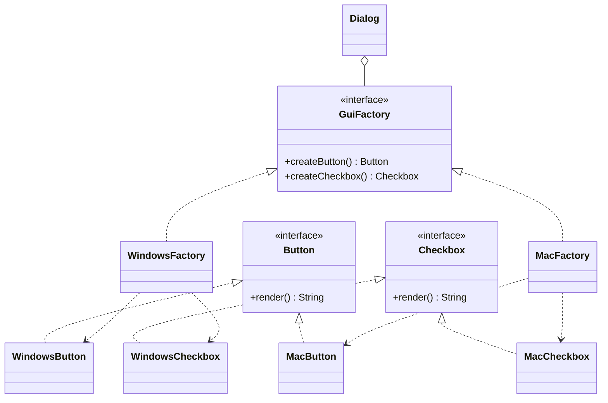

# Abstract Factory Pattern

Back to [[LLD-Index]].

## Problem

A system must work with several *families* of products (Windows vs macOS widgets, AWS vs GCP clients, MySQL vs Postgres DAOs). Mixing products from different families (a macOS button in a Windows dialog) is a bug. Scattered `new` calls make it easy to mix them and hard to switch families.

## Motivation

- One factory object per family creates *all* products of that family, which guarantees consistency.
- The client receives the factory once (via constructor, i.e. [[Dependency-Injection]]) and never names concrete classes.
- Switching the whole family means swapping one object.
- Each creation method in an Abstract Factory is typically a [[Factory-Method-Pattern]]. Concrete factories are often singletons ([[Singleton-Pattern]]) or DI-scoped beans.

## Structure



## Implementation

```java
// AbstractFactoryDemo.java
interface Button { String render(); }
interface Checkbox { String render(); }

interface GuiFactory {
    Button createButton();
    Checkbox createCheckbox();
}

class WindowsButton implements Button { public String render() { return "[Win Button]"; } }
class WindowsCheckbox implements Checkbox { public String render() { return "[Win Checkbox]"; } }
class MacButton implements Button { public String render() { return "(Mac Button)"; } }
class MacCheckbox implements Checkbox { public String render() { return "(Mac Checkbox)"; } }

class WindowsFactory implements GuiFactory {
    public Button createButton() { return new WindowsButton(); }
    public Checkbox createCheckbox() { return new WindowsCheckbox(); }
}

class MacFactory implements GuiFactory {
    public Button createButton() { return new MacButton(); }
    public Checkbox createCheckbox() { return new MacCheckbox(); }
}

// Client: only knows abstractions
class Dialog {
    private final Button ok;
    private final Checkbox remember;

    Dialog(GuiFactory factory) {
        this.ok = factory.createButton();
        this.remember = factory.createCheckbox();
    }

    String render() { return ok.render() + " " + remember.render(); }
}

public class AbstractFactoryDemo {
    static GuiFactory factoryFor(String os) {
        return os.toLowerCase().contains("mac") ? new MacFactory() : new WindowsFactory();
    }

    public static void main(String[] args) {
        GuiFactory factory = factoryFor(System.getProperty("os.name"));
        System.out.println(new Dialog(factory).render());
    }
}
```

## Tradeoffs

| Pro | Con |
|---|---|
| Guarantees products from one family are used together | Adding a new *product type* (e.g. `Slider`) changes the interface and every concrete factory |
| Swapping families is a one-line change | Many interfaces/classes for small problems |
| Isolates concrete classes from the client | Can be overkill when there is only one family |

Asymmetry to remember: adding a new **family** follows OCP. Adding a new **product** does not.

## When to use

- Multiple families of related products must be used consistently (themes, cloud providers, DB dialects, test vs prod infrastructure).
- You want to configure the family once at startup.

## When NOT to use

- Only one product or one family exists: use [[Factory-Method-Pattern]] or plain constructors.
- Product types change frequently while families rarely do, because every new product breaks all factories.

## Real-world example

- `javax.xml.parsers.DocumentBuilderFactory.newInstance()` returns a provider-specific factory (implementation chosen via system property / `ServiceLoader` lookup), which then creates `DocumentBuilder` objects. `SAXParserFactory` and `TransformerFactory` follow the same model.
- JDBC: a `Connection` acts as a factory for a vendor-consistent family: `createStatement()`, `prepareStatement()`, `getMetaData()`.
- Swing `UIManager` look-and-feel supplies a consistent family of UI delegates.

## Pattern comparisons

| | [[Factory-Method-Pattern]] | Abstract Factory | [[Builder-Pattern]] |
|---|---|---|---|
| Output | One product | Several related products | One complex product |
| Relationship | Inheritance-based | Object composition (factory is injected) | Director/fluent API |
| Returns | Immediately | Immediately, per product | At the end (`build()`) |

## Interview questions

1. **Abstract Factory vs Factory Method?** Factory Method creates one product via an overridable method (inheritance). Abstract Factory is an object with several factory methods that creates a *family* and is passed around (composition).
2. **How do you add a new product type?** Add a method to the factory interface and implement it in every concrete factory. Java `default` methods can soften the break.
3. **Where does the concrete factory get chosen?** Once, at the composition root: `main`, DI config, or `ServiceLoader`.
4. **Are concrete factories singletons?** Often. They are stateless, so a single instance (or DI singleton scope) suffices.
5. **Relation to DI?** A DI container is effectively a generalized abstract factory. Choosing a profile (`@Profile("aws")`) swaps a whole family of beans.
