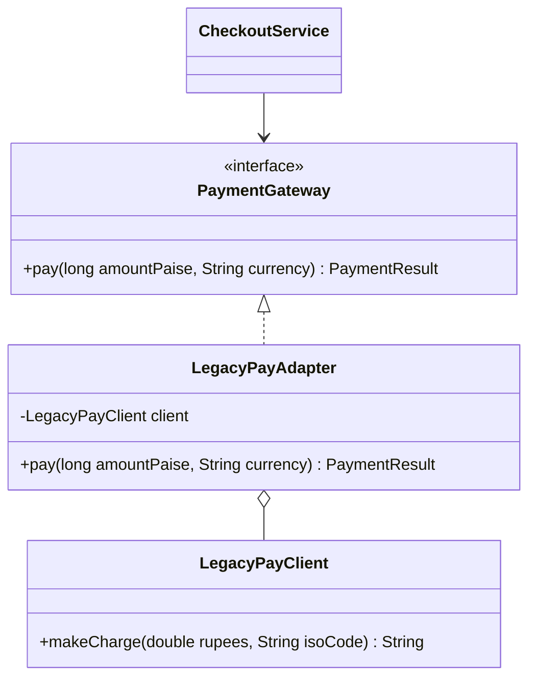

# Adapter Pattern

Back to [[LLD-Index]].

## Problem

Your code depends on an interface (`PaymentGateway.pay(amountInPaise, currency)`), but the class you need to use (a third-party SDK, a legacy module) exposes a different, incompatible API (`makeCharge(double rupees, String isoCode)` returning a status string). You cannot or should not modify either side.

## Motivation

- Write a thin class that implements the **target** interface and translates calls to the **adaptee**: rename methods, convert units/types, map errors and return values.
- Keeps third-party types out of the domain ([[Dependency-Inversion-Principle]]): the domain owns the interface, and the adapter lives at the boundary. This is the "ports and adapters" idea.
- Two forms:
  - **Object adapter** (composition): holds a reference to the adaptee. Preferred in Java.
  - **Class adapter** (inheritance): extends the adaptee and implements the target. Needs multiple inheritance of implementation, so in Java it only works when the target is an interface and the adaptee is not final.

## Structure



## Implementation

```java
// AdapterDemo.java
import java.util.Objects;

// Target: owned by our domain
interface PaymentGateway {
    PaymentResult pay(long amountPaise, String currency);
}

record PaymentResult(boolean success, String reference) {}

// Adaptee: third-party / legacy, cannot change
class LegacyPayClient {
    /** Returns "OK:<txnId>" or "ERR:<reason>". Amount is in rupees. */
    public String makeCharge(double rupees, String isoCode) {
        if (rupees <= 0) return "ERR:invalid_amount";
        return "OK:TXN" + Math.abs(Objects.hash(rupees, isoCode));
    }
}

// Object adapter: translate units, names, and result format
class LegacyPayAdapter implements PaymentGateway {
    private final LegacyPayClient client;

    LegacyPayAdapter(LegacyPayClient client) { this.client = Objects.requireNonNull(client); }

    @Override
    public PaymentResult pay(long amountPaise, String currency) {
        double rupees = amountPaise / 100.0;
        String raw = client.makeCharge(rupees, currency.toUpperCase());
        if (raw.startsWith("OK:")) return new PaymentResult(true, raw.substring(3));
        return new PaymentResult(false, raw.substring(4));
    }
}

class CheckoutService {
    private final PaymentGateway gateway;
    CheckoutService(PaymentGateway gateway) { this.gateway = gateway; }
    String checkout(long paise) {
        PaymentResult r = gateway.pay(paise, "inr");
        return r.success() ? "Paid, ref=" + r.reference() : "Failed: " + r.reference();
    }
}

public class AdapterDemo {
    public static void main(String[] args) {
        CheckoutService svc = new CheckoutService(new LegacyPayAdapter(new LegacyPayClient()));
        System.out.println(svc.checkout(49_900));
        System.out.println(svc.checkout(0));
    }
}
```

## Tradeoffs

| Pro | Con |
|---|---|
| Reuse existing code without modifying it | Extra class per adaptee; adds indirection |
| Isolates vendor APIs; swapping vendors means writing a new adapter | Semantic mismatches (units, error models, sync vs async) can be lossy or leaky |
| Supports [[Open-Closed-Principle]] and testability (mock the target) | Too much logic in an adapter turns it into a hidden service |

## When to use

- Integrating third-party SDKs, legacy systems or external APIs behind a domain interface.
- Making an existing class satisfy an interface that a library/framework requires.
- Migrating between two implementations with different APIs.

## When NOT to use

- You control both sides and can just change the interface.
- You need to simplify a whole subsystem rather than match one interface: use [[Facade-Pattern]].
- You need to add behaviour while keeping the same interface: use [[Decorator-Pattern]].

## Real-world example

- `java.util.Arrays.asList(T...)` adapts an array to the `List` interface. It is a fixed-size view backed by the array: `add`/`remove` throw `UnsupportedOperationException`, and `set` writes through to the array.
- `java.io.InputStreamReader` adapts a byte-oriented `InputStream` to a character-oriented `Reader` (with a charset decoder). `OutputStreamWriter` is the reverse.
- `java.util.Collections.enumeration(Collection)` adapts a collection to a legacy `Enumeration`.
- Spring MVC `HandlerAdapter` lets the `DispatcherServlet` invoke different handler types through one interface.

## Pattern comparisons

| | Adapter | [[Facade-Pattern]] | [[Decorator-Pattern]] | [[Proxy-Pattern]] |
|---|---|---|---|---|
| Interface | Changes it to the expected one | New, simpler interface over many classes | Same as the wrapped object | Same as the wrapped object |
| Wraps | One adaptee | A subsystem | One component (stackable) | One subject |
| Intent | Compatibility | Simplification | Add responsibilities | Control access |

## Interview questions

1. **Object vs class adapter?** An object adapter composes the adaptee, works with subclasses of it, and is preferred. A class adapter inherits from the adaptee, can override its behaviour, but ties you to one concrete class. In Java it requires the target to be an interface.
2. **Adapter vs Facade?** An adapter makes one existing interface match an expected one. A facade defines a new, simpler interface over a complex subsystem.
3. **Adapter vs Decorator?** An adapter changes the interface. A decorator keeps the interface and adds behaviour.
4. **Where do adapters live in hexagonal architecture?** At the edges: inbound adapters (REST controllers) and outbound adapters (DB, payment SDK) implement or call domain-owned ports.
5. **Why does `Arrays.asList(...).add(x)` throw?** It is an adapter view over a fixed-size array, not an `ArrayList`. Wrap it with `new ArrayList<>(Arrays.asList(...))` if you need growth.
6. **Two-way adapter?** An adapter that implements both interfaces so each side can use it. This is rare and increases coupling.
