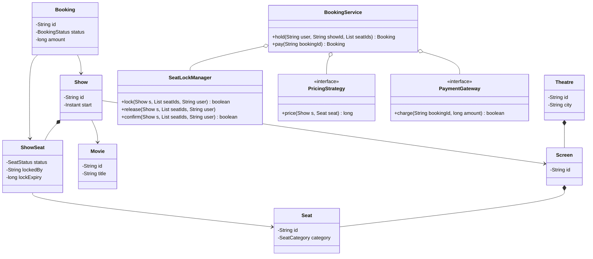
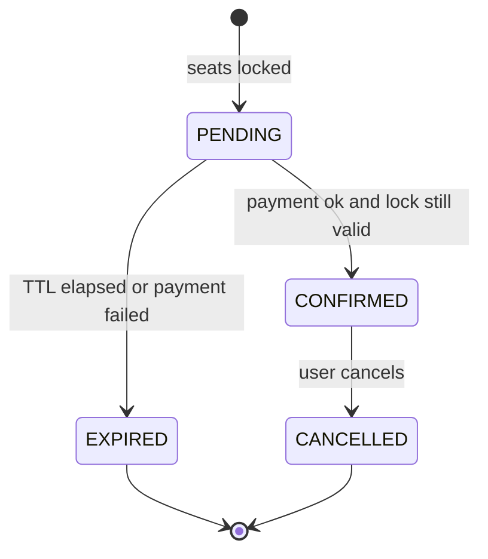

# BookMyShow LLD

Back to [[LLD-Index]].

## Clarifying questions

1. Scope: browse (city -> movie -> theatre -> show) and booking, or booking only?
2. Seat selection by user, or auto-assign?
3. How long is a seat held while the user pays? (Assume a configurable TTL, e.g. a few minutes.)
4. Seat categories with different prices?
5. Payment: interface only?
6. Cancellation and refunds?
7. Single server or multiple app servers? (Determines whether in-memory locks suffice.)

## Requirements

### Functional (in scope)

- Catalog: cities, theatres, screens (seat layout), movies, shows (movie + screen + start time).
- List available seats for a show.
- Select seats -> lock them for the user with a TTL -> create `PENDING` booking.
- Confirm on payment success -> seats `BOOKED`, booking `CONFIRMED`.
- On payment failure or TTL expiry -> seats released, booking `EXPIRED`/`FAILED`.
- Price per seat category, pluggable pricing.

### Non-functional

- **No double booking**, ever, under concurrent users selecting overlapping seats.
- Locking is all-or-nothing across the selected seats.
- Expired locks must not block seats indefinitely.
- Lock/unlock O(k) for k seats.

### Out of scope

Search ranking, reviews, offers engine, real payment gateway, distributed lock infra (discussed).

## Key modeling decision

A `Seat` belongs to a `Screen` (physical). Availability belongs to a **`Show`** (a seat can be free at 3 PM and booked at 6 PM). So inventory is `ShowSeat` = (show, seat, status). Mixing these is the most common mistake.

## Entities

| Entity | Responsibility |
|---|---|
| `Movie`, `Theatre`, `Screen`, `Seat` | Static catalog. |
| `Show` | Movie on a screen at a time. Owns `ShowSeat`s. |
| `ShowSeat` | status `AVAILABLE` / `LOCKED` / `BOOKED`, lock owner, lock expiry. |
| `Booking` | user, show, seats, amount, status (`PENDING`, `CONFIRMED`, `EXPIRED`, `CANCELLED`). |
| `SeatLockManager` | Atomically lock/unlock sets of seats with TTL. |
| `PricingStrategy` | Price per seat/show. |
| `PaymentGateway` | Interface. |
| `BookingService` | Facade orchestrating lock -> pay -> confirm. |

## Class diagram



Booking lifecycle:



## Seat locking approach

- Lock the requested seats in a **canonical order** (sorted seat id) to avoid deadlock between two users selecting overlapping sets in different orders.
- Check all seats are free (or lock expired); if any is not, release what you took and fail. All-or-nothing.
- Expiry is **lazy**: a `LOCKED` seat whose `lockExpiry < now` is treated as available. A background sweeper additionally flips expired bookings, but correctness does not depend on it.
- At confirm time, re-check the lock is still owned by this user and not expired. Payment that succeeds after expiry must be refunded, not honored.

## Core Java code

Single file, compiles with `javac BookMyShowDemo.java` (Java 17+). Per-show lock: contention is limited to users of the same show, which is the natural unit.

```java
import java.util.*;
import java.util.concurrent.ConcurrentHashMap;
import java.util.concurrent.locks.ReentrantLock;
import java.util.function.LongSupplier;

enum SeatCategory { SILVER, GOLD, RECLINER }
enum SeatStatus { AVAILABLE, LOCKED, BOOKED }
enum BookingStatus { PENDING, CONFIRMED, EXPIRED, CANCELLED }

record Movie(String id, String title) {}
record Seat(String id, SeatCategory category) {}
record Screen(String id, List<Seat> seats) {}

final class ShowSeat {
    final Seat seat;
    SeatStatus status = SeatStatus.AVAILABLE;
    String lockedBy;
    long lockExpiry;
    ShowSeat(Seat seat) { this.seat = seat; }

    boolean isFreeFor(String user, long now) {
        return status == SeatStatus.AVAILABLE
            || (status == SeatStatus.LOCKED && (lockExpiry <= now || user.equals(lockedBy)));
    }
}

final class Show {
    final String id; final Movie movie; final Screen screen; final long startEpochMs;
    final Map<String, ShowSeat> seats = new TreeMap<>();   // sorted by seat id
    final ReentrantLock lock = new ReentrantLock();       // guards all ShowSeat mutations of this show
    Show(String id, Movie movie, Screen screen, long start) {
        this.id = id; this.movie = movie; this.screen = screen; this.startEpochMs = start;
        for (Seat s : screen.seats()) seats.put(s.id(), new ShowSeat(s));
    }
}

final class Booking {
    final String id, user; final Show show; final List<String> seatIds; final long amount;
    volatile BookingStatus status = BookingStatus.PENDING;
    Booking(String id, String user, Show show, List<String> seatIds, long amount) {
        this.id = id; this.user = user; this.show = show; this.seatIds = seatIds; this.amount = amount;
    }
}

interface PricingStrategy { long price(Show show, Seat seat); }
interface PaymentGateway { boolean charge(String bookingId, long amount); }

final class SeatLockManager {
    private final long ttlMs;
    private final LongSupplier clock;
    SeatLockManager(long ttlMs, LongSupplier clock) { this.ttlMs = ttlMs; this.clock = clock; }

    /** All-or-nothing. Seat ids are processed in sorted order. */
    boolean lock(Show show, List<String> seatIds, String user) {
        List<String> ids = new ArrayList<>(new TreeSet<>(seatIds));
        show.lock.lock();
        try {
            long now = clock.getAsLong();
            for (String id : ids) {
                ShowSeat ss = show.seats.get(id);
                if (ss == null || !ss.isFreeFor(user, now)) return false;   // nothing mutated yet
            }
            for (String id : ids) {
                ShowSeat ss = show.seats.get(id);
                ss.status = SeatStatus.LOCKED; ss.lockedBy = user; ss.lockExpiry = now + ttlMs;
            }
            return true;
        } finally { show.lock.unlock(); }
    }

    /** Succeeds only if every seat is still locked by this user and not expired. */
    boolean confirm(Show show, List<String> seatIds, String user) {
        show.lock.lock();
        try {
            long now = clock.getAsLong();
            for (String id : seatIds) {
                ShowSeat ss = show.seats.get(id);
                if (ss.status != SeatStatus.LOCKED || !user.equals(ss.lockedBy) || ss.lockExpiry <= now) return false;
            }
            for (String id : seatIds) { ShowSeat ss = show.seats.get(id); ss.status = SeatStatus.BOOKED; ss.lockedBy = null; }
            return true;
        } finally { show.lock.unlock(); }
    }

    void release(Show show, List<String> seatIds, String user) {
        show.lock.lock();
        try {
            for (String id : seatIds) {
                ShowSeat ss = show.seats.get(id);
                if (ss.status == SeatStatus.LOCKED && user.equals(ss.lockedBy)) { ss.status = SeatStatus.AVAILABLE; ss.lockedBy = null; }
            }
        } finally { show.lock.unlock(); }
    }

    List<String> available(Show show, String user) {
        show.lock.lock();
        try {
            long now = clock.getAsLong();
            List<String> out = new ArrayList<>();
            show.seats.forEach((id, ss) -> { if (ss.isFreeFor(user, now)) out.add(id); });
            return out;
        } finally { show.lock.unlock(); }
    }
}

final class BookingService {
    private final Map<String, Show> shows = new ConcurrentHashMap<>();
    private final Map<String, Booking> bookings = new ConcurrentHashMap<>();
    private final SeatLockManager locks; private final PricingStrategy pricing; private final PaymentGateway payments;
    private long seq = 0;

    BookingService(SeatLockManager l, PricingStrategy p, PaymentGateway g) { locks = l; pricing = p; payments = g; }
    void addShow(Show s) { shows.put(s.id, s); }
    List<String> availableSeats(String showId, String user) { return locks.available(shows.get(showId), user); }

    Booking hold(String user, String showId, List<String> seatIds) {
        Show show = Objects.requireNonNull(shows.get(showId), "show");
        if (seatIds.isEmpty()) throw new IllegalArgumentException("no seats");
        if (!locks.lock(show, seatIds, user)) throw new IllegalStateException("one or more seats unavailable");
        long amount = seatIds.stream().mapToLong(id -> pricing.price(show, show.seats.get(id).seat)).sum();
        Booking b = new Booking(nextId(), user, show, List.copyOf(seatIds), amount);
        bookings.put(b.id, b);
        return b;
    }

    Booking pay(String bookingId) {
        Booking b = Objects.requireNonNull(bookings.get(bookingId), "booking");
        synchronized (b) {
            if (b.status != BookingStatus.PENDING) return b;          // idempotent
            boolean charged = payments.charge(b.id, b.amount);
            if (charged && locks.confirm(b.show, b.seatIds, b.user)) { b.status = BookingStatus.CONFIRMED; }
            else {
                locks.release(b.show, b.seatIds, b.user);
                b.status = BookingStatus.EXPIRED;
                // if charged but confirm failed (lock expired), a refund must be issued: > TODO in production
            }
            return b;
        }
    }

    private synchronized String nextId() { return "B" + (++seq); }
}

public class BookMyShowDemo {
    public static void main(String[] args) throws Exception {
        long[] now = {0};
        List<Seat> seats = List.of(new Seat("A1", SeatCategory.GOLD), new Seat("A2", SeatCategory.GOLD), new Seat("B1", SeatCategory.SILVER));
        Show show = new Show("S1", new Movie("M1", "Film"), new Screen("SC1", seats), 0);
        Map<SeatCategory, Long> price = Map.of(SeatCategory.SILVER, 20_000L, SeatCategory.GOLD, 30_000L, SeatCategory.RECLINER, 50_000L);
        BookingService svc = new BookingService(new SeatLockManager(5 * 60_000, () -> now[0]),
                (s, seat) -> price.get(seat.category()), (id, amt) -> true);
        svc.addShow(show);

        // Two users race for overlapping seats: exactly one wins.
        Runnable u1 = () -> { try { System.out.println("u1 " + svc.hold("u1", "S1", List.of("A1", "A2")).id); } catch (IllegalStateException e) { System.out.println("u1 lost"); } };
        Runnable u2 = () -> { try { System.out.println("u2 " + svc.hold("u2", "S1", List.of("A2", "B1")).id); } catch (IllegalStateException e) { System.out.println("u2 lost"); } };
        Thread t1 = new Thread(u1), t2 = new Thread(u2); t1.start(); t2.start(); t1.join(); t2.join();

        now[0] += 6 * 60_000; // TTL passes: the loser can now take the seats
        Booking b = svc.hold("u3", "S1", List.of("A2"));
        System.out.println(svc.pay(b.id).status);
    }
}
```

## Patterns used and why

| Pattern | Where | Why |
|---|---|---|
| [[Facade-Pattern]] | `BookingService` | Controllers call hold/pay; lock and payment details hidden. |
| [[Strategy-Pattern]] | `PricingStrategy` | Weekend, category, dynamic pricing without touching booking flow. |
| [[State-Pattern]] | Booking and ShowSeat lifecycle | Legal transitions explicit; can promote enums to state objects when rules grow. |
| [[Dependency-Inversion-Principle]] | `PaymentGateway`, clock | Service depends on abstractions; tests inject fakes. |
| [[Observer-Pattern]] | Booking confirmed -> email/SMS (follow-up) | Notification decoupled. |
| [[Proxy-Pattern]] | Caching proxy for catalog reads (follow-up) | Browsing is read-heavy. |

## Concurrency concerns

- **Double booking:** prevented because check-and-lock for all seats happens inside one per-show critical section.
- **Deadlock:** avoided since only one lock (the show's) is taken. If you use per-seat locks instead, acquire in sorted order.
- **Expired lock + late payment:** `confirm` re-validates ownership and expiry. Charge-then-confirm needs a compensating refund; the alternative is authorize -> confirm -> capture.
- **Idempotent pay:** retries of `pay` for the same booking return the existing result.
- **Multiple app servers:** in-memory locks break. Options: (a) DB conditional update `UPDATE show_seat SET status='LOCKED', locked_by=?, expiry=? WHERE show_id=? AND seat_id IN (...) AND (status='AVAILABLE' OR expiry < now)` in one transaction and check affected rows == k; (b) Redis `SET key value NX PX ttl` per seat with rollback on partial failure. Final `BOOKED` must be persisted in the DB with a unique constraint on (show_id, seat_id) for confirmed bookings as the last line of defense.

## Extensibility follow-ups

| Follow-up | How |
|---|---|
| Hold extension while on payment page | `extend(show, seats, user)` updates expiry if still owned. |
| Waitlist for sold-out shows | Queue per show; on release/expiry, notify via [[Observer-Pattern]]. |
| Coupons / offers | [[Decorator-Pattern]] or chain over `PricingStrategy`. |
| Auto seat selection ("best 4 together") | `SeatSelectionStrategy` over the layout grid. |
| Cancellation with refund policy | `RefundPolicy` strategy by time-to-show. |
| Very hot show (release day) | Virtual queue in front of booking; shard locks per show section. |

## Common interview pitfalls

- Storing seat status on `Seat` instead of per-show `ShowSeat`.
- Check-then-act without a lock: two users both see a seat free and both lock it.
- Locking seats one at a time without rollback: partial holds leak.
- Relying only on a scheduler to expire locks; a missed tick blocks seats. Use lazy expiry checks.
- Confirming after payment without re-checking the lock still belongs to the user.
- Using `synchronized` on the whole service: correct, but serializes every show in the city.
