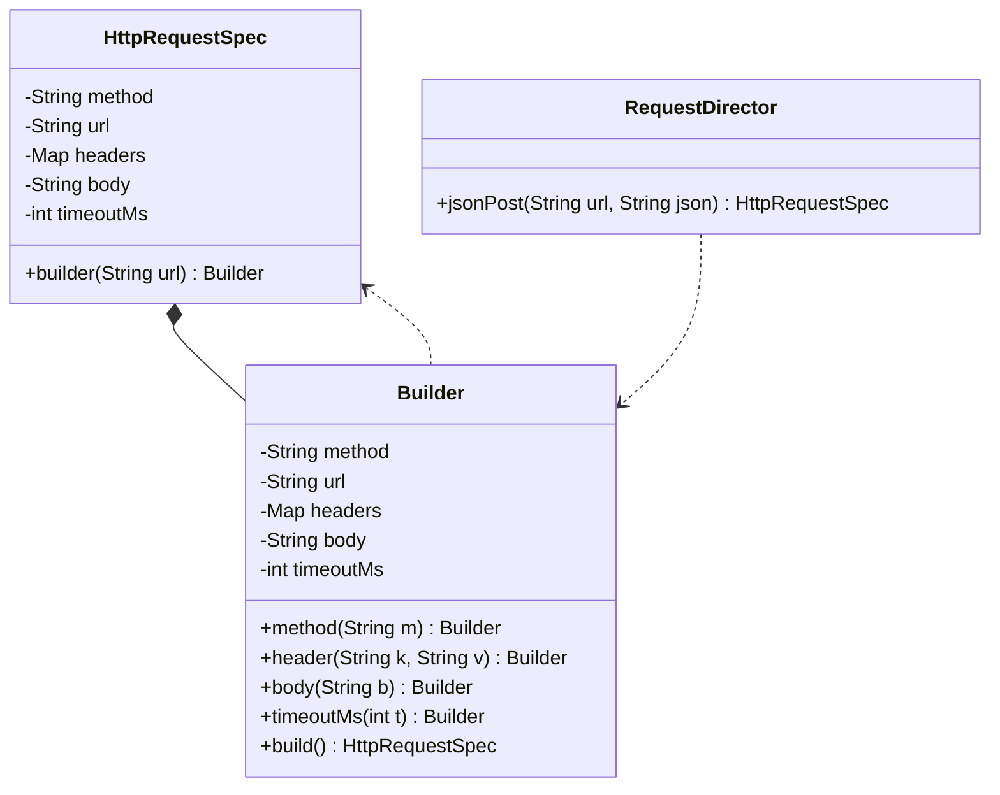

# Builder Pattern

Back to [[LLD-Index]].

## Problem

An object has several required and many optional fields. The alternatives are poor:

- **Telescoping constructors**: `new Pizza(size, true, false, true, null, 2)` is unreadable and error-prone when adjacent params share a type.
- **JavaBeans setters**: the object is mutable and can be observed in an inconsistent state halfway through construction. It also cannot be immutable.

## Motivation

- Separate *construction* from *representation*: a mutable builder collects parameters, validates them once in `build()`, and produces an immutable product.
- Fluent API: calls read like named arguments.
- GoF also defines a **Director** that runs a fixed sequence of builder steps to produce different representations (e.g. the same document built as HTML or PDF). The Effective Java "static nested builder" is the common interview form.

## Structure



## Implementation

```java
// BuilderDemo.java
import java.util.Collections;
import java.util.LinkedHashMap;
import java.util.Map;
import java.util.Objects;

final class HttpRequestSpec {
    private final String method;
    private final String url;
    private final Map<String, String> headers;
    private final String body;
    private final int timeoutMs;

    private HttpRequestSpec(Builder b) {
        this.method = b.method;
        this.url = b.url;
        this.headers = Collections.unmodifiableMap(new LinkedHashMap<>(b.headers)); // defensive copy
        this.body = b.body;
        this.timeoutMs = b.timeoutMs;
    }

    static Builder builder(String url) { return new Builder(url); }

    public String method() { return method; }
    public String url() { return url; }
    public Map<String, String> headers() { return headers; }
    public String body() { return body; }
    public int timeoutMs() { return timeoutMs; }

    @Override public String toString() {
        return method + " " + url + " headers=" + headers + " body=" + body + " timeout=" + timeoutMs;
    }

    static final class Builder {
        private final String url;                 // required
        private String method = "GET";            // optional with defaults
        private final Map<String, String> headers = new LinkedHashMap<>();
        private String body;
        private int timeoutMs = 5_000;

        private Builder(String url) { this.url = Objects.requireNonNull(url, "url"); }

        Builder method(String m) { this.method = Objects.requireNonNull(m); return this; }
        Builder header(String k, String v) { headers.put(k, v); return this; }
        Builder body(String b) { this.body = b; return this; }
        Builder timeoutMs(int t) { this.timeoutMs = t; return this; }

        HttpRequestSpec build() {
            // cross-field invariants validated once, before the object exists
            if (timeoutMs <= 0) throw new IllegalStateException("timeout must be > 0");
            if (body != null && method.equals("GET")) throw new IllegalStateException("GET cannot have a body");
            if (!url.startsWith("http://") && !url.startsWith("https://")) throw new IllegalStateException("bad scheme");
            return new HttpRequestSpec(this);
        }
    }
}

// Optional GoF-style Director: encodes a reusable construction recipe
final class RequestDirector {
    HttpRequestSpec jsonPost(String url, String json) {
        return HttpRequestSpec.builder(url)
                .method("POST")
                .header("Content-Type", "application/json")
                .body(json)
                .build();
    }
}

public class BuilderDemo {
    public static void main(String[] args) {
        HttpRequestSpec get = HttpRequestSpec.builder("https://api.example.com/users")
                .header("Accept", "application/json")
                .timeoutMs(2_000)
                .build();
        System.out.println(get);
        System.out.println(new RequestDirector().jsonPost("https://api.example.com/users", "{\"name\":\"a\"}"));
    }
}
```

## Tradeoffs

| Pro | Con |
|---|---|
| Readable construction with named steps | Duplicates every field in the builder (boilerplate; Lombok/records help) |
| Enables immutable products and validated invariants | Slight allocation overhead (one extra object) |
| Defaults for optional params | Required params can still be forgotten unless enforced (constructor arg or step builder) |
| Same builder can produce variants | Overkill for 2-3 fields |

**Step builder** variant: each step returns a different interface (`UrlStep -> MethodStep -> BuildStep`), so the compiler enforces required fields in order.

## When to use

- Four or more constructor parameters, especially optional ones or ones of the same type.
- Immutable value objects / config objects / request objects.
- Construction requires validating relationships between fields.
- Building composite structures (trees, queries, documents) incrementally.

## When NOT to use

- Few, all-required fields: use a constructor or a Java `record`.
- Objects that are legitimately mutable over their lifetime.
- When a static factory with a clear name suffices ([[Factory-Method-Pattern]]).

## Real-world example

- `java.lang.StringBuilder`: builds a `String` incrementally, finishing with `toString()`. (It is a mutable accumulator rather than the strict GoF builder, but it is the canonical JDK example.)
- `java.net.http.HttpRequest.newBuilder().uri(URI.create(...)).header(...).GET().build()` and `HttpClient.newBuilder()`.
- `java.util.stream.Stream.builder()`, `Locale.Builder`, `Calendar.Builder`.
- Lombok `@Builder` generates the static nested builder at compile time. `@Builder.Default` sets field defaults.
- Protocol Buffers generated Java messages: `Person.newBuilder().setName(...).build()`.

## Pattern comparisons

| | [[Factory-Method-Pattern]] | [[Abstract-Factory-Pattern]] | Builder |
|---|---|---|---|
| Focus | *Which* class to create | *Which family* to create | *How* to assemble one object |
| API | One call | One call per product | Many calls then `build()` |
| Validation | Inside factory | Inside factory | Centralised in `build()` |

## Interview questions

1. **Why not setters?** Setters allow a partially-initialised, mutable object to escape. A builder validates in `build()` and yields an immutable object.
2. **How do you enforce required fields?** Pass them to the builder's constructor/static entry (`builder(url)`), or use a step builder so the type system enforces order.
3. **Is the builder thread-safe?** No, and it does not need to be: builders are local, short-lived objects. The *product* is immutable and therefore safe to share.
4. **Why defensively copy collections in the product constructor?** The builder is reused or mutated after `build()`. Without a copy, the "immutable" product would share mutable state.
5. **Builder vs record?** Records give concise immutable carriers but only a canonical constructor. Add a builder when there are many optional fields or cross-field validation.
6. **What is the Director for?** It encapsulates a reusable construction sequence, so clients get standard configurations without knowing the steps.
