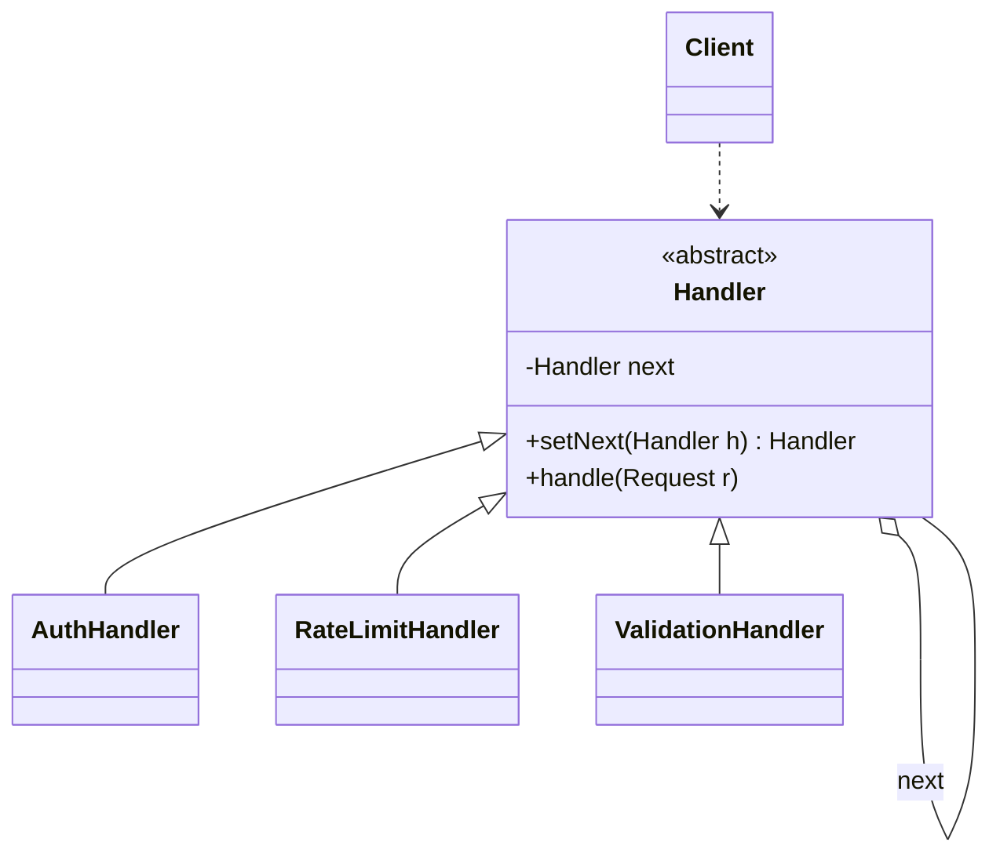

# Chain of Responsibility Pattern

Back to [[LLD-Index]].

## Problem

A request must go through several checks or handlers (authenticate, rate-limit, validate, route) or must be handled by whichever handler is competent (support ticket L1 -> L2 -> L3; approval by amount). Putting all of this in one method couples the sender to every handler and makes the order hard to change.

## Motivation

- Each handler has one job ([[Single-Responsibility-Principle]]) and a reference to the next.
- The sender only knows the first handler.
- Two variants:
  - **Pure GoF:** exactly one handler handles the request; others pass it on.
  - **Pipeline / middleware:** every handler may act, then decide whether to continue (`chain.doFilter`) or short-circuit (reject).
- Handlers can be reordered, added, or removed by configuration ([[Open-Closed-Principle]]).

## Structure



## Implementation

### Java: linked handlers (GoF style, approval by amount)

```java
abstract class Approver {
    private Approver next;
    Approver linkWith(Approver next) { this.next = next; return next; }

    final void approve(int amount) {
        if (canApprove(amount)) {
            System.out.println(getClass().getSimpleName() + " approved " + amount);
        } else if (next != null) {
            next.approve(amount);
        } else {
            System.out.println("No one can approve " + amount);
        }
    }
    protected abstract boolean canApprove(int amount);
}

final class TeamLead extends Approver { protected boolean canApprove(int a) { return a <= 1_000; } }
final class Manager  extends Approver { protected boolean canApprove(int a) { return a <= 10_000; } }
final class Director extends Approver { protected boolean canApprove(int a) { return a <= 100_000; } }

public class ApprovalChainDemo {
    public static void main(String[] args) {
        Approver chain = new TeamLead();
        chain.linkWith(new Manager()).linkWith(new Director());
        chain.approve(500);       // TeamLead approved 500
        chain.approve(5_000);     // Manager approved 5000
        chain.approve(50_000);    // Director approved 50000
        chain.approve(500_000);   // No one can approve 500000
    }
}
```

### Java: middleware pipeline (servlet-filter style)

```java
import java.util.List;
import java.util.Map;
import java.util.concurrent.ConcurrentHashMap;

record HttpRequest(String user, String token, String path) {}

final class HttpResponse {
    int status = 200; String body = "";
    @Override public String toString() { return status + " " + body; }
}

interface Filter {
    void doFilter(HttpRequest req, HttpResponse res, FilterChain chain);
}

final class FilterChain {
    private final List<Filter> filters;
    private final Filter terminal;
    private int index = 0;                     // one chain instance per request
    FilterChain(List<Filter> filters, Filter terminal) { this.filters = filters; this.terminal = terminal; }

    void doFilter(HttpRequest req, HttpResponse res) {
        if (index < filters.size()) filters.get(index++).doFilter(req, res, this);
        else terminal.doFilter(req, res, this);
    }
}

final class AuthFilter implements Filter {
    public void doFilter(HttpRequest req, HttpResponse res, FilterChain chain) {
        if (!"secret".equals(req.token())) { res.status = 401; res.body = "unauthorized"; return; } // short-circuit
        chain.doFilter(req, res);
    }
}

final class RateLimitFilter implements Filter {
    private final Map<String, Integer> counts = new ConcurrentHashMap<>();
    private final int limit;
    RateLimitFilter(int limit) { this.limit = limit; }
    public void doFilter(HttpRequest req, HttpResponse res, FilterChain chain) {
        int n = counts.merge(req.user(), 1, Integer::sum);
        if (n > limit) { res.status = 429; res.body = "too many requests"; return; }
        chain.doFilter(req, res);
    }
}

final class TimingFilter implements Filter {
    public void doFilter(HttpRequest req, HttpResponse res, FilterChain chain) {
        long t = System.nanoTime();
        chain.doFilter(req, res);              // code after this line runs on the way back
        System.out.println(req.path() + " -> " + res.status + " in " + (System.nanoTime() - t) / 1_000 + "us");
    }
}

public class FilterChainDemo {
    public static void main(String[] args) {
        RateLimitFilter rl = new RateLimitFilter(2);
        List<Filter> filters = List.of(new TimingFilter(), new AuthFilter(), rl);
        Filter handler = (req, res, chain) -> res.body = "hello " + req.user();

        String[][] calls = { {"ana", "secret"}, {"ana", "bad"}, {"ana", "secret"}, {"ana", "secret"} };
        for (String[] c : calls) {
            HttpResponse res = new HttpResponse();
            new FilterChain(filters, handler).doFilter(new HttpRequest(c[0], c[1], "/hi"), res);
            System.out.println(res);
        }
        // 200 hello ana, 401 unauthorized, 200 hello ana, 429 too many requests
    }
}
```

## Tradeoffs

| Pro | Con |
|---|---|
| Sender decoupled from receivers | No guarantee a request is handled (needs a terminal/default handler) |
| Handlers single-purpose, reorderable, reusable | Order dependence is implicit and easy to get wrong (auth must precede rate-limit-by-user) |
| Add/remove handlers by configuration | Long chains are hard to debug; stack depth grows with chain length |
| Supports pre- and post-processing around the next call | Per-request mutable chain state (`index`) must not be shared across threads |

## When to use

- Request pipelines: HTTP middleware, RPC interceptors, validation pipelines, [[Rate-Limiter-LLD]] as one filter among many.
- Escalation / approval flows where the handler is determined at runtime.
- Log level routing to appenders in [[Logger-Framework-LLD]].
- Event bubbling in UI trees (child -> parent until consumed).

## When NOT to use

- Every handler must always run and none can stop the flow: a simple list loop (or [[Observer-Pattern]]) is clearer.
- The correct handler is known up front: dispatch directly (map lookup).
- Strict latency budgets with deep chains.

## Real-world example

- `javax.servlet.Filter` (`doFilter(ServletRequest, ServletResponse, FilterChain)`) and `javax.servlet.FilterChain.doFilter(...)`: each filter calls `chain.doFilter` to continue or writes the response and returns to stop. (Jakarta EE renamed the package to `jakarta.servlet`.)
- Spring Security's `SecurityFilterChain` is a chain of servlet filters.
- `java.util.logging.Logger` passes records to parent loggers' handlers when `useParentHandlers` is true.
- OkHttp `Interceptor` / `Interceptor.Chain.proceed(request)`.

## Pattern comparisons

- **Chain of Responsibility vs Decorator:** Structurally similar (each wraps/points to the next). [[Decorator-Pattern]] *always* delegates and adds behaviour; all decorators run and the core object always runs. A chain handler *may stop* the request, and in the pure form only one handler handles it. Decorators share the component's interface for transparent wrapping; chain handlers share a handler interface. Servlet filters sit between the two: middleware that can both decorate and short-circuit.
- **Chain vs Command:** requests travelling a chain are often [[Command-Pattern]] objects.
- **Chain vs Observer:** chain delivers to handlers sequentially until handled; [[Observer-Pattern]] broadcasts to all.

## Interview questions

1. **What if no handler handles the request?** Add a terminal default handler (404 / reject / log) so behaviour is defined.
2. **How is order configured?** Builder or list in config; document order dependencies (auth before per-user rate limit).
3. **Linked-list handlers vs chain object with index?** Linked handlers are simple but each handler holds `next`. A chain object (servlet style) keeps handlers stateless and lets them run code before and after the rest of the chain.
4. **Thread safety?** Handlers should be stateless or thread-safe; per-request chain position must be per-request.
5. **Chain vs Decorator in one line?** Decorator always forwards and adds; Chain may stop.
6. **Design an expense approval system.** Chain of approvers by limit; add escalation timeout and a terminal "reject/needs CFO" handler.
