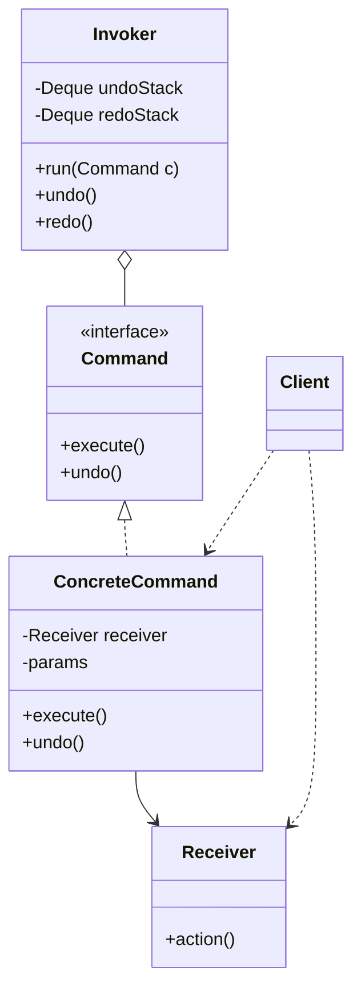

# Command Pattern

Back to [[LLD-Index]].

## Problem

The code that triggers an action (button, menu, scheduler, network handler) should not know how the action is performed. You also want to queue actions, retry them, log them, run them on another thread, or undo them. A direct method call supports none of this.

## Motivation

- Wrap "receiver + operation + arguments" into an object with `execute()` (and optionally `undo()`).
- The **invoker** stores and triggers commands without knowing receivers.
- Commands are first-class values: store in a history stack, serialize to a log, send to an executor, combine into a macro ([[Composite-Pattern]]).

## Structure



## Implementation

### Java: text editor with undo/redo stacks

```java
import java.util.ArrayDeque;
import java.util.ArrayList;
import java.util.Deque;
import java.util.List;

final class Document {                       // Receiver
    private final StringBuilder text = new StringBuilder();
    void insert(int pos, String s) { text.insert(pos, s); }
    String delete(int pos, int len) {
        String removed = text.substring(pos, pos + len);
        text.delete(pos, pos + len);
        return removed;
    }
    int length() { return text.length(); }
    @Override public String toString() { return text.toString(); }
}

interface Command {
    void execute();
    void undo();
}

final class InsertCommand implements Command {
    private final Document doc; private final int pos; private final String s;
    InsertCommand(Document doc, int pos, String s) { this.doc = doc; this.pos = pos; this.s = s; }
    public void execute() { doc.insert(pos, s); }
    public void undo() { doc.delete(pos, s.length()); }
}

final class DeleteCommand implements Command {
    private final Document doc; private final int pos; private final int len;
    private String removed;                   // state captured at execute time for undo
    DeleteCommand(Document doc, int pos, int len) { this.doc = doc; this.pos = pos; this.len = len; }
    public void execute() { removed = doc.delete(pos, len); }
    public void undo() { doc.insert(pos, removed); }
}

final class MacroCommand implements Command {   // Composite command
    private final List<Command> steps = new ArrayList<>();
    MacroCommand add(Command c) { steps.add(c); return this; }
    public void execute() { for (Command c : steps) c.execute(); }
    public void undo() { for (int i = steps.size() - 1; i >= 0; i--) steps.get(i).undo(); }
}

final class Editor {                            // Invoker
    private final Deque<Command> undoStack = new ArrayDeque<>();
    private final Deque<Command> redoStack = new ArrayDeque<>();
    private final int maxHistory;
    Editor(int maxHistory) { this.maxHistory = maxHistory; }

    void run(Command c) {
        c.execute();
        undoStack.push(c);
        if (undoStack.size() > maxHistory) undoStack.removeLast(); // bound memory
        redoStack.clear();                    // a new action invalidates the redo branch
    }
    boolean undo() {
        if (undoStack.isEmpty()) return false;
        Command c = undoStack.pop();
        c.undo();
        redoStack.push(c);
        return true;
    }
    boolean redo() {
        if (redoStack.isEmpty()) return false;
        Command c = redoStack.pop();
        c.execute();
        undoStack.push(c);
        return true;
    }
}

public class CommandDemo {
    public static void main(String[] args) {
        Document doc = new Document();
        Editor ed = new Editor(100);

        ed.run(new InsertCommand(doc, 0, "Hello"));
        ed.run(new InsertCommand(doc, 5, " World"));
        System.out.println(doc);                 // Hello World
        ed.run(new DeleteCommand(doc, 0, 6));
        System.out.println(doc);                 // World
        ed.undo();
        System.out.println(doc);                 // Hello World
        ed.undo();
        System.out.println(doc);                 // Hello
        ed.redo();
        System.out.println(doc);                 // Hello World

        ed.run(new MacroCommand()
                .add(new InsertCommand(doc, 0, ">> "))
                .add(new InsertCommand(doc, doc.length() + 3, "!")));
        System.out.println(doc);                 // >> Hello World!
        ed.undo();
        System.out.println(doc);                 // Hello World
        System.out.println(ed.redo() + " " + doc); // true >> Hello World!
    }
}
```

Undo/redo rules:

- Two stacks. `run` pushes to undo and **clears redo**. `undo` pops undo -> `undo()` -> push redo. `redo` pops redo -> `execute()` -> push undo.
- A command must capture whatever it needs to reverse itself (`DeleteCommand.removed`). Alternative: store a snapshot (GoF Memento) — simpler but heavier in memory.
- Bound the history. Non-undoable commands (e.g. "save", "send email") either clear history or are simply not pushed.
- Macros undo in reverse order.

### C++ (C++17)

```cpp
#include <iostream>
#include <memory>
#include <stack>
#include <string>

class Document {
    std::string text_;
public:
    void insert(std::size_t pos, const std::string& s) { text_.insert(pos, s); }
    std::string erase(std::size_t pos, std::size_t len) {
        std::string removed = text_.substr(pos, len);
        text_.erase(pos, len);
        return removed;
    }
    const std::string& text() const { return text_; }
};

class Command {
public:
    virtual ~Command() = default;
    virtual void execute() = 0;
    virtual void undo() = 0;
};

class InsertCommand : public Command {
    Document& doc_; std::size_t pos_; std::string s_;
public:
    InsertCommand(Document& d, std::size_t p, std::string s) : doc_(d), pos_(p), s_(std::move(s)) {}
    void execute() override { doc_.insert(pos_, s_); }
    void undo() override { doc_.erase(pos_, s_.size()); }
};

class DeleteCommand : public Command {
    Document& doc_; std::size_t pos_, len_; std::string removed_;
public:
    DeleteCommand(Document& d, std::size_t p, std::size_t l) : doc_(d), pos_(p), len_(l) {}
    void execute() override { removed_ = doc_.erase(pos_, len_); }
    void undo() override { doc_.insert(pos_, removed_); }
};

class Editor {
    std::stack<std::unique_ptr<Command>> undo_, redo_;
public:
    void run(std::unique_ptr<Command> c) {
        c->execute();
        undo_.push(std::move(c));
        while (!redo_.empty()) redo_.pop();
    }
    bool undo() {
        if (undo_.empty()) return false;
        auto c = std::move(undo_.top()); undo_.pop();
        c->undo();
        redo_.push(std::move(c));
        return true;
    }
    bool redo() {
        if (redo_.empty()) return false;
        auto c = std::move(redo_.top()); redo_.pop();
        c->execute();
        undo_.push(std::move(c));
        return true;
    }
};

int main() {
    Document doc;
    Editor ed;
    ed.run(std::make_unique<InsertCommand>(doc, 0, "Hello"));
    ed.run(std::make_unique<InsertCommand>(doc, 5, " World"));
    ed.run(std::make_unique<DeleteCommand>(doc, 0, 6));
    std::cout << doc.text() << "\n";   // World
    ed.undo();
    std::cout << doc.text() << "\n";   // Hello World
    ed.redo();
    std::cout << doc.text() << "\n";   // World
    return 0;
}
```

## Tradeoffs

| Pro | Con |
|---|---|
| Decouples invoker from receiver | One class per operation; many small classes |
| Enables undo/redo, queues, retries, audit logs, macros | Undo logic must be correct for every command; state capture can be subtle |
| Commands can be serialized and replayed (event sourcing style) | History consumes memory; must be bounded |
| Easy to add new commands without changing invoker | Commands holding receiver references can outlive receivers |

## When to use

- Undo/redo (editors, drawing tools, form wizards).
- Queued or scheduled work: job queues, thread pools, elevator requests in [[Elevator-System-LLD]].
- Transactional / audit logs: record commands, replay to rebuild state.
- GUI actions where the same operation is bound to a button, menu, and shortcut.

## When NOT to use

- A single direct call with no queuing, logging, or undo: the indirection buys nothing.
- Reversal is impossible (external side effects like sending an email): undo becomes a compensating action, which is a different design problem.

## Real-world example

- `java.lang.Runnable` and `java.util.concurrent.Callable` are commands; `ExecutorService.submit(...)` is the invoker, decoupling submission from execution thread and time.
- `javax.swing.Action` (extends `ActionListener`) binds one command to buttons/menus/keystrokes.
- `javax.swing.undo`: `UndoableEdit` (`undo()`, `redo()`, `canUndo()`), `AbstractUndoableEdit`, `CompoundEdit` (macro), and `UndoManager` (the invoker holding history). Text components fire `UndoableEditEvent`s to an `UndoableEditListener`.

## Pattern comparisons

- **Command vs Strategy:** Command encapsulates *a request to do something* (receiver + args, may be queued, logged, undone). [[Strategy-Pattern]] encapsulates *how* a context performs a fixed task and is used synchronously by that context. A `Runnable` in an executor queue is a command; a `Comparator` passed to `sort` is a strategy.
- **Command vs Chain of Responsibility:** commands are often the requests that travel down a [[Chain-of-Responsibility-Pattern]].
- **Command vs Observer:** [[Observer-Pattern]] callbacks are frequently implemented as command objects.

## Interview questions

1. **Design undo/redo.** Two stacks; `run` pushes undo and clears redo; undo moves top to redo after `undo()`; redo moves back after `execute()`. Bound history.
2. **Why clear the redo stack on a new command?** The redo commands were computed against a state that no longer exists after a divergent edit.
3. **Command-based undo vs snapshot (Memento)?** Commands store deltas (small, need correct inverse logic). Snapshots store full state (simple, memory-heavy). Hybrid: periodic snapshots plus commands.
4. **How do you support macro commands?** A composite command holding a list; execute forward, undo in reverse.
5. **How is Command used in a job queue?** Commands are serialized into the queue; workers deserialize and `execute()`; idempotency needed for retries.
6. **Is a lambda a command?** Yes when it represents a deferred request (`Runnable`); it cannot carry `undo` unless you pair it with an inverse.
