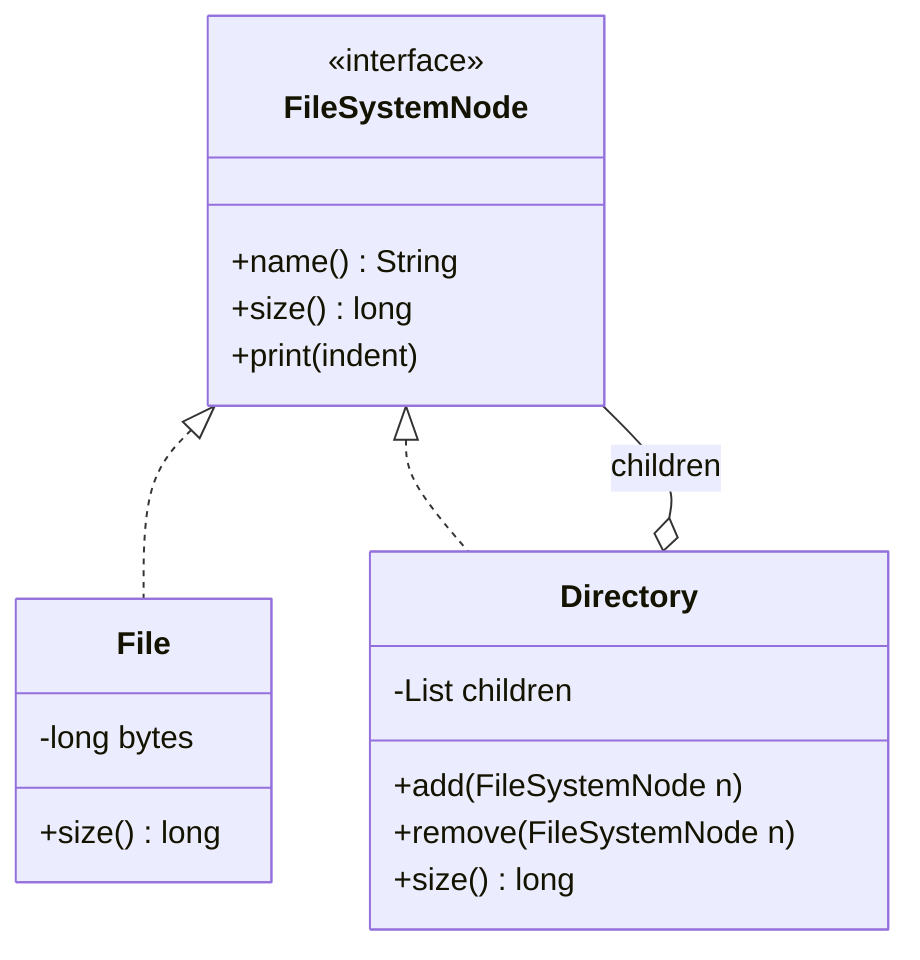

# Composite Pattern

Back to [[LLD-Index]].

## Problem

Data is naturally hierarchical: files in folders, UI widgets in panels, line items in bundles, employees in departments. Clients that must distinguish leaf vs container (`if (x instanceof Folder) ... else ...`) at every call site duplicate recursion logic and break whenever a new node type appears.

## Motivation

- Define one **Component** interface for both leaves and containers.
- A **Composite** holds child components and implements operations by delegating to children (usually recursively) and aggregating.
- Clients call `size()`, `render()`, `price()` on any node without caring whether it is a leaf or a subtree.
- Part-whole hierarchies of arbitrary depth come for free.

## Structure



## Implementation

### Java

```java
import java.util.ArrayList;
import java.util.Collections;
import java.util.List;

interface FileSystemNode {
    String name();
    long size();
    void print(String indent);
}

final class File implements FileSystemNode {
    private final String name;
    private final long bytes;
    File(String name, long bytes) { this.name = name; this.bytes = bytes; }
    public String name() { return name; }
    public long size() { return bytes; }
    public void print(String indent) { System.out.println(indent + name + " (" + bytes + "B)"); }
}

final class Directory implements FileSystemNode {
    private final String name;
    private final List<FileSystemNode> children = new ArrayList<>();
    Directory(String name) { this.name = name; }

    Directory add(FileSystemNode n) {
        if (n == this) throw new IllegalArgumentException("cannot add directory to itself");
        children.add(n);
        return this;
    }
    boolean remove(FileSystemNode n) { return children.remove(n); }
    List<FileSystemNode> children() { return Collections.unmodifiableList(children); }

    public String name() { return name; }
    public long size() {                       // recursive aggregation
        long total = 0;
        for (FileSystemNode c : children) total += c.size();
        return total;
    }
    public void print(String indent) {
        System.out.println(indent + name + "/ (" + size() + "B)");
        for (FileSystemNode c : children) c.print(indent + "  ");
    }
}

public class CompositeDemo {
    public static void main(String[] args) {
        Directory root = new Directory("root")
                .add(new File("readme.md", 120))
                .add(new Directory("src")
                        .add(new File("Main.java", 900))
                        .add(new Directory("util").add(new File("Strings.java", 300))))
                .add(new Directory("empty"));

        root.print("");
        System.out.println("total = " + root.size());   // 1320

        FileSystemNode single = new File("x.bin", 10);
        System.out.println(single.size());             // uniform call on a leaf
    }
}
```

### Transparency vs safety

Where do `add`/`remove` live?

- **Transparent (GoF default):** declared on `Component`. Clients treat all nodes identically, but leaves must throw `UnsupportedOperationException`, which weakens [[Liskov-Substitution-Principle]].
- **Safe (shown above):** only `Directory` has `add`/`remove`. Type-safe and respects [[Interface-Segregation-Principle]], but clients building the tree must know they hold a composite.

Most modern code chooses safety.

Other concerns:

- **Cycles:** adding an ancestor as a child causes infinite recursion. Guard by checking ancestry or keeping parent pointers.
- **Parent references:** useful for navigation up the tree; must be kept consistent on add/remove.
- **Caching aggregates:** recursive `size()` is O(n) each call; cache and invalidate up the parent chain on change if called often.
- **Deep trees:** recursion depth can overflow the stack; use an explicit stack ([[Iterator-Pattern]]).

## Tradeoffs

| Pro | Con |
|---|---|
| Uniform treatment of leaves and trees; simpler clients | Overly general component interface (transparent variant) |
| New node types plug in without client changes | Hard to restrict which children a composite accepts at compile time |
| Recursion expresses aggregation naturally | Performance of repeated recursive traversals; stack depth |
| Pairs well with Iterator, Visitor, Command (macros) | Cycles and shared children need explicit handling |

## When to use

- Part-whole hierarchies where clients should ignore the leaf/container distinction.
- File systems, UI component trees, org charts, menus with submenus, product bundles, expression trees (`Add(Num, Mul(Num, Num))`), macro commands ([[Command-Pattern]]).

## When NOT to use

- The structure is flat or fixed-depth: a list or a two-level model is simpler.
- Leaves and containers have very different operations: forcing one interface produces many unsupported methods.

## Real-world example

- AWT/Swing: `java.awt.Container extends java.awt.Component`, and a `Container` holds child `Component`s (`add(Component)`, `getComponents()`). Painting, layout (`doLayout`) and `validate()` recurse through the tree; `JPanel` inside `JFrame` inside ... is a composite.
- DOM (`org.w3c.dom.Node` with `getChildNodes()`), where elements and text nodes share the `Node` interface.
- `javax.swing.undo.CompoundEdit` is a composite of `UndoableEdit`s.

## Pattern comparisons

- **Composite vs Decorator:** both use recursive composition around a shared interface. [[Decorator-Pattern]] wraps exactly **one** component to *add responsibilities*; the chain is linear. Composite holds **many** children to *aggregate* them into a whole; the structure is a tree. A decorator is conceptually a degenerate composite with one child whose intent is enhancement, not grouping.
- **Composite and Iterator:** traversal of the tree is typically exposed through an [[Iterator-Pattern]].

## Interview questions

1. **What problem does Composite solve?** Lets clients treat single objects and groups uniformly in part-whole hierarchies.
2. **Transparent vs safe composite?** Child-management methods on Component (uniform, leaves throw) vs only on Composite (type-safe, clients must know types).
3. **How do you prevent cycles?** Check that the new child is not an ancestor (walk parent pointers) or enforce tree ownership (a node has at most one parent).
4. **Design a file system `du`.** Composite `size()` recursion; cache sizes with invalidation on writes for large trees.
5. **Composite vs Decorator?** One child + add behaviour vs many children + aggregation.
6. **Where does AWT use Composite?** `Container` is a `Component` that contains `Component`s; layout and painting recurse.
7. **Model a product bundle price.** `Product` leaf with price; `Bundle` composite sums children and applies a bundle discount (a [[Strategy-Pattern]]).
