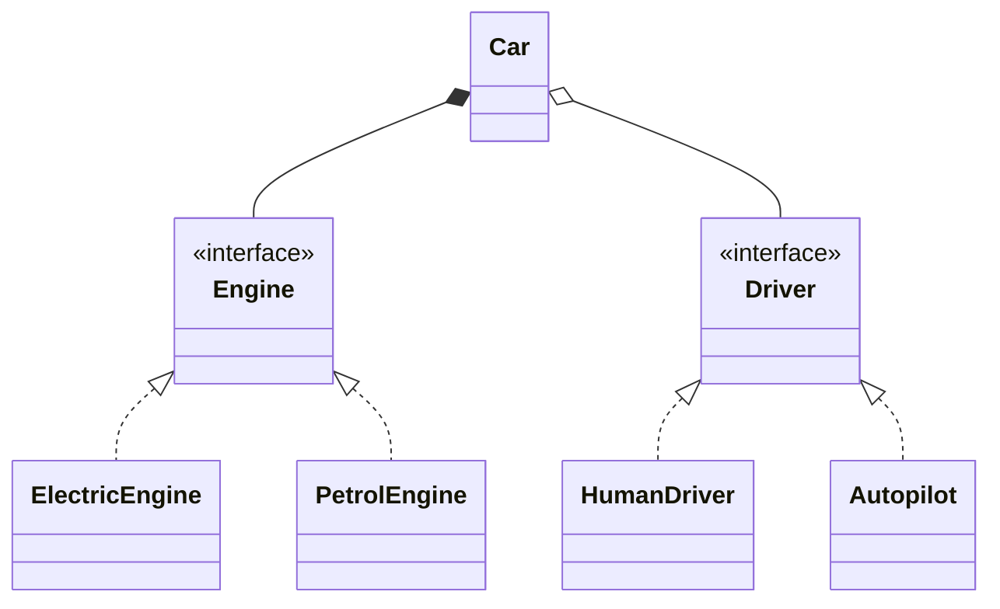

# Composition vs Inheritance

Back to [[LLD-Index]].

## Definition

Gang of Four, *Design Patterns* (1994): **"Favor object composition over class inheritance."** Joshua Bloch, *Effective Java* Item 18: "Favor composition over inheritance", and Item 19: "Design and document for inheritance or else prohibit it".

- **Inheritance (white-box reuse):** subclass reuses and overrides parent implementation; bound at compile time; exposes parent internals to the subclass.
- **Composition (black-box reuse):** object holds references to collaborators behind interfaces and delegates; can be swapped at runtime.

The core problem with implementation inheritance is the **fragile base class**: subclasses depend on undocumented self-use in the parent, so harmless-looking parent changes break them.

## Violating example

Bloch's `InstrumentedHashSet`: counts added elements, but `HashSet.addAll` internally calls `add`, so elements are double counted.

```java
import java.util.Collection;
import java.util.HashSet;
import java.util.List;

class InstrumentedHashSet<E> extends HashSet<E> {
    private int addCount = 0;
    @Override public boolean add(E e) { addCount++; return super.add(e); }
    @Override public boolean addAll(Collection<? extends E> c) {
        addCount += c.size();
        return super.addAll(c);          // calls add() internally -> double count
    }
    int getAddCount() { return addCount; }
}

public class FragileBase {
    public static void main(String[] args) {
        InstrumentedHashSet<String> s = new InstrumentedHashSet<>();
        s.addAll(List.of("a", "b", "c"));
        System.out.println(s.getAddCount());   // 6, not 3
    }
}
```

A second smell: class explosion from inheritance across two axes (`ElectricCar`, `PetrolCar`, `ElectricSelfDrivingCar`, ...).

## Refactored

Forwarding wrapper (composition + delegation), independent of `HashSet` internals:

```java
import java.util.Collection;
import java.util.HashSet;
import java.util.Iterator;
import java.util.List;
import java.util.Set;
import java.util.AbstractSet;

class InstrumentedSet<E> extends AbstractSet<E> {
    private final Set<E> inner;
    private int addCount = 0;
    InstrumentedSet(Set<E> inner) { this.inner = inner; }

    @Override public boolean add(E e) { addCount++; return inner.add(e); }
    @Override public boolean addAll(Collection<? extends E> c) {
        addCount += c.size();
        return inner.addAll(c);          // inner's self-use no longer affects us
    }
    @Override public Iterator<E> iterator() { return inner.iterator(); }
    @Override public int size() { return inner.size(); }
    int getAddCount() { return addCount; }
}

interface Engine { String start(); }
class ElectricEngine implements Engine { public String start() { return "silent start"; } }
class PetrolEngine implements Engine { public String start() { return "vroom"; } }

interface Driver { String drive(); }
class HumanDriver implements Driver { public String drive() { return "human driving"; } }
class Autopilot implements Driver { public String drive() { return "autopilot"; } }

class Car {                              // 2 + 2 parts instead of 2 x 2 subclasses
    private final Engine engine;
    private Driver driver;
    Car(Engine engine, Driver driver) { this.engine = engine; this.driver = driver; }
    void setDriver(Driver d) { this.driver = d; }   // swap at runtime
    String go() { return engine.start() + ", " + driver.drive(); }
}

public class CompositionDemo {
    public static void main(String[] args) {
        InstrumentedSet<String> s = new InstrumentedSet<>(new HashSet<>());
        s.addAll(List.of("a", "b", "c"));
        System.out.println(s.getAddCount());           // 3
        Car car = new Car(new ElectricEngine(), new HumanDriver());
        car.setDriver(new Autopilot());
        System.out.println(car.go());
    }
}
```

(`InstrumentedSet` extends `AbstractSet`, a class explicitly designed and documented for extension — that is the acceptable use of inheritance.)



## When inheritance is right

- A genuine, stable **is-a** relationship that satisfies [[Liskov-Substitution-Principle]].
- The base class is designed for extension (documented hooks, `protected` template steps) — [[Template-Method-Pattern]].
- Inside one package/module where the same team owns both classes.
- Sealed hierarchies modelling closed algebraic data types.

## Detecting violations in code review

- Extending a concrete class from another library/team (`extends HashMap`, `extends ArrayList`).
- Deep hierarchies (> 2–3 levels) or subclass names combining multiple axes.
- Subclasses overriding methods to disable them (LSP break).
- `super.method()` call-order dependencies; subclass relying on parent's internal self-calls.
- Inheritance used only to reuse a utility method.

## Tradeoffs

| | Inheritance | Composition |
|---|---|---|
| Reuse | Automatic, less code | Requires forwarding/delegation boilerplate |
| Binding | Compile time | Runtime, swappable |
| Encapsulation | Broken (white-box) | Preserved (black-box) |
| Polymorphism | Built-in | Via interfaces |
| Risk | Fragile base class, class explosion | More objects, indirection, identity (wrapper != wrapped for `equals`/callbacks — "SELF problem") |

## Related patterns

[[Decorator-Pattern]], [[Strategy-Pattern]], [[State-Pattern]], [[Composite-Pattern]], [[Proxy-Pattern]], [[Adapter-Pattern]] (object adapter vs class adapter), [[Template-Method-Pattern]] (the inheritance-based counterpart of Strategy).

## Interview questions

1. **Why favour composition?** Encapsulation is preserved, behaviour is swappable at runtime, avoids fragile base class and combinatorial subclassing.
2. **Explain the fragile base class problem.** Subclass correctness depends on parent implementation details (self-use); parent changes silently break subclasses.
3. **Strategy vs Template Method?** Same intent (vary algorithm steps); Strategy uses composition, Template Method uses inheritance.
4. **When prefer inheritance?** True is-a with LSP, framework base classes designed for extension, sealed domain hierarchies.
5. **What does `final` by default buy you?** Prevents accidental inheritance from classes not designed for it (Bloch Item 19).
