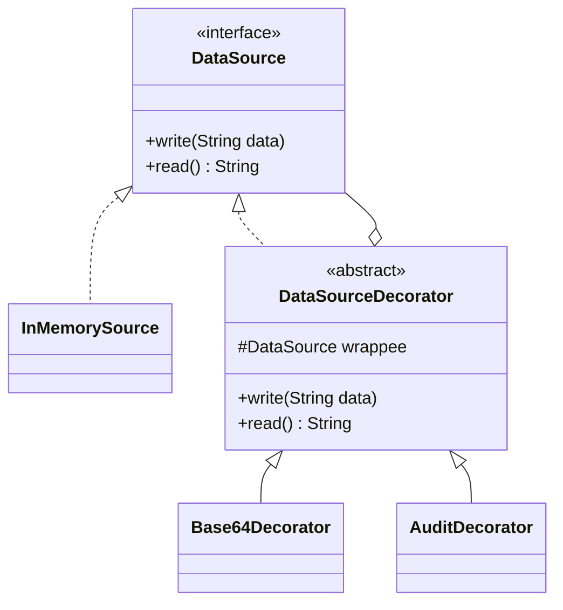

# Decorator Pattern

Back to [[LLD-Index]].

## Problem

You need optional, combinable features on an object: a data source that may be compressed, encrypted, buffered, or any combination. Subclassing for every combination (`EncryptedCompressedFileSource`, ...) causes a class explosion (2^n combinations for n features), and it is fixed at compile time.

## Motivation

- A decorator **implements the same interface** as the component and **holds a reference** to another component.
- It forwards calls, doing extra work before or after. Because it is itself a component, decorators stack: `new Encrypt(new Compress(new FileSource()))`.
- Responsibilities are chosen at runtime by composition ([[Composition-vs-Inheritance]]). New features are new classes ([[Open-Closed-Principle]]).
- Order matters: compress-then-encrypt differs from encrypt-then-compress.

## Structure



## Implementation

### Java

```java
// DecoratorDemo.java
import java.nio.charset.StandardCharsets;
import java.util.ArrayList;
import java.util.Base64;
import java.util.List;

interface DataSource {
    void write(String data);
    String read();
}

class InMemorySource implements DataSource {
    private String stored = "";
    public void write(String data) { stored = data; }
    public String read() { return stored; }
}

abstract class DataSourceDecorator implements DataSource {
    protected final DataSource wrappee;
    protected DataSourceDecorator(DataSource wrappee) { this.wrappee = wrappee; }
    public void write(String data) { wrappee.write(data); }
    public String read() { return wrappee.read(); }
}

// Encodes on write, decodes on read (stand-in for encryption/compression)
class Base64Decorator extends DataSourceDecorator {
    Base64Decorator(DataSource w) { super(w); }
    @Override public void write(String data) {
        wrappee.write(Base64.getEncoder().encodeToString(data.getBytes(StandardCharsets.UTF_8)));
    }
    @Override public String read() {
        return new String(Base64.getDecoder().decode(wrappee.read()), StandardCharsets.UTF_8);
    }
}

// Cross-cutting concern: auditing
class AuditDecorator extends DataSourceDecorator {
    private final List<String> log;
    AuditDecorator(DataSource w, List<String> log) { super(w); this.log = log; }
    @Override public void write(String data) {
        log.add("write len=" + data.length());
        super.write(data);
    }
    @Override public String read() {
        String r = super.read();
        log.add("read len=" + r.length());
        return r;
    }
}

public class DecoratorDemo {
    public static void main(String[] args) {
        InMemorySource raw = new InMemorySource();
        List<String> audit = new ArrayList<>();
        DataSource ds = new AuditDecorator(new Base64Decorator(raw), audit);

        ds.write("hello decorator");
        System.out.println("stored raw : " + raw.read());   // base64 text
        System.out.println("read back  : " + ds.read());    // original
        System.out.println("audit      : " + audit);
    }
}
```

### C++

```cpp
// decorator.cpp  (g++ -std=c++17 decorator.cpp)
#include <iostream>
#include <memory>
#include <string>

class Notifier {
public:
    virtual ~Notifier() = default;
    virtual std::string send(const std::string& msg) const = 0;
};

class EmailNotifier : public Notifier {
public:
    std::string send(const std::string& msg) const override { return "email(" + msg + ")"; }
};

class NotifierDecorator : public Notifier {
protected:
    std::unique_ptr<Notifier> inner_;
public:
    explicit NotifierDecorator(std::unique_ptr<Notifier> inner) : inner_(std::move(inner)) {}
    std::string send(const std::string& msg) const override { return inner_->send(msg); }
};

class SmsDecorator : public NotifierDecorator {
public:
    using NotifierDecorator::NotifierDecorator;
    std::string send(const std::string& msg) const override {
        return NotifierDecorator::send(msg) + " + sms(" + msg + ")";
    }
};

class SlackDecorator : public NotifierDecorator {
public:
    using NotifierDecorator::NotifierDecorator;
    std::string send(const std::string& msg) const override {
        return NotifierDecorator::send(msg) + " + slack(" + msg + ")";
    }
};

int main() {
    std::unique_ptr<Notifier> n =
        std::make_unique<SlackDecorator>(
            std::make_unique<SmsDecorator>(
                std::make_unique<EmailNotifier>()));
    std::cout << n->send("server down") << "\n";
    // email(server down) + sms(server down) + slack(server down)
}
```

`std::unique_ptr` expresses exclusive ownership of the wrapped component, so the chain is destroyed automatically.

## Tradeoffs

| Pro | Con |
|---|---|
| Combine behaviours at runtime without subclass explosion | Many small objects; stack traces and debugging get deeper |
| Each decorator has one responsibility ([[Single-Responsibility-Principle]]) | Order-dependent behaviour is easy to get wrong |
| Open for extension | Object identity differs: `decorated != original`, and `instanceof` of the concrete class fails |
| | Wide interfaces make decorators tedious (must forward every method); an abstract base decorator helps |

## When to use

- Optional, orthogonal features that combine: I/O streams, middleware (logging, retry, metrics, caching around a client), UI borders/scrolls.
- Adding behaviour to objects you cannot subclass (final classes, instances created by others).

## When NOT to use

- Behaviour is always required: put it in the class.
- Clients depend on concrete types or object identity.
- The interface is huge and changes often (forwarding boilerplate).
- You need to control *access* or lifecycle rather than add features: use [[Proxy-Pattern]].

## Real-world example

- `java.io`: `new BufferedInputStream(new GZIPInputStream(new FileInputStream(f)))`. `FilterInputStream` is the abstract decorator base. `BufferedReader`, `DataInputStream`, `CipherInputStream` are all decorators.
- `java.util.Collections.unmodifiableList(list)`, `synchronizedList(list)`, `checkedList(list, type)` wrap a `List` and add read-only enforcement, locking, or runtime type checks, keeping the `List` interface.
- Servlet `HttpServletRequestWrapper` / `HttpServletResponseWrapper`.

## Pattern comparisons

| | Decorator | [[Proxy-Pattern]] |
|---|---|---|
| Intent | Add responsibilities | Control access to the subject (lazy load, remote, security, caching) |
| Who creates the wrapped object | Client composes the stack explicitly | Proxy often creates/manages the real subject itself, hidden from client |
| Stacking | Designed to be stacked, order-sensitive | Usually one level |
| Client awareness | Client chooses decorators | Client usually unaware it has a proxy |

Structurally they are nearly identical; the difference is intent. See also [[Adapter-Pattern]] (changes interface) and [[Composite-Pattern]] (one component with *many* children versus a decorator's *one*). [[Chain-of-Responsibility-Pattern]] handlers may stop propagation, whereas a decorator always delegates.

## Interview questions

1. **Why prefer Decorator over inheritance for features?** It avoids a 2^n subclass explosion, allows runtime composition, and works on final classes.
2. **Is `Collections.unmodifiableList` a decorator or a proxy?** It is usually classified as a decorator (a protection-style wrapper): same interface, adds read-only enforcement, wraps any `List`. The underlying list can still be modified through the original reference.
3. **Why does `java.io` have so many classes?** Each stream class is a single-responsibility decorator. Buffering, compression and decoding are combined by wrapping.
4. **Does decorator order matter?** Yes. For example, buffering should sit closest to the costly I/O, and compress-then-encrypt produces different bytes than encrypt-then-compress.
5. **Decorator vs Proxy in one line?** Same shape. A decorator *adds behaviour* chosen by the client. A proxy *controls access* and usually manages the real object.
6. **How do you avoid forwarding boilerplate?** Use an abstract base decorator that forwards everything, and override only what changes. In Java, dynamic proxies can also generate forwarding.
