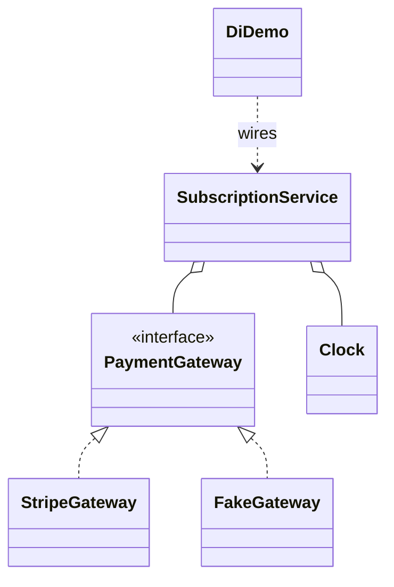

# Dependency Injection

Back to [[LLD-Index]].

## Definition

Term coined by Martin Fowler, "Inversion of Control Containers and the Dependency Injection pattern" (2004):

> A separate object, an assembler, populates a field in the lister class with an appropriate implementation.

A class declares what it needs; a **composition root** (usually `main` or a container like Spring/Guice/Dagger) creates and supplies it. DI is a technique for implementing the [[Dependency-Inversion-Principle]]; IoC is the broader idea of the framework controlling object creation and flow.

Forms:

| Form | How | Use |
|---|---|---|
| Constructor injection | Required deps as constructor params | Default. Immutable, fails fast, obvious dependencies |
| Setter / property injection | Optional deps via setters | Optional or reconfigurable collaborators |
| Method injection | Dep passed per call | Varies per invocation (e.g. `Clock`, request context) |
| Field injection (`@Inject` on field) | Reflection | Avoid: hides deps, needs container for tests |

Alternative (anti-pattern per Mark Seemann, *Dependency Injection in .NET*, 2011): **Service Locator** — class pulls deps from a global registry; dependencies are hidden and failures happen at runtime.

## Violating example

```java
import java.time.LocalDateTime;

class PaymentGateway {
    static final PaymentGateway INSTANCE = new PaymentGateway();   // global singleton
    boolean charge(String card, double amt) { System.out.println("real charge"); return true; }
}

class SubscriptionService {
    private final PaymentGateway gateway = PaymentGateway.INSTANCE;  // hidden dependency

    boolean renew(String card, double amt) {
        if (LocalDateTime.now().getDayOfMonth() != 1) return false;  // hidden clock dependency
        return gateway.charge(card, amt);
    }
}
```

Untestable without hitting the real gateway and waiting for the 1st of the month.

## Refactored

```java
import java.time.Clock;
import java.time.Instant;
import java.time.LocalDate;
import java.time.ZoneOffset;

interface PaymentGateway { boolean charge(String card, double amount); }

class StripeGateway implements PaymentGateway {
    public boolean charge(String card, double amount) { System.out.println("charge " + amount); return true; }
}

class SubscriptionService {
    private final PaymentGateway gateway;
    private final Clock clock;

    SubscriptionService(PaymentGateway gateway, Clock clock) {       // constructor injection
        if (gateway == null || clock == null) throw new IllegalArgumentException("deps");
        this.gateway = gateway; this.clock = clock;
    }

    boolean renew(String card, double amount) {
        if (LocalDate.now(clock).getDayOfMonth() != 1) return false;
        return gateway.charge(card, amount);
    }
}

class FakeGateway implements PaymentGateway {
    int calls = 0;
    public boolean charge(String card, double amount) { calls++; return true; }
}

public class DiDemo {
    public static void main(String[] args) {
        // Composition root (production)
        SubscriptionService prod = new SubscriptionService(new StripeGateway(), Clock.systemUTC());
        prod.renew("4242", 9.99);

        // Test wiring: deterministic clock + fake gateway
        Clock firstOfMonth = Clock.fixed(Instant.parse("2026-09-01T00:00:00Z"), ZoneOffset.UTC);
        FakeGateway fake = new FakeGateway();
        boolean ok = new SubscriptionService(fake, firstOfMonth).renew("4242", 9.99);
        System.out.println(ok + " calls=" + fake.calls);
    }
}
```



## Detecting violations in code review

- `new` of a service/infra class inside another service (vs creating value objects, which is fine).
- `X.getInstance()`, static `ServiceLocator.get(...)`, or `ApplicationContext.getBean(...)` inside business code.
- Hidden non-determinism: `System.currentTimeMillis()`, `LocalDateTime.now()`, `new Random()`, `UUID.randomUUID()` in logic.
- `@Autowired` / `@Inject` on private fields; `final` impossible.
- Constructors with 6+ parameters — not a DI problem per se but an SRP signal ("constructor over-injection").
- Circular dependencies resolved with setter injection or `@Lazy`.

## Tradeoffs and over-application

- Containers add reflection, startup cost, and "magic" wiring errors at runtime; manual DI in `main` is fine for small apps and interviews.
- Injecting everything (including value objects, utilities, `String` constants) adds noise.
- Scope mistakes: injecting a request-scoped bean into a singleton leaks state across requests.
- DI makes dependencies visible, which exposes bad designs (long constructors) — treat that as feedback, not a DI flaw.

## Related patterns

[[Singleton-Pattern]] (container-managed singleton scope replaces static `getInstance()`), [[Factory-Method-Pattern]] and [[Abstract-Factory-Pattern]] (inject a factory when objects must be created at runtime), [[Strategy-Pattern]] (injected strategies), [[Proxy-Pattern]] and [[Decorator-Pattern]] (containers wrap injected beans for transactions/AOP).

## Interview questions

1. **Why constructor injection over field injection?** Dependencies explicit, fields can be `final`, object always valid, testable without a container.
2. **DI vs Service Locator?** DI pushes deps in (visible in signature); locator pulls them (hidden, runtime failures, global coupling).
3. **How do you inject something created per request?** Inject a factory/`Supplier<T>` or use method injection.
4. **How does DI replace the Singleton pattern?** Container creates one instance and injects it; class itself isn't static-global, so it can be faked.
5. **What is a composition root?** The single place (near the entry point) where the object graph is assembled.
6. **How to handle a circular dependency?** Usually a design smell: extract the shared part into a third class or use events; setter/lazy injection is a workaround.
