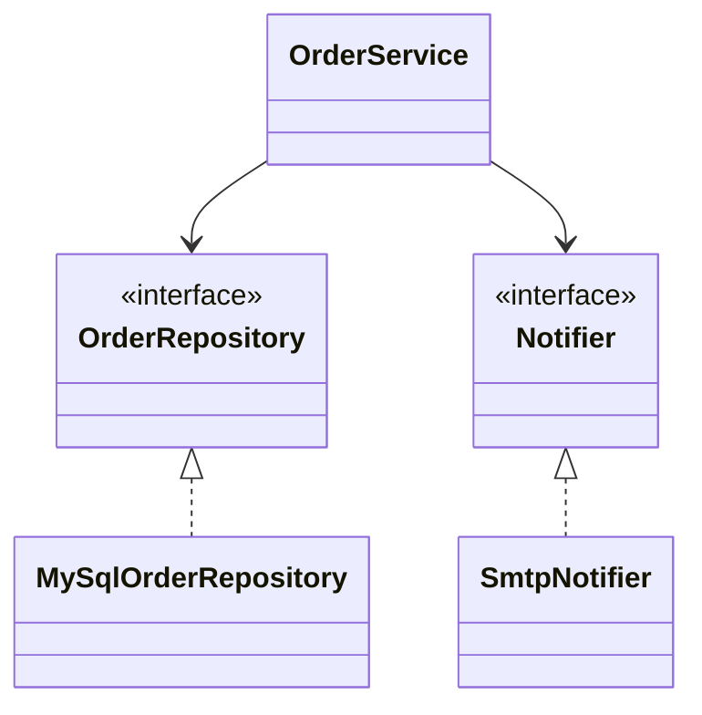

# Dependency Inversion Principle

Back to [[LLD-Index]].

## Definition

Robert C. Martin, "The Dependency Inversion Principle", C++ Report (1996):

> A. High-level modules should not depend on low-level modules. Both should depend on abstractions.
> B. Abstractions should not depend on details. Details should depend on abstractions.

The "inversion": source-code dependencies point **against** the flow of control. The high-level module **owns** the interface (e.g. `OrderRepository` lives in the domain package); the low-level module (JDBC, Kafka) implements it. DIP is a design principle; [[Dependency-Injection]] is one technique to satisfy it at runtime.

## Violating example

```java
class MySqlOrderDao {
    void insert(String orderId, double amount) {
        System.out.println("INSERT INTO orders VALUES('" + orderId + "'," + amount + ")");
    }
}

class SmtpMailer {
    void send(String to, String body) { System.out.println("SMTP to " + to + ": " + body); }
}

class OrderService {                       // business policy
    private final MySqlOrderDao dao = new MySqlOrderDao();   // concrete, hard-wired
    private final SmtpMailer mailer = new SmtpMailer();

    void place(String id, double amount, String email) {
        if (amount <= 0) throw new IllegalArgumentException("amount");
        dao.insert(id, amount);
        mailer.send(email, "Order " + id + " placed");
    }
}
```

Policy cannot be unit tested without MySQL/SMTP, and swapping to Postgres or SES means editing business code.

## Refactored

```java
import java.util.HashMap;
import java.util.Map;

// Abstractions owned by the domain layer
interface OrderRepository { void save(String orderId, double amount); }
interface Notifier { void notify(String to, String message); }

class OrderService {
    private final OrderRepository repo;
    private final Notifier notifier;
    OrderService(OrderRepository repo, Notifier notifier) {
        this.repo = repo; this.notifier = notifier;
    }
    void place(String id, double amount, String email) {
        if (amount <= 0) throw new IllegalArgumentException("amount");
        repo.save(id, amount);
        notifier.notify(email, "Order " + id + " placed");
    }
}

// Details in the infrastructure layer
class MySqlOrderRepository implements OrderRepository {
    public void save(String id, double amount) { System.out.println("MySQL save " + id); }
}
class SmtpNotifier implements Notifier {
    public void notify(String to, String msg) { System.out.println("SMTP " + to + ": " + msg); }
}
class InMemoryOrderRepository implements OrderRepository {   // for tests
    final Map<String, Double> store = new HashMap<>();
    public void save(String id, double amount) { store.put(id, amount); }
}

public class DipDemo {
    public static void main(String[] args) {                  // composition root
        new OrderService(new MySqlOrderRepository(), new SmtpNotifier())
            .place("o-1", 99.0, "a@example.com");
        InMemoryOrderRepository fake = new InMemoryOrderRepository();
        new OrderService(fake, (to, m) -> {}).place("o-2", 10.0, "b@example.com");
        System.out.println(fake.store);
    }
}
```



## Detecting violations in code review

- `new ConcreteInfraClass()` inside business logic.
- Domain packages importing `java.sql`, HTTP clients, SDKs, or framework annotations.
- Interfaces defined in the infrastructure package and shaped like the vendor API (`S3Client`-shaped `Storage`).
- Static calls to infrastructure (`Db.query(...)`, `HttpUtil.post(...)`) from policy code.
- Unit tests require containers/network for pure business rules.

## Tradeoffs and over-application

- An interface for every class with exactly one implementation and no test seam is noise ([[DRY-KISS-YAGNI]]).
- Don't invert dependencies on stable, non-volatile things (`String`, `java.time`, collections).
- Leaky abstractions: an interface that exposes SQL concepts isn't really inverted.
- Apply at volatile boundaries: persistence, messaging, external APIs, clocks, randomness.

## Related patterns

[[Dependency-Injection]], [[Adapter-Pattern]] (wrap vendor SDK behind owned interface), [[Abstract-Factory-Pattern]], [[Factory-Method-Pattern]], [[Strategy-Pattern]], [[Observer-Pattern]].

## Interview questions

1. **DIP vs DI vs IoC?** DIP: design rule about dependency direction. DI: supplying dependencies from outside. IoC: framework calls your code (DI is one form).
2. **Who owns the interface?** The high-level (client) module; that ownership is the inversion.
3. **Does DIP require a DI container?** No; constructor wiring in `main` is enough.
4. **Where should you not apply DIP?** Stable library types and code with no alternative implementations or test needs.
5. **How does DIP enable testing?** Policy depends on interfaces, so tests supply in-memory fakes.
