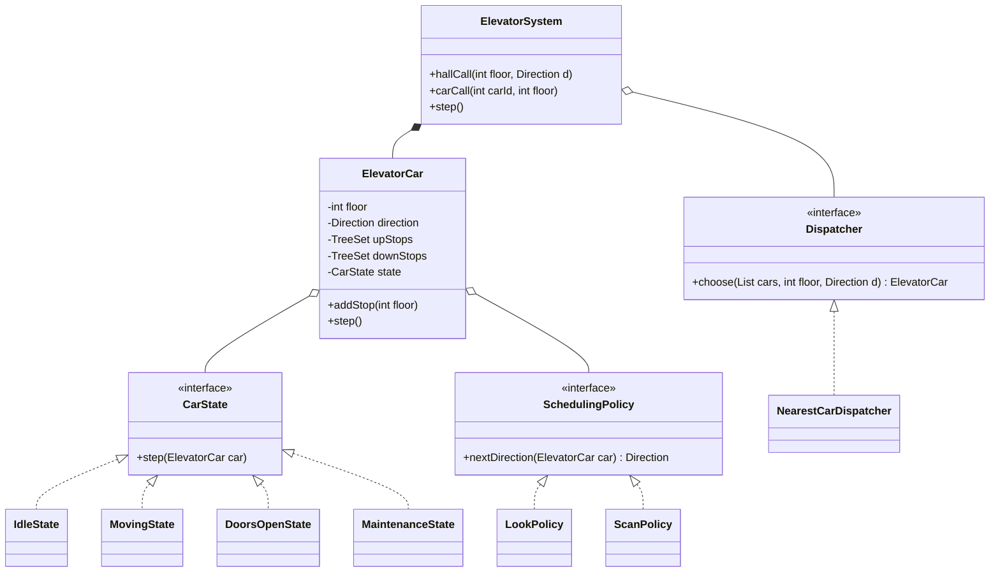
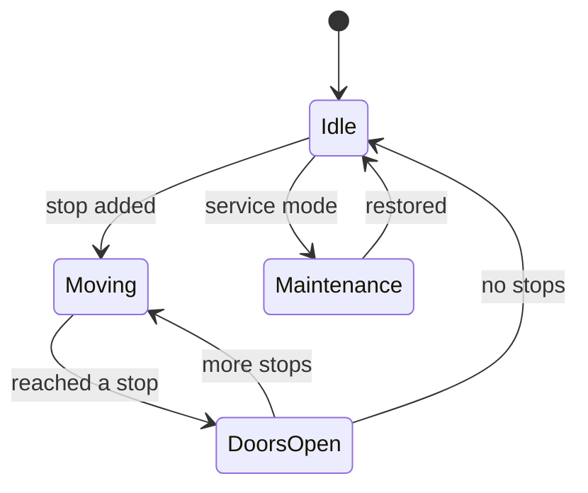

# Elevator System LLD

Back to [[LLD-Index]].

## Clarifying questions

1. How many elevators and floors? One building?
2. Two kinds of requests: **hall calls** (floor + direction, outside the car) and **car calls** (destination pressed inside). Both in scope?
3. Is dispatching (which car serves a hall call) in scope, or only the movement of a single car?
4. Which scheduling algorithm is expected: FCFS, SCAN, LOOK, nearest-car?
5. Capacity/weight limits, maintenance mode, emergency stop, door open/close timing?
6. Is it a simulation (discrete ticks) or real-time?

## Requirements

### Functional (in scope)

- N cars, floors `0..F-1`.
- Accept hall calls (floor, UP/DOWN) and car calls (car id, floor).
- Dispatcher assigns each hall call to one car via a pluggable strategy.
- Each car serves its stops using LOOK (default) or SCAN.
- Car states: `IDLE`, `MOVING_UP`, `MOVING_DOWN`, `DOORS_OPEN`, `MAINTENANCE`.
- Discrete `step()` advances the simulation one floor/tick.

### Non-functional

- Requests may arrive from many threads (buttons) while cars step.
- No starvation: every request is eventually served.
- New scheduling/dispatch policies without modifying cars.

### Out of scope

Weight sensors, physical door timing, fire mode, destination-dispatch kiosks. Discuss as follow-ups.

## Entities

| Entity | Responsibility |
|---|---|
| `ElevatorSystem` | Facade: receives requests, owns cars, runs dispatcher. |
| `ElevatorCar` | Current floor, direction, pending stops (up set, down set), state. |
| `CarState` | Behavior per state (`Idle`, `MovingUp`, ...). |
| `Dispatcher` (strategy) | Chooses car for a hall call. |
| `SchedulingPolicy` (strategy) | Chooses next direction for a car given its stops (SCAN vs LOOK). |
| `Request` | Floor, direction, type. |

## Relationships

- `ElevatorSystem` composes `ElevatorCar`s and aggregates a `Dispatcher`.
- `ElevatorCar` holds a `CarState` (swapped at runtime) and a `SchedulingPolicy`.
- `Dispatcher` depends on read-only car snapshots.

## Class diagram



State transitions:



## SCAN vs LOOK

- **SCAN** (elevator algorithm): keep moving in the current direction to the **end of the shaft** (floor 0 or top), then reverse. Predictable, but wastes travel past the last request.
- **LOOK**: keep moving in the current direction only while there are stops ahead; reverse when none remain. Same no-starvation property, less travel. Real elevators behave like LOOK.
- Both avoid starvation that **nearest-stop-first** (SSTF) suffers: SSTF can keep bouncing among a cluster of floors and never serve a far one.

## Core Java code

Single file, compiles with `javac ElevatorDemo.java` (Java 17+). Car methods are `synchronized` because buttons (other threads) call `addStop` while the controller thread calls `step`.

```java
import java.util.*;

enum Direction { UP, DOWN, NONE }

interface SchedulingPolicy { Direction nextDirection(ElevatorCar car); }

/** LOOK: continue while stops exist ahead, else reverse, else idle. */
final class LookPolicy implements SchedulingPolicy {
    public Direction nextDirection(ElevatorCar c) {
        boolean above = c.hasStopAbove(), below = c.hasStopBelow();
        if (c.direction() == Direction.UP && above) return Direction.UP;
        if (c.direction() == Direction.DOWN && below) return Direction.DOWN;
        if (above) return Direction.UP;
        if (below) return Direction.DOWN;
        return Direction.NONE;
    }
}

/** SCAN: run to the shaft end before reversing (only when any stop exists). */
final class ScanPolicy implements SchedulingPolicy {
    public Direction nextDirection(ElevatorCar c) {
        if (!c.hasAnyStop()) return Direction.NONE;
        if (c.direction() == Direction.UP && c.floor() < c.topFloor()) return Direction.UP;
        if (c.direction() == Direction.DOWN && c.floor() > 0) return Direction.DOWN;
        return c.floor() < c.topFloor() && c.hasStopAbove() ? Direction.UP : Direction.DOWN;
    }
}

interface CarState { void step(ElevatorCar car); String name(); }

final class IdleState implements CarState {
    public void step(ElevatorCar car) {
        if (car.isStop(car.floor())) { car.arrive(); return; }
        Direction d = car.policy().nextDirection(car);
        if (d != Direction.NONE) { car.setDirection(d); car.setState(new MovingState()); }
    }
    public String name() { return "IDLE"; }
}

final class MovingState implements CarState {
    public void step(ElevatorCar car) {
        car.moveOneFloor();
        if (car.isStop(car.floor())) car.arrive();
    }
    public String name() { return "MOVING"; }
}

final class DoorsOpenState implements CarState {
    public void step(ElevatorCar car) { // doors close after one tick
        Direction d = car.policy().nextDirection(car);
        car.setDirection(d);
        car.setState(d == Direction.NONE ? new IdleState() : new MovingState());
    }
    public String name() { return "DOORS_OPEN"; }
}

final class MaintenanceState implements CarState {
    public void step(ElevatorCar car) { /* ignores movement */ }
    public String name() { return "MAINTENANCE"; }
}

final class ElevatorCar {
    private final int id, topFloor;
    private int floor = 0;
    private Direction direction = Direction.NONE;
    private final TreeSet<Integer> stops = new TreeSet<>();
    private CarState state = new IdleState();
    private final SchedulingPolicy policy;

    ElevatorCar(int id, int topFloor, SchedulingPolicy policy) { this.id = id; this.topFloor = topFloor; this.policy = policy; }

    synchronized void addStop(int f) {
        if (f < 0 || f > topFloor) throw new IllegalArgumentException("bad floor " + f);
        if (!(state instanceof MaintenanceState)) stops.add(f);
    }
    synchronized void step() { state.step(this); }

    // Package-private helpers used by states/policies (called while holding the car lock).
    boolean hasStopAbove() { return stops.higher(floor) != null; }
    boolean hasStopBelow() { return stops.lower(floor) != null; }
    boolean hasAnyStop() { return !stops.isEmpty(); }
    boolean isStop(int f) { return stops.contains(f); }
    void arrive() { stops.remove(floor); setState(new DoorsOpenState()); }
    void moveOneFloor() {
        if (direction == Direction.UP && floor < topFloor) floor++;
        else if (direction == Direction.DOWN && floor > 0) floor--;
    }
    void setState(CarState s) { state = s; }
    void setDirection(Direction d) { direction = d; }
    SchedulingPolicy policy() { return policy; }
    synchronized void enterMaintenance() { stops.clear(); state = new MaintenanceState(); direction = Direction.NONE; }

    synchronized int floor() { return floor; }
    synchronized Direction direction() { return direction; }
    synchronized boolean isAvailable() { return !(state instanceof MaintenanceState); }
    int topFloor() { return topFloor; }
    int id() { return id; }
    synchronized String describe() { return "car" + id + "@" + floor + " " + direction + " " + state.getClass().getSimpleName() + " " + stops; }
}

interface Dispatcher { Optional<ElevatorCar> choose(List<ElevatorCar> cars, int floor, Direction d); }

/**
 * Cost = distance, penalized if the car is moving away from the call or in the opposite direction.
 * Cars already heading toward the floor in the same direction are preferred.
 */
final class NearestCarDispatcher implements Dispatcher {
    public Optional<ElevatorCar> choose(List<ElevatorCar> cars, int floor, Direction d) {
        return cars.stream().filter(ElevatorCar::isAvailable).min(Comparator.comparingInt(c -> cost(c, floor, d)));
    }
    private int cost(ElevatorCar c, int floor, Direction d) {
        int dist = Math.abs(c.floor() - floor);
        Direction cd = c.direction();
        if (cd == Direction.NONE) return dist;
        boolean onTheWay = (cd == Direction.UP && floor >= c.floor()) || (cd == Direction.DOWN && floor <= c.floor());
        if (onTheWay && cd == d) return dist;
        return dist + 2 * c.topFloor(); // must finish current sweep first
    }
}

final class ElevatorSystem {
    private final List<ElevatorCar> cars = new ArrayList<>();
    private final Dispatcher dispatcher;
    private final int floors;

    ElevatorSystem(int nCars, int floors, Dispatcher dispatcher, SchedulingPolicy policy) {
        this.floors = floors; this.dispatcher = dispatcher;
        for (int i = 0; i < nCars; i++) cars.add(new ElevatorCar(i, floors - 1, policy));
    }
    void hallCall(int floor, Direction d) {
        dispatcher.choose(cars, floor, d)
                .orElseThrow(() -> new IllegalStateException("no car available"))
                .addStop(floor);
    }
    void carCall(int carId, int floor) { cars.get(carId).addStop(floor); }
    void step() { cars.forEach(ElevatorCar::step); }
    void print() { cars.forEach(c -> System.out.println(c.describe())); }
}

public class ElevatorDemo {
    public static void main(String[] args) {
        ElevatorSystem sys = new ElevatorSystem(2, 10, new NearestCarDispatcher(), new LookPolicy());
        sys.hallCall(5, Direction.DOWN);
        sys.carCall(0, 8);
        sys.hallCall(2, Direction.UP);
        for (int t = 0; t < 12; t++) { sys.step(); }
        sys.print();
    }
}
```

## Patterns used and why

| Pattern | Where | Why |
|---|---|---|
| [[State-Pattern]] | `CarState` implementations | Behavior of `step()` differs per state; avoids a growing `switch` and makes illegal transitions explicit. |
| [[Strategy-Pattern]] | `Dispatcher`, `SchedulingPolicy` | SCAN/LOOK/nearest-car are interchangeable algorithms. |
| [[Command-Pattern]] | Requests as objects (follow-up) | Queue, log, and replay requests; undo a cancelled car call. |
| [[Observer-Pattern]] | Floor displays, hall lanterns | Cars publish floor/direction changes. |
| [[Facade-Pattern]] | `ElevatorSystem` | Buttons talk to one API. |

## Concurrency concerns

- Buttons fire from many threads while a controller thread steps cars. Each car guards its state with its own monitor, so cars never block each other.
- The dispatcher reads `floor()`/`direction()` of several cars without a global lock, so its choice is based on a slightly stale snapshot. That is acceptable: the cost function is a heuristic and the stop is still added atomically.
- If reassigning hall calls between cars is required (car goes to maintenance), you need a system-level lock or a single-threaded event loop. A single-threaded controller consuming a `BlockingQueue` of requests is the simplest correct design and is what many real controllers do.

## Extensibility follow-ups

| Follow-up | Absorbed by |
|---|---|
| Destination dispatch (choose floor in lobby) | New `Dispatcher` that groups passengers by destination. |
| Capacity limit | Car tracks load; dispatcher cost treats full cars as unavailable. |
| Express elevators serving floors 20+ | Car has `servedFloors` set; dispatcher filters. |
| Peak-hour mode (park idle cars at lobby) | Idle-parking strategy invoked from `IdleState`. |
| Emergency / fire mode | New `EmergencyState`; system broadcasts to all cars. |
| Remove a hall call once served by another car | Track hall calls in a system map; on arrival, notify via [[Observer-Pattern]]. |

## Common interview pitfalls

- Mixing hall calls and car calls into one queue without direction; you lose "pick up only if going my way".
- FCFS scheduling: correct but causes absurd travel; explain SCAN/LOOK and starvation.
- Giant `if/else` on state in one method instead of [[State-Pattern]].
- Letting the dispatcher mutate car internals directly (violates encapsulation, see [[Cohesion-and-Coupling]]).
- Not defining what happens when all cars are in maintenance.
- Over-engineering physics (acceleration, door timers) before the core flows work.
