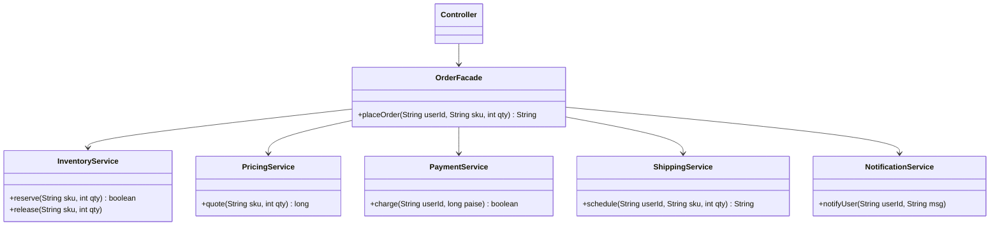

# Facade Pattern

Back to [[LLD-Index]].

## Problem

Placing an order requires calling inventory, pricing, payment, shipping and notification components in the correct order, with the correct rollback on failure. If every client (web controller, mobile API, batch job) orchestrates this itself, the workflow is duplicated, clients are coupled to every subsystem class ([[Cohesion-and-Coupling]]), and a change in one subsystem ripples everywhere.

## Motivation

- A facade exposes a few high-level operations (`placeOrder`) and hides the sequencing, error handling and wiring of subsystem classes.
- Subsystem classes remain accessible for advanced clients. The facade does not lock them away; it offers a convenient default path.
- Reduces coupling and provides a natural layer boundary (the service/application layer is often a facade over domain + infrastructure).

## Structure



## Implementation

```java
// FacadeDemo.java
import java.util.HashMap;
import java.util.Map;
import java.util.UUID;

class InventoryService {
    private final Map<String, Integer> stock = new HashMap<>(Map.of("BOOK-1", 5));
    synchronized boolean reserve(String sku, int qty) {
        int have = stock.getOrDefault(sku, 0);
        if (have < qty) return false;
        stock.put(sku, have - qty);
        return true;
    }
    synchronized void release(String sku, int qty) { stock.merge(sku, qty, Integer::sum); }
}

class PricingService {
    long quote(String sku, int qty) { return 49_900L * qty; } // paise
}

class PaymentService {
    boolean charge(String userId, long paise) { return paise < 1_000_000; } // stub rule
}

class ShippingService {
    String schedule(String userId, String sku, int qty) { return "SHP-" + UUID.randomUUID().toString().substring(0, 8); }
}

class NotificationService {
    void notifyUser(String userId, String msg) { System.out.println("notify " + userId + ": " + msg); }
}

// Facade: one entry point, owns orchestration + compensation
class OrderFacade {
    private final InventoryService inventory;
    private final PricingService pricing;
    private final PaymentService payment;
    private final ShippingService shipping;
    private final NotificationService notifier;

    OrderFacade(InventoryService i, PricingService p, PaymentService pay, ShippingService s, NotificationService n) {
        this.inventory = i; this.pricing = p; this.payment = pay; this.shipping = s; this.notifier = n;
    }

    String placeOrder(String userId, String sku, int qty) {
        if (!inventory.reserve(sku, qty)) return "REJECTED: out of stock";
        long amount = pricing.quote(sku, qty);
        if (!payment.charge(userId, amount)) {
            inventory.release(sku, qty);               // compensate
            return "REJECTED: payment failed";
        }
        String shipmentId = shipping.schedule(userId, sku, qty);
        notifier.notifyUser(userId, "Order confirmed, shipment " + shipmentId);
        return "CONFIRMED: " + shipmentId;
    }
}

public class FacadeDemo {
    public static void main(String[] args) {
        OrderFacade orders = new OrderFacade(new InventoryService(), new PricingService(),
                new PaymentService(), new ShippingService(), new NotificationService());
        System.out.println(orders.placeOrder("u1", "BOOK-1", 2));
        System.out.println(orders.placeOrder("u1", "BOOK-1", 10));
        System.out.println(orders.placeOrder("u1", "BOOK-1", 3));
    }
}
```

## Tradeoffs

| Pro | Con |
|---|---|
| Simple API for common use cases | Can grow into a "god object" if every operation is added to it |
| Decouples clients from subsystem internals | Hides capabilities; advanced use cases may bypass it inconsistently |
| One place for orchestration, transactions, compensation | Extra layer; thin pass-through facades add no value |
| Easier to test clients (mock one facade) | |

Keep facades cohesive: split by use case (`OrderFacade`, `RefundFacade`) rather than one `ApplicationFacade`.

## When to use

- A subsystem has many interacting classes and most clients need a few standard workflows.
- Layering: define entry points to each layer or module.
- Wrapping a complex third-party library behind an app-specific API.

## When NOT to use

- The subsystem is already simple.
- Clients genuinely need fine-grained control over each step.
- You only need interface conversion for one class: use [[Adapter-Pattern]].

## Real-world example

- **SLF4J** (Simple Logging *Facade* for Java): application code calls `org.slf4j.LoggerFactory.getLogger(...)`, and the binding (Logback, Log4j 2, JUL) is chosen at deploy time. See [[Logger-Framework-LLD]].
- `javax.faces.context.FacesContext` (JSF) exposes request/response/application state through one object over the underlying servlet/portlet environment.
- Spring `JdbcTemplate` is a facade over JDBC connection acquisition, statement creation, result iteration, exception translation and resource cleanup.
- A booking service in [[BookMyShow-LLD]] fronts seat locking, payment and ticket issuance.

## Pattern comparisons

| | [[Adapter-Pattern]] | Facade | [[Decorator-Pattern]] |
|---|---|---|---|
| Interface | Existing interface the client expects | New simplified interface | Same interface as the wrapped object |
| Wraps | One object | Many objects / subsystem | One object |
| Goal | Make incompatible things fit | Make complex things easy | Add behaviour dynamically |

## Interview questions

1. **Facade vs Adapter?** A facade *defines* a new, simpler interface over many classes. An adapter *conforms* one class to an existing interface.
2. **Does a facade prevent direct subsystem access?** No, not by design. It is a convenience. Use module visibility (package-private, JPMS) if you need enforcement.
3. **Facade vs Mediator?** A facade is unidirectional: clients call the facade, and subsystems do not know it exists. A mediator coordinates peers that talk *through* it.
4. **Is a service layer a facade?** Typically yes: it offers use-case operations over repositories, domain objects and gateways, and owns transactions.
5. **How do you avoid a god-facade?** Split by use case or bounded context, keep business rules in the domain, and let the facade only orchestrate.
6. **Why is SLF4J called a facade?** It gives one logging API and delegates to whichever backend is bound at runtime, decoupling libraries from a concrete logging implementation.
