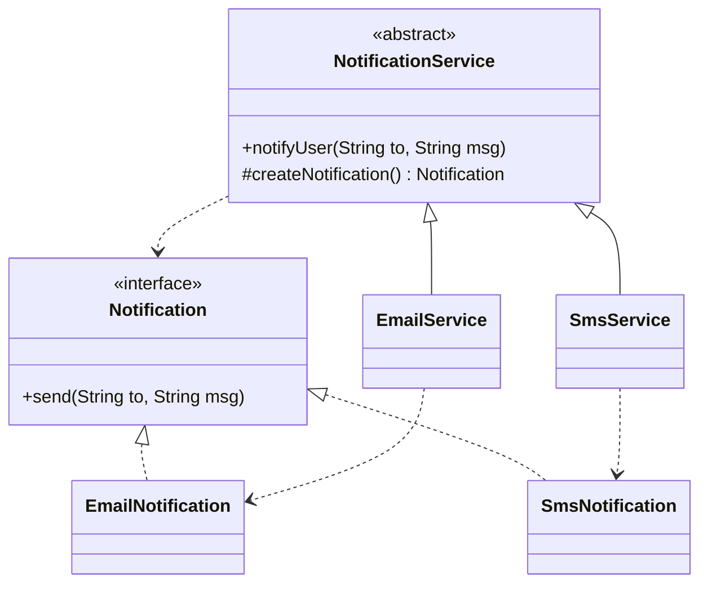

# Factory Method Pattern

Back to [[LLD-Index]].

## Problem

Client code writes `new ConcreteType()` directly. Every new variant forces edits to the client (`if/else` or `switch` on a type string), violating [[Open-Closed-Principle]] and coupling high-level code to concrete classes ([[Dependency-Inversion-Principle]]).

## Motivation

- Define an interface for creating an object, but let subclasses (or a dedicated creator) decide which class to instantiate.
- The creator usually contains business logic that *uses* the product; the factory method is just the "hook" that supplies it. This makes Factory Method a specialisation of [[Template-Method-Pattern]].
- Two common forms:
  - **GoF Factory Method**: abstract `createX()` overridden by subclasses.
  - **Simple / static factory**: one method with a parameter (`NotificationFactory.of("sms")`). Not a GoF pattern, but the most common interview answer. Know the difference.

## Structure



## Implementation

```java
// FactoryMethodDemo.java
import java.util.Map;
import java.util.function.Supplier;

interface Notification {
    void send(String to, String msg);
}

class EmailNotification implements Notification {
    public void send(String to, String msg) { System.out.println("EMAIL to " + to + ": " + msg); }
}

class SmsNotification implements Notification {
    public void send(String to, String msg) { System.out.println("SMS to " + to + ": " + msg); }
}

// GoF form: creator with an overridable factory method
abstract class NotificationService {
    // Template logic that depends only on the abstraction
    public final void notifyUser(String to, String msg) {
        if (to == null || to.isBlank()) throw new IllegalArgumentException("recipient required");
        Notification n = createNotification();
        n.send(to, msg);
    }
    protected abstract Notification createNotification(); // the factory method
}

class EmailService extends NotificationService {
    protected Notification createNotification() { return new EmailNotification(); }
}

class SmsService extends NotificationService {
    protected Notification createNotification() { return new SmsNotification(); }
}

// Simple (static) factory with a registry: new types are registered, not switch-cased
final class NotificationFactory {
    private static final Map<String, Supplier<Notification>> REGISTRY = Map.of(
            "email", EmailNotification::new,
            "sms", SmsNotification::new);

    private NotificationFactory() {}

    static Notification of(String type) {
        Supplier<Notification> s = REGISTRY.get(type.toLowerCase());
        if (s == null) throw new IllegalArgumentException("Unknown type: " + type);
        return s.get();
    }
}

public class FactoryMethodDemo {
    public static void main(String[] args) {
        NotificationService svc = new SmsService();
        svc.notifyUser("+10000000000", "OTP 1234");

        NotificationFactory.of("email").send("a@b.com", "Welcome");
    }
}
```

## Tradeoffs

| Pro | Con |
|---|---|
| Client depends on `Notification`, not concrete classes | Parallel class hierarchies (one creator subclass per product) in GoF form |
| New products added without modifying existing creators | Extra indirection for trivial cases |
| Centralises construction logic (validation, caching, pooling) | Static factories are hard to mock/override; prefer injecting a factory ([[Dependency-Injection]]) |
| Factory can return a cached instance or a subtype | Registry-based factories fail at runtime, not compile time, for unknown keys |

## When to use

- The exact type to create is decided at runtime (config, user input, platform).
- A framework/library must let users plug in their own product types.
- Construction needs logic (caching, validation, choosing a subtype) that should not leak into callers.

## When NOT to use

- Only one concrete type exists and no variation is expected ([[DRY-KISS-YAGNI]]).
- You need families of related objects that must match: use [[Abstract-Factory-Pattern]].
- The object has many optional parameters: use [[Builder-Pattern]].

## Real-world example

- `java.util.Calendar.getInstance()` returns a locale-dependent subclass (e.g. `GregorianCalendar`).
- `java.text.NumberFormat.getInstance()` / `getCurrencyInstance()` return locale-specific `NumberFormat` subclasses.
- `java.util.Collection.iterator()`: each collection is a creator whose factory method returns its own `Iterator` ([[Iterator-Pattern]]).
- `List.of(...)`, `EnumSet.of(...)` are static factories returning hidden implementation classes.

## Pattern comparisons

| | Factory Method | [[Abstract-Factory-Pattern]] | [[Builder-Pattern]] |
|---|---|---|---|
| Creates | One product | Family of related products | One complex product |
| Mechanism | Inheritance (override a method) or static method | Composition (inject a factory object) | Step-by-step fluent calls, then `build()` |
| Variation point | Which class | Which family | Which parts / configuration |
| Typical signal | `switch(type) { new ... }` | "Products must be consistent with each other" | Telescoping constructors |

## Interview questions

1. **Factory Method vs simple factory?** GoF Factory Method uses subclassing: the creator declares an abstract `create()` that subclasses override. A simple factory is one class with a conditional/registry. It is not a GoF pattern, but it is fine in practice.
2. **How do you avoid a growing `switch` in a factory?** Use a registry `Map<String, Supplier<T>>` populated at startup, or via `ServiceLoader`/DI container scanning.
3. **Why is Factory Method related to Template Method?** The creator's algorithm (`notifyUser`) is fixed and calls an overridable step (`createNotification`), which is exactly the Template Method structure.
4. **Static factory advantages over constructors (Effective Java item 1)?** Named methods, can return cached instances, can return subtypes, and can hide the implementation class.
5. **How does it support OCP?** Adding a new product means adding a new creator subclass or registry entry. Existing client code and creators stay unchanged.
6. **How do you test code using a static factory?** Wrap it behind an injected interface (`NotificationFactory` bean) so tests can substitute a fake.
