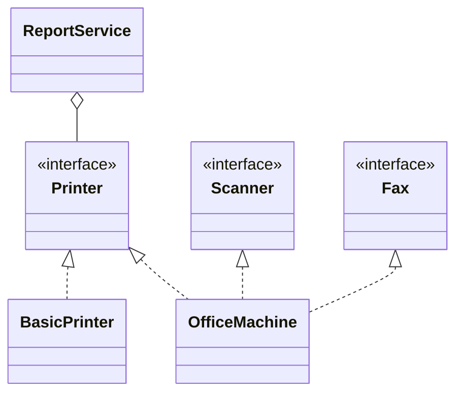

# Interface Segregation Principle

Back to [[LLD-Index]].

## Definition

Robert C. Martin (originating from consulting work at Xerox, 1990s; published in *Agile Software Development: Principles, Patterns, and Practices*, 2002):

> Clients should not be forced to depend upon interfaces that they do not use.

Prefer several **role interfaces** shaped by client needs over one "fat" interface shaped by the implementation. Fat interfaces cause recompilation/redeployment coupling and force implementers into stub methods (which usually become [[Liskov-Substitution-Principle]] violations).

## Violating example

```java
interface Machine {
    void print(String doc);
    void scan(String doc);
    void fax(String doc);
}

class BasicPrinter implements Machine {
    public void print(String doc) { System.out.println("Print " + doc); }
    public void scan(String doc)  { throw new UnsupportedOperationException(); }
    public void fax(String doc)   { throw new UnsupportedOperationException(); }
}
```

Every client of `Machine` now depends on `fax`, and `BasicPrinter` lies about its capabilities.

## Refactored

```java
interface Printer { void print(String doc); }
interface Scanner { void scan(String doc); }
interface Fax     { void fax(String doc); }

class BasicPrinter implements Printer {
    public void print(String doc) { System.out.println("Print " + doc); }
}

class OfficeMachine implements Printer, Scanner, Fax {
    public void print(String doc) { System.out.println("Print " + doc); }
    public void scan(String doc)  { System.out.println("Scan " + doc); }
    public void fax(String doc)   { System.out.println("Fax " + doc); }
}

class ReportService {                     // needs printing only
    private final Printer printer;
    ReportService(Printer printer) { this.printer = printer; }
    void publish(String r) { printer.print(r); }
}

public class IspDemo {
    public static void main(String[] args) {
        new ReportService(new BasicPrinter()).publish("Q3");
        new ReportService(new OfficeMachine()).publish("Q4");
    }
}
```



## Detecting violations in code review

- Implementations with `throw new UnsupportedOperationException()` or empty method bodies.
- Interfaces with 10+ methods mixing read, write, admin and lifecycle concerns.
- Test doubles that must stub many irrelevant methods.
- A client uses 1–2 methods from a large injected interface.
- Interface named after the implementation (`UserServiceImpl` -> `UserService` with every public method).

## Tradeoffs and over-application

- One-method-per-interface everywhere ("interface soup") hurts discoverability.
- Segregate by **client role** (reader vs writer, e.g. CQRS-style `OrderReader`/`OrderWriter`), not mechanically per method.
- Java default methods can soften breaking changes but don't fix a fat interface.

## Related patterns

[[Adapter-Pattern]] (expose a narrow interface over a wide class), [[Proxy-Pattern]], [[Facade-Pattern]], [[Dependency-Inversion-Principle]] (client-owned abstractions are naturally segregated).

## Interview questions

1. **ISP vs SRP?** SRP is about why a class changes; ISP is about what a client sees. A class may implement several segregated interfaces and still obey SRP if they serve one actor.
2. **How does ISP relate to LSP?** Fat interfaces force stubbed methods, which break substitutability.
3. **Real Java example?** `java.util.List` optional ops vs segregated read-only views; `Readable`/`Appendable`/`Closeable` are good narrow roles.
4. **How to split an existing fat interface without breaking clients?** Extract role interfaces, make the old one extend them, migrate clients, then deprecate.
5. **Cost of ISP?** More types and names; interfaces must be designed from client usage, which requires knowing the clients.
