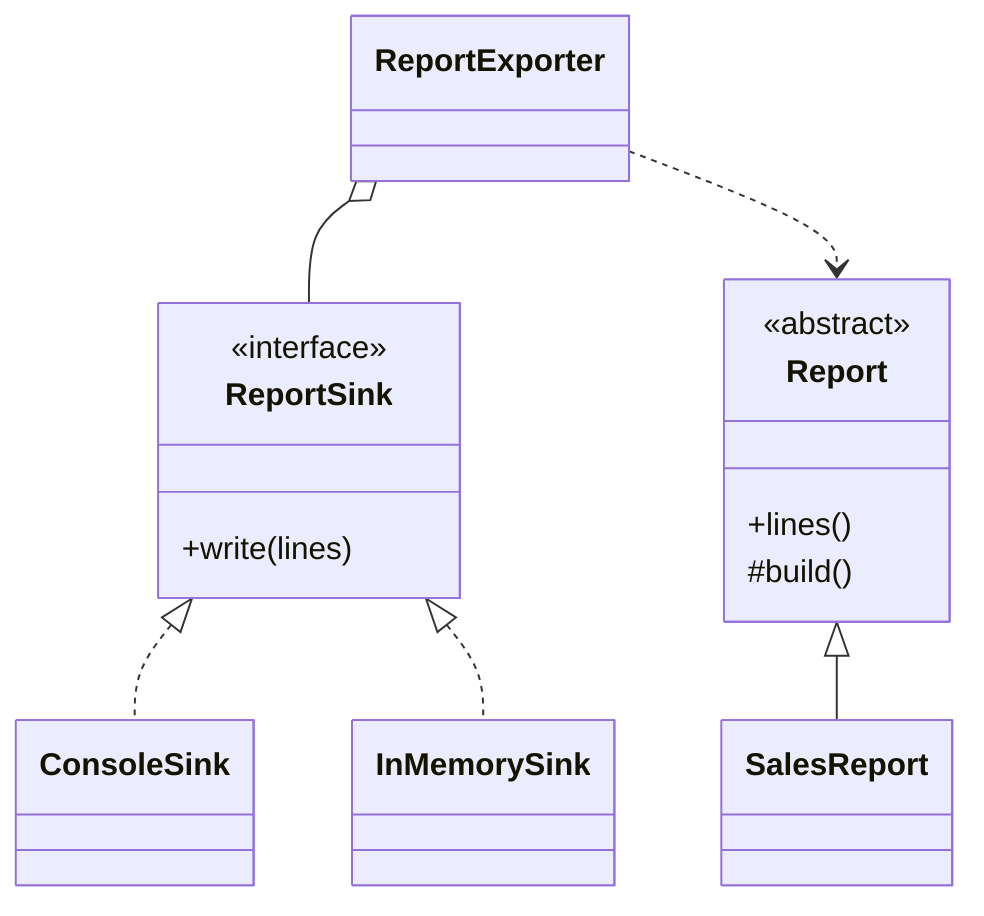

# Interfaces and Abstraction

Back to [[LLD-Index]].

## Definition

- **Abstraction:** exposing *what* a component does while hiding *how*. Rooted in David Parnas, "On the Criteria To Be Used in Decomposing Systems into Modules" (CACM, 1972) — information hiding: modules should hide design decisions likely to change.
- **Interface:** an explicit contract (method signatures + documented semantics) that clients depend on.
- GoF (1994): **"Program to an interface, not an implementation."**

In Java: `interface` (contract, multiple inheritance of type, `default`/`static`/`private` methods since Java 8/9) vs `abstract class` (partial implementation, state, constructors, single inheritance).

| | `interface` | `abstract class` |
|---|---|---|
| State (instance fields) | No (only constants) | Yes |
| Constructors | No | Yes |
| Multiple inheritance | Yes | No |
| Methods | abstract, default, static, private | any |
| Use for | Capabilities/roles (`Comparable`, `Runnable`) | Shared skeleton among closely related types |

## Violating example

```java
import java.util.ArrayList;
import java.io.FileWriter;
import java.io.IOException;

class ReportGenerator {
    private final ArrayList<String> lines = new ArrayList<>();   // concrete collection type leaked

    ArrayList<String> getLines() { return lines; }              // callers now bound to ArrayList

    void export(String path) throws IOException {
        try (FileWriter w = new FileWriter(path)) {               // hard-wired destination
            for (String l : lines) w.write(l + "\n");
        }
    }
}
```

Clients can't pass a `LinkedList` or immutable list, can't export to S3/stdout, and tests must touch the filesystem.

## Refactored

```java
import java.io.IOException;
import java.util.ArrayList;
import java.util.Collections;
import java.util.List;

interface ReportSink {
    void write(List<String> lines) throws IOException;
}

class ConsoleSink implements ReportSink {
    public void write(List<String> lines) { lines.forEach(System.out::println); }
}

class InMemorySink implements ReportSink {
    final List<String> captured = new ArrayList<>();
    public void write(List<String> lines) { captured.addAll(lines); }
}

abstract class Report {                                   // abstract class: shared skeleton + state
    private final List<String> lines = new ArrayList<>();
    protected void add(String l) { lines.add(l); }
    protected abstract void build();
    public final List<String> lines() {                   // expose the interface, read-only
        if (lines.isEmpty()) build();
        return Collections.unmodifiableList(lines);
    }
}

class SalesReport extends Report {
    protected void build() { add("Sales"); add("Total: 42"); }
}

class ReportExporter {
    private final ReportSink sink;
    ReportExporter(ReportSink sink) { this.sink = sink; }
    void export(Report r) throws IOException { sink.write(r.lines()); }
}

public class AbstractionDemo {
    public static void main(String[] args) throws IOException {
        new ReportExporter(new ConsoleSink()).export(new SalesReport());
        InMemorySink mem = new InMemorySink();
        new ReportExporter(mem).export(new SalesReport());
        System.out.println(mem.captured.size());
    }
}
```



## Detecting violations in code review

- Fields, parameters, or return types declared as concrete classes (`ArrayList`, `HashMap`, `MySqlClient`) where an interface exists.
- Getters returning mutable internal collections (breaks encapsulation).
- Interfaces that mirror one implementation's quirks (leaky abstraction: `Storage.getS3Bucket()`).
- Abstractions whose names describe mechanism (`JsonFileUserStore` as the interface name).
- Header interfaces auto-generated for every class, never with a second implementation or test double.

## Tradeoffs and over-application

- Every abstraction costs a hop in navigation and a concept to learn.
- Abstractions must be discovered from **at least two concrete cases** (or a test double); designing one up front usually leaks the first implementation.
- Joel Spolsky's "Law of Leaky Abstractions" (2002): non-trivial abstractions leak (latency, failure modes); document them in the contract.
- Default methods in interfaces enable evolution but can create diamond ambiguity (must be resolved explicitly with `X.super.m()`).

## Related patterns

Nearly all GoF patterns rest on this: [[Strategy-Pattern]], [[Adapter-Pattern]], [[Proxy-Pattern]], [[Iterator-Pattern]], [[Factory-Method-Pattern]], [[Template-Method-Pattern]] (abstract class). Principles: [[Dependency-Inversion-Principle]], [[Interface-Segregation-Principle]], [[Composition-vs-Inheritance]].

## Interview questions

1. **Interface vs abstract class — when each?** Interface for a capability many unrelated types may have; abstract class for sharing state/skeleton among closely related types.
2. **Why declare `List<String> x = new ArrayList<>()`?** Callers depend on the contract; the implementation can change without ripple.
3. **Abstraction vs encapsulation?** Abstraction chooses what to expose (the contract); encapsulation hides and protects the state behind it.
4. **Can interfaces have state?** Only `static final` constants; no instance state.
5. **What is a leaky abstraction?** One whose implementation details (performance, errors) force clients to know about them.
