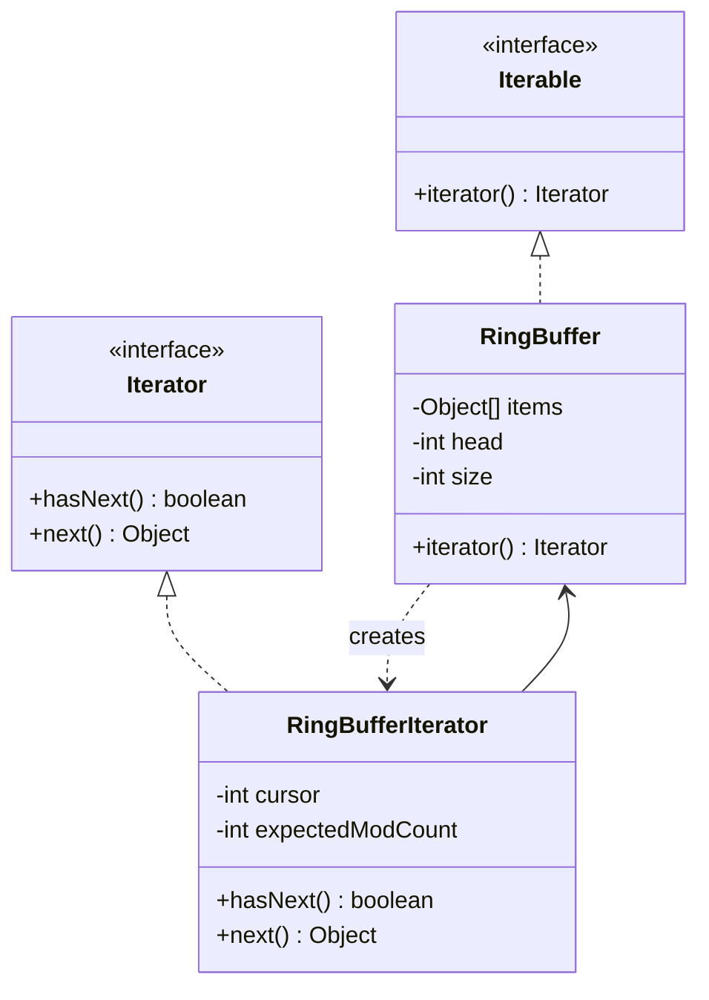

# Iterator Pattern

Back to [[LLD-Index]].

## Problem

Clients need to walk a collection (array, linked list, tree, paged API result) but should not depend on how it stores elements. Exposing internals (the array, the `head` node) breaks encapsulation and ties every client to one representation. You may also want several traversals at once or different orders (in-order, level-order).

## Motivation

- Move traversal state (cursor) into a separate **iterator** object with `hasNext()` / `next()`.
- The **aggregate** exposes a factory method `iterator()`.
- Multiple independent iterators can walk the same aggregate concurrently (read-only).
- Traversal logic is separated from storage ([[Single-Responsibility-Principle]]).
- Language support: Java `Iterable` enables the for-each loop; C++ range-for uses `begin()`/`end()`.

## Structure



## Implementation

### Java: fail-fast iterator over a ring buffer

```java
import java.util.ConcurrentModificationException;
import java.util.Iterator;
import java.util.NoSuchElementException;

final class RingBuffer<T> implements Iterable<T> {
    private final Object[] items;
    private int head = 0, size = 0;
    private int modCount = 0;                     // bumped on structural change

    RingBuffer(int capacity) { items = new Object[capacity]; }

    void add(T item) {
        int tail = (head + size) % items.length;
        items[tail] = item;
        if (size == items.length) head = (head + 1) % items.length; // overwrite oldest
        else size++;
        modCount++;
    }

    @Override
    public Iterator<T> iterator() {
        return new Iterator<T>() {
            private int visited = 0;
            private final int expectedModCount = modCount;

            @Override public boolean hasNext() { return visited < size; }

            @Override
            @SuppressWarnings("unchecked")
            public T next() {
                if (modCount != expectedModCount) throw new ConcurrentModificationException();
                if (!hasNext()) throw new NoSuchElementException();
                T item = (T) items[(head + visited) % items.length];
                visited++;
                return item;
            }
        };
    }
}

// Tree traversal as an iterator (in-order, explicit stack instead of recursion)
final class Bst implements Iterable<Integer> {
    private static final class Node { int v; Node l, r; Node(int v) { this.v = v; } }
    private Node root;

    void insert(int v) { root = insert(root, v); }
    private Node insert(Node n, int v) {
        if (n == null) return new Node(v);
        if (v < n.v) n.l = insert(n.l, v); else n.r = insert(n.r, v);
        return n;
    }

    @Override
    public Iterator<Integer> iterator() {
        return new Iterator<>() {
            private final java.util.ArrayDeque<Node> stack = new java.util.ArrayDeque<>();
            { pushLeft(root); }
            private void pushLeft(Node n) { while (n != null) { stack.push(n); n = n.l; } }
            public boolean hasNext() { return !stack.isEmpty(); }
            public Integer next() {
                if (stack.isEmpty()) throw new NoSuchElementException();
                Node n = stack.pop();
                pushLeft(n.r);
                return n.v;
            }
        };
    }
}

public class IteratorDemo {
    public static void main(String[] args) {
        RingBuffer<String> rb = new RingBuffer<>(3);
        rb.add("a"); rb.add("b"); rb.add("c"); rb.add("d");   // "a" overwritten
        for (String s : rb) System.out.print(s + " ");         // b c d
        System.out.println();

        try {
            for (String s : rb) rb.add(s + "!");                // structural change during iteration
        } catch (ConcurrentModificationException e) {
            System.out.println("fail-fast: " + e.getClass().getSimpleName());
        }

        Bst t = new Bst();
        for (int v : new int[] {5, 2, 8, 1, 3}) t.insert(v);
        for (int v : t) System.out.print(v + " ");              // 1 2 3 5 8
        System.out.println();
    }
}
```

### Java: fail-fast vs fail-safe in the JDK

```java
import java.util.ArrayList;
import java.util.ConcurrentModificationException;
import java.util.Iterator;
import java.util.List;
import java.util.concurrent.CopyOnWriteArrayList;

public class FailFastVsSafe {
    public static void main(String[] args) {
        List<Integer> list = new ArrayList<>(List.of(1, 2, 3, 4));
        try {
            for (Integer x : list) if (x == 2) list.remove(x);   // modifies behind the iterator
        } catch (ConcurrentModificationException e) {
            System.out.println("ArrayList: CME");
        }

        // Correct way on a fail-fast collection: remove via the iterator (or removeIf)
        Iterator<Integer> it = list.iterator();
        while (it.hasNext()) if (it.next() % 2 == 0) it.remove();
        System.out.println(list);                               // [1, 3] (2 may already be gone)

        List<Integer> cow = new CopyOnWriteArrayList<>(List.of(1, 2, 3, 4));
        for (Integer x : cow) if (x == 2) cow.remove(x);        // no exception: iterates a snapshot
        System.out.println(cow);                                // [1, 3, 4]
    }
}
```

## Fail-fast vs fail-safe (weakly consistent)

| | Fail-fast | Fail-safe / weakly consistent |
|---|---|---|
| Examples | `ArrayList`, `HashMap`, `HashSet`, `LinkedList` iterators | `CopyOnWriteArrayList` (snapshot), `ConcurrentHashMap` (weakly consistent), `ConcurrentLinkedQueue` |
| Mechanism | `modCount` checked against `expectedModCount` on `next()` | Snapshot of array, or traversal tolerant of concurrent updates |
| Concurrent modification | Throws `ConcurrentModificationException` on a best-effort basis (not guaranteed; do not rely on it for correctness) | Never throws CME |
| Sees updates made after iterator creation? | N/A (throws) | Snapshot: no. Weakly consistent: may or may not |
| Cost | Cheap | COW: copy on every write. CHM: no copy, weaker guarantees |
| `iterator.remove()` | Supported (safe removal) | COW iterator `remove()` throws `UnsupportedOperationException` |

Also note: iterating the collection from another thread without synchronization is a data race even if no CME is thrown; `Collections.synchronizedList` still requires manual `synchronized (list)` around iteration.

## Tradeoffs

| Pro | Con |
|---|---|
| Hides representation; clients use one interface | Extra object per traversal |
| Multiple simultaneous traversals, multiple traversal orders | External iterators need care with concurrent modification |
| Lazy / infinite sequences (paged APIs, generators) | Stateful cursor; not thread-safe to share one iterator |
| Uniform for-each syntax | For simple arrays, index loops can be faster and clearer |

Internal iteration (`forEach(Consumer)`, streams) lets the collection drive traversal and can parallelize; external iteration (`Iterator`) gives the caller control (early exit, interleaving two sequences).

## When to use

- Exposing traversal of a custom collection (ring buffer, tree, graph, LRU list in [[LRU-Cache-LLD]]).
- Lazy traversal of large or remote data (paging through an API, reading a file line by line).
- Several traversal orders over one structure (pre/in/post-order over a [[Composite-Pattern]] tree).

## When NOT to use

- Standard collections already provide iterators; do not wrap them.
- Random access is the main need: expose `get(i)`.
- A stream pipeline or `forEach` expresses the intent more clearly.

## Real-world example

- `java.util.Iterator<E>` (`hasNext`, `next`, optional `remove`, `forEachRemaining`) and `java.lang.Iterable<T>` (`iterator()`), which enables `for (T x : iterable)`.
- `java.util.ListIterator` adds bidirectional traversal and `set`/`add`.
- `java.util.Spliterator` supports splitting for parallel streams.
- `java.sql.ResultSet.next()` is a cursor-style iterator over rows.
- C++ STL iterators (`begin()`/`end()`, iterator categories: input, forward, bidirectional, random access).

## Pattern comparisons

- **Iterator vs Composite:** iterators commonly traverse [[Composite-Pattern]] trees without exposing children lists.
- **Iterator and Observer:** notification loops over listener lists are the classic place where fail-fast iteration bites; see [[Observer-Pattern]].

## Interview questions

1. **Fail-fast vs fail-safe?** Fail-fast detects structural modification via `modCount` and throws CME; fail-safe iterates a snapshot or tolerates concurrent change without throwing.
2. **How do you remove while iterating an `ArrayList`?** `Iterator.remove()` or `list.removeIf(pred)`; never `list.remove` inside for-each.
3. **Is CME guaranteed?** No, it is best-effort; it signals a bug, it is not a concurrency control.
4. **Why is `CopyOnWriteArrayList` good for listener lists?** Reads (notify) vastly outnumber writes (subscribe); snapshot iteration allows unsubscribing during notify.
5. **Implement an in-order BST iterator in O(h) space.** Stack of left spine; on `next`, pop, push left spine of right child. Amortized O(1) per `next`.
6. **External vs internal iteration?** External: caller pulls (`Iterator`). Internal: collection pushes to a callback (`forEach`, streams), enabling parallelism.
7. **Design an iterator over a list of iterators (flatten / round-robin).** Keep a queue of non-empty iterators; `next` takes from the head and re-queues it if it still has elements.
