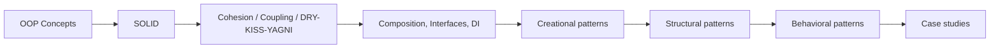
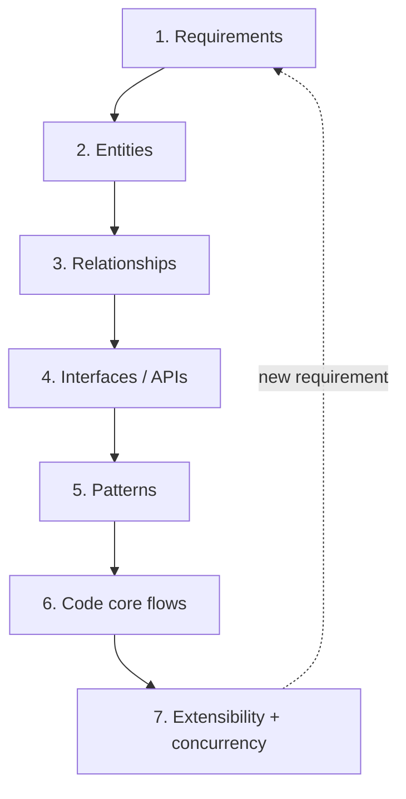

# LLD Index

Low-Level Design (LLD, also "machine coding" or "object-oriented design") interviews test whether you can turn a vague problem into classes, interfaces and code that are correct, readable and cheap to extend. This index is the entry point: learn the principles, then the patterns, then drill case studies.

## Learning Order

- [ ] Stage 0 — [[OOP-Concepts]]: encapsulation, abstraction, inheritance, polymorphism.
- [ ] Stage 1 — SOLID, in order:
  - [ ] [[Single-Responsibility-Principle]]
  - [ ] [[Open-Closed-Principle]]
  - [ ] [[Liskov-Substitution-Principle]]
  - [ ] [[Interface-Segregation-Principle]]
  - [ ] [[Dependency-Inversion-Principle]]
- [ ] Stage 2 — Design heuristics:
  - [ ] [[Cohesion-and-Coupling]]
  - [ ] [[DRY-KISS-YAGNI]]
  - [ ] [[Composition-vs-Inheritance]]
  - [ ] [[Interfaces-and-Abstraction]]
  - [ ] [[Dependency-Injection]]
- [ ] Stage 3 — Creational patterns:
  - [ ] [[Factory-Method-Pattern]]
  - [ ] [[Abstract-Factory-Pattern]]
  - [ ] [[Builder-Pattern]]
  - [ ] [[Singleton-Pattern]]
- [ ] Stage 4 — Structural patterns:
  - [ ] [[Adapter-Pattern]]
  - [ ] [[Decorator-Pattern]]
  - [ ] [[Facade-Pattern]]
  - [ ] [[Proxy-Pattern]]
  - [ ] [[Composite-Pattern]]
- [ ] Stage 5 — Behavioral patterns (highest interview yield: Strategy, Observer, State, Command):
  - [ ] [[Strategy-Pattern]]
  - [ ] [[Observer-Pattern]]
  - [ ] [[State-Pattern]]
  - [ ] [[Command-Pattern]]
  - [ ] [[Template-Method-Pattern]]
  - [ ] [[Chain-of-Responsibility-Pattern]]
  - [ ] [[Iterator-Pattern]]
- [ ] Stage 6 — Case studies (do each on a blank page, timed, before reading):
  - [ ] [[LRU-Cache-LLD]] — data-structure design, O(1) ops
  - [ ] [[Parking-Lot-LLD]] — the canonical warm-up
  - [ ] [[Rate-Limiter-LLD]] — algorithms + concurrency
  - [ ] [[Logger-Framework-LLD]] — Chain of Responsibility, Singleton, async
  - [ ] [[Library-Management-LLD]] — entity modelling, Observer
  - [ ] [[Elevator-System-LLD]] — State + scheduling Strategy
  - [ ] [[Splitwise-LLD]] — split strategies, debt simplification
  - [ ] [[BookMyShow-LLD]] — seat locking and concurrency

## The Interview Method

Use the same seven steps every time. Say each step out loud; interviewers grade process as much as output.

### 1. Requirements (3-5 min)
- Ask clarifying questions; write functional requirements as a numbered list and **explicitly mark what is out of scope** (payments, auth, UI, persistence are usually out).
- Pin down the actors (who calls the system) and the 3-4 core use cases you will actually code.
- Non-functional in LLD means: thread-safety, extensibility, testability — not QPS.

### 2. Entities (nouns)
- Extract nouns from the requirements: `ParkingLot`, `Spot`, `Ticket`, `Vehicle`. Drop nouns that are only attributes (colour, name).
- Separate **entities** (identity, lifecycle) from **value objects** (immutable, compared by value: `Money`, `TimeSlot`).
- Use enums for closed sets (`SpotType`, `SeatStatus`), classes for open sets that will grow behaviour.

### 3. Relationships
- Is-a vs has-a ([[Composition-vs-Inheritance]]). Default to composition.
- Multiplicity (1..*), ownership (composition `*--` vs aggregation `o--`), direction of navigation.
- Draw the class diagram now — interviewers expect one.

### 4. Interfaces (verbs)
- Verbs become methods; group them into small role interfaces ([[Interface-Segregation-Principle]]).
- Public API of the system first (`park(vehicle) -> Ticket`, `unpark(ticket) -> Receipt`), then internal collaborators.
- Depend on interfaces at every point that might vary ([[Dependency-Inversion-Principle]]).

### 5. Patterns — only where a force demands one
| Force in the requirements | Pattern |
|---|---|
| "Algorithm/policy may change" (pricing, allocation, splitting) | [[Strategy-Pattern]] |
| "Behaviour depends on current status" (elevator, order, ATM) | [[State-Pattern]] |
| "Notify X when Y happens" | [[Observer-Pattern]] |
| "Undo / queue / log operations" | [[Command-Pattern]] |
| "Pass request through ordered handlers" (log levels, filters, approvals) | [[Chain-of-Responsibility-Pattern]] |
| "Create family/variant of objects" | [[Factory-Method-Pattern]], [[Abstract-Factory-Pattern]] |
| "Object with many optional fields" | [[Builder-Pattern]] |
| "Exactly one shared instance" (registry, config) | [[Singleton-Pattern]] — prefer DI scope |
| "Add behaviour without subclass explosion" | [[Decorator-Pattern]] |
| "Integrate an incompatible third-party API" | [[Adapter-Pattern]] |
| "Tree of part-whole objects" | [[Composite-Pattern]] |
| "Control access / lazy load / remote" | [[Proxy-Pattern]] |
| "Simple entry point over a subsystem" | [[Facade-Pattern]] |
| "Fixed skeleton, variable steps" | [[Template-Method-Pattern]] |
| "Traverse without exposing internals" | [[Iterator-Pattern]] |

Name the pattern **and the reason** ("Strategy because pricing changes per lot and must be swappable at runtime"). Pattern-stuffing without a force is a negative signal ([[DRY-KISS-YAGNI]]).

### 6. Code
- Code the core flows end-to-end in one language; skip getters/setters and boilerplate unless asked.
- Keep services thin and entities meaningful (avoid an anemic model where all logic sits in one `Manager`).
- Validate inputs, use enums, throw specific exceptions, return immutable views of collections.

### 7. Extensibility and concurrency
- Walk through 2-3 likely follow-ups and show which single class changes ([[Open-Closed-Principle]]).
- Identify shared mutable state; choose a strategy: per-object locks, `ConcurrentHashMap`, atomic compare-and-set, optimistic versioning, or single-writer queue.

## Common Failure Modes

- Jumping to code before requirements and a diagram.
- God class (`ParkingLotManager` with 30 methods) — violates [[Single-Responsibility-Principle]], see [[Cohesion-and-Coupling]].
- Inheritance hierarchies for variation that is really a strategy (`CarWithHourlyPricing`).
- `instanceof`/`switch` on type spread across the codebase — replace with polymorphism.
- Ignoring concurrency when the problem obviously has contention (seat booking, spot allocation).
- Singletons everywhere, making the design untestable ([[Dependency-Injection]]).

## Related

- [[OOP-Concepts]]
