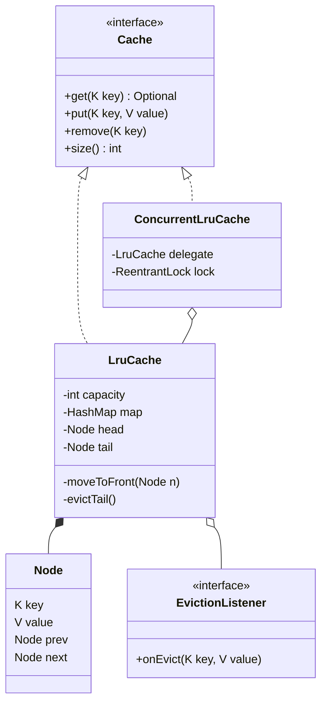

# LRU Cache LLD

Back to [[LLD-Index]].

## Clarifying questions

1. Capacity by entry count or by bytes/weight?
2. `get`/`put` must be O(1)? (Almost always yes.)
3. Single-threaded or concurrent access?
4. Is eviction policy fixed to LRU, or should LFU/FIFO be pluggable?
5. TTL per entry? Eviction callbacks (e.g. flush to disk)?
6. Is `null` a valid value?

## Requirements

### Functional (in scope)

- `get(key)`: return value and mark as most recently used, or empty.
- `put(key, value)`: insert/update, mark as MRU; if over capacity, evict the LRU entry.
- `remove(key)`, `size()`.
- Optional eviction listener.

### Non-functional

- `get` and `put` in O(1) time; O(capacity) space.
- Thread-safe variant for concurrent callers.
- Eviction policy replaceable without rewriting storage.

### Out of scope

Distributed caching, persistence, size-in-bytes weighing (follow-up).

## Entities

| Entity | Responsibility |
|---|---|
| `Cache<K,V>` | Public interface. |
| `LruCache<K,V>` | HashMap for lookup + doubly linked list for recency. |
| `Node<K,V>` | key, value, prev, next. Key stored so eviction can delete from map. |
| `EvictionListener<K,V>` | Callback on eviction. |
| `ConcurrentLruCache<K,V>` | Lock-guarded wrapper. |

## Why HashMap + doubly linked list

- HashMap gives O(1) key to node.
- Doubly linked list gives O(1) move-to-front and O(1) remove-tail **given the node pointer**. A singly linked list cannot unlink in O(1) because it needs the predecessor.
- Sentinel head/tail nodes remove all null checks at the edges.
- Java's `LinkedHashMap(capacity, 0.75f, true)` with `removeEldestEntry` does the same; say so, but interviewers usually want it built by hand.

## Class diagram



## Core Java code

Single file, compiles with `javac LruDemo.java` (Java 17+).

```java
import java.util.*;
import java.util.concurrent.locks.ReentrantLock;
import java.util.function.Function;

interface Cache<K, V> {
    Optional<V> get(K key);
    void put(K key, V value);
    void remove(K key);
    int size();
}

interface EvictionListener<K, V> { void onEvict(K key, V value); }

final class LruCache<K, V> implements Cache<K, V> {
    private static final class Node<K, V> {
        K key; V value; Node<K, V> prev, next;
        Node(K k, V v) { key = k; value = v; }
    }

    private final int capacity;
    private final Map<K, Node<K, V>> map;
    private final Node<K, V> head = new Node<>(null, null); // MRU side sentinel
    private final Node<K, V> tail = new Node<>(null, null); // LRU side sentinel
    private final EvictionListener<K, V> listener;

    LruCache(int capacity, EvictionListener<K, V> listener) {
        if (capacity <= 0) throw new IllegalArgumentException("capacity must be > 0");
        this.capacity = capacity;
        this.map = new HashMap<>(capacity * 4 / 3 + 1);
        this.listener = listener == null ? (k, v) -> {} : listener;
        head.next = tail; tail.prev = head;
    }

    public Optional<V> get(K key) {
        Node<K, V> n = map.get(key);
        if (n == null) return Optional.empty();
        moveToFront(n);
        return Optional.ofNullable(n.value);
    }

    public void put(K key, V value) {
        Node<K, V> n = map.get(key);
        if (n != null) { n.value = value; moveToFront(n); return; }
        if (map.size() == capacity) evictTail();
        n = new Node<>(key, value);
        map.put(key, n);
        addFront(n);
    }

    public void remove(K key) {
        Node<K, V> n = map.remove(key);
        if (n != null) unlink(n);
    }

    public int size() { return map.size(); }

    private void addFront(Node<K, V> n) {
        n.prev = head; n.next = head.next;
        head.next.prev = n; head.next = n;
    }
    private void unlink(Node<K, V> n) {
        n.prev.next = n.next; n.next.prev = n.prev;
        n.prev = n.next = null;
    }
    private void moveToFront(Node<K, V> n) { unlink(n); addFront(n); }
    private void evictTail() {
        Node<K, V> lru = tail.prev;
        if (lru == head) return;
        unlink(lru);
        map.remove(lru.key);
        listener.onEvict(lru.key, lru.value);
    }

    List<K> keysMruToLru() {
        List<K> out = new ArrayList<>();
        for (Node<K, V> n = head.next; n != tail; n = n.next) out.add(n.key);
        return out;
    }
}

/**
 * Thread-safe variant. A plain ReadWriteLock does NOT help: get() mutates recency order,
 * so every operation is a write. One exclusive lock is correct; contention is the cost.
 */
final class ConcurrentLruCache<K, V> implements Cache<K, V> {
    private final LruCache<K, V> delegate;
    private final ReentrantLock lock = new ReentrantLock();

    ConcurrentLruCache(int capacity, EvictionListener<K, V> listener) { delegate = new LruCache<>(capacity, listener); }

    public Optional<V> get(K key) { lock.lock(); try { return delegate.get(key); } finally { lock.unlock(); } }
    public void put(K key, V value) { lock.lock(); try { delegate.put(key, value); } finally { lock.unlock(); } }
    public void remove(K key) { lock.lock(); try { delegate.remove(key); } finally { lock.unlock(); } }
    public int size() { lock.lock(); try { return delegate.size(); } finally { lock.unlock(); } }

    /** Load-through: compute under the lock so two threads never load the same key twice. */
    public V getOrLoad(K key, Function<K, V> loader) {
        lock.lock();
        try {
            Optional<V> v = delegate.get(key);
            if (v.isPresent()) return v.get();
            V loaded = loader.apply(key);
            delegate.put(key, loaded);
            return loaded;
        } finally { lock.unlock(); }
    }
}

/**
 * Striped variant: N independent LRU segments chosen by key hash.
 * Much less contention; LRU is approximate (per segment, not global).
 */
final class StripedLruCache<K, V> implements Cache<K, V> {
    private final List<ConcurrentLruCache<K, V>> segments = new ArrayList<>();

    StripedLruCache(int capacity, int stripes) {
        int per = Math.max(1, capacity / stripes);
        for (int i = 0; i < stripes; i++) segments.add(new ConcurrentLruCache<>(per, null));
    }
    private ConcurrentLruCache<K, V> seg(K key) {
        int h = key.hashCode(); h ^= (h >>> 16);
        return segments.get(Math.floorMod(h, segments.size()));
    }
    public Optional<V> get(K key) { return seg(key).get(key); }
    public void put(K key, V value) { seg(key).put(key, value); }
    public void remove(K key) { seg(key).remove(key); }
    public int size() { return segments.stream().mapToInt(ConcurrentLruCache::size).sum(); }
}

public class LruDemo {
    public static void main(String[] args) {
        LruCache<Integer, String> c = new LruCache<>(2, (k, v) -> System.out.println("evicted " + k));
        c.put(1, "a"); c.put(2, "b");
        c.get(1);          // order: 1, 2
        c.put(3, "c");     // evicts 2
        System.out.println(c.keysMruToLru()); // [3, 1]
        System.out.println(c.get(2).isPresent()); // false
    }
}
```

## Complexity

| Operation | Time | Notes |
|---|---|---|
| `get` | O(1) average | HashMap lookup + pointer relink. |
| `put` | O(1) average | Possible single eviction. |
| `remove` | O(1) average | |
| Space | O(capacity) | One node + one map entry per key. |

## Patterns used and why

| Pattern | Where | Why |
|---|---|---|
| [[Decorator-Pattern]] / [[Proxy-Pattern]] | `ConcurrentLruCache` wraps `LruCache` | Adds locking without changing the core algorithm; single-threaded users skip the lock cost. |
| [[Strategy-Pattern]] | Eviction policy (follow-up) | LRU, LFU, FIFO behind an `EvictionPolicy` interface: `onAccess`, `onInsert`, `victim()`. |
| [[Observer-Pattern]] | `EvictionListener` | Callers react to evictions (write-back, metrics). |
| [[Interface-Segregation-Principle]] | `Cache` | Small surface; clients depend only on get/put/remove. |

## Concurrency concerns

- `get` is a **write** to the recency list. `ReadWriteLock` or `ConcurrentHashMap` alone does not make the linked list safe.
- Global lock: simple and correct; the bottleneck under high contention.
- Striping: per-segment locks; LRU becomes approximate. State this trade-off explicitly.
- Production caches (e.g. Caffeine) avoid the lock on reads by recording accesses into buffers and replaying them asynchronously. Caffeine (per its design wiki) records reads into striped lossy ring buffers and writes into a bounded write buffer, draining them under a single lock to update its W-TinyLFU policy — so reads rarely contend.
- **Cache stampede:** many threads miss the same key and all call the loader. `getOrLoad` under the lock prevents duplicate loads but serializes loaders; a per-key future map (`ConcurrentHashMap<K, CompletableFuture<V>>`) avoids blocking other keys.
- Eviction listener runs under the lock in this code; a slow listener blocks the cache. Collect evictions and fire them after unlocking in production.

## Extensibility follow-ups

| Follow-up | How |
|---|---|
| TTL per entry | Store `expiresAt` in node; check on `get` (lazy) plus periodic sweep. |
| LFU instead of LRU | Map key -> node, map freq -> doubly linked list, track `minFreq`: O(1). Plug via eviction strategy. |
| Capacity in bytes | `Weigher<K,V>`; evict until `totalWeight <= max`. |
| Generic over K/V with nulls | Wrap values or disallow null (current code returns `Optional.empty()` for a stored null, which is ambiguous; document or forbid). |
| Metrics | Hit/miss counters as `LongAdder`. |
| Distributed cache | Out of LLD scope; consistent hashing across nodes. |

## Common interview pitfalls

- Using a singly linked list or `ArrayList` for order: removal becomes O(n).
- Forgetting to store the key in the node, so eviction cannot remove the map entry.
- Updating an existing key but not moving it to front.
- Evicting before checking whether the key already exists (evicts needlessly when updating a full cache).
- Claiming `ConcurrentHashMap` + `ConcurrentLinkedDeque` is thread-safe LRU: `remove(Object)` on the deque is O(n) and the two structures are not updated atomically together.
- Using `synchronized` on `get` only, not `put`, or vice versa.
