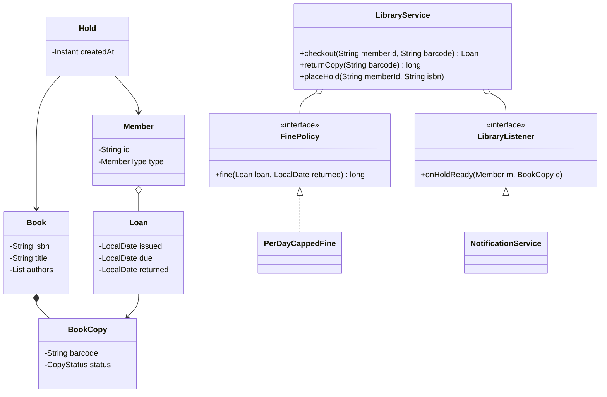

# Library Management LLD

Back to [[LLD-Index]].

## Clarifying questions

1. Do we distinguish a **book title** (ISBN, metadata) from a **physical copy** (barcode)? (Yes; this is the key modeling decision.)
2. Member types with different limits (student vs faculty)?
3. Borrow period, renewals, max books per member?
4. Holds/reservations when all copies are out? Queue order?
5. Fines: per day, capped? Payment in scope?
6. Search by title/author/subject needed?
7. Notifications (hold available, due soon, overdue)?

## Requirements

### Functional (in scope)

- Catalog: add titles and copies; search by title, author, ISBN.
- Checkout a copy to a member, subject to member limits and holds.
- Return a copy; compute fine if overdue; if holds exist, assign copy to next member and notify.
- Place a hold on a title when no copy is available.
- Renew if no one is waiting.

### Non-functional

- Two librarians cannot check out the same copy concurrently.
- Fine policy and member limits change without code edits to core flows.

### Out of scope

Payment gateway, digital lending, inter-library loan, persistence.

## Entities

| Entity | Responsibility |
|---|---|
| `Book` | Title-level: ISBN, title, authors. |
| `BookCopy` | Physical item: barcode, status (`AVAILABLE`, `LOANED`, `ON_HOLD_SHELF`, `LOST`). |
| `Member` | Id, name, `MemberType` (limits). |
| `Loan` | copy, member, issue date, due date, return date. |
| `Hold` | member, book, created at. FIFO per book. |
| `Catalog` | Indexes for search. |
| `FinePolicy` | Computes fine for a loan. |
| `LibraryService` | Facade orchestrating checkout/return/hold. |
| `NotificationService` | Observer that sends messages. |

## Relationships

- `Book` 1 to many `BookCopy` (composition).
- `Member` 1 to many `Loan`; `Loan` references exactly one `BookCopy`.
- `Book` 1 to many `Hold` (FIFO queue).
- `LibraryService` aggregates `Catalog`, `FinePolicy`, listeners.

## Class diagram



## Core Java code

Single file, compiles with `javac LibraryDemo.java` (Java 17+).

```java
import java.time.LocalDate;
import java.time.temporal.ChronoUnit;
import java.util.*;
import java.util.concurrent.ConcurrentHashMap;
import java.util.concurrent.CopyOnWriteArrayList;

enum CopyStatus { AVAILABLE, LOANED, ON_HOLD_SHELF, LOST }

enum MemberType {
    STUDENT(3, 14), FACULTY(10, 30);
    final int maxLoans, loanDays;
    MemberType(int maxLoans, int loanDays) { this.maxLoans = maxLoans; this.loanDays = loanDays; }
}

record Book(String isbn, String title, List<String> authors) {}

final class BookCopy {
    final String barcode; final Book book;
    CopyStatus status = CopyStatus.AVAILABLE;
    String reservedFor; // member id when ON_HOLD_SHELF
    BookCopy(String barcode, Book book) { this.barcode = barcode; this.book = book; }
}

final class Member {
    final String id; final String name; final MemberType type;
    final Set<Loan> activeLoans = new HashSet<>();
    Member(String id, String name, MemberType type) { this.id = id; this.name = name; this.type = type; }
}

final class Loan {
    final BookCopy copy; final Member member; final LocalDate issued; LocalDate due; LocalDate returned;
    Loan(BookCopy c, Member m, LocalDate issued) { copy = c; member = m; this.issued = issued; due = issued.plusDays(m.type.loanDays); }
}

interface FinePolicy { long fine(Loan loan, LocalDate returnedOn); }

final class PerDayCappedFine implements FinePolicy {
    private final long perDay, cap;
    PerDayCappedFine(long perDay, long cap) { this.perDay = perDay; this.cap = cap; }
    public long fine(Loan l, LocalDate r) {
        long late = ChronoUnit.DAYS.between(l.due, r);
        return late <= 0 ? 0 : Math.min(cap, late * perDay);
    }
}

interface LibraryListener { void onHoldReady(Member m, BookCopy c); }

final class Catalog {
    private final Map<String, Book> byIsbn = new ConcurrentHashMap<>();
    private final Map<String, List<BookCopy>> copies = new ConcurrentHashMap<>();
    private final Map<String, BookCopy> byBarcode = new ConcurrentHashMap<>();

    void addBook(Book b) { byIsbn.put(b.isbn(), b); copies.putIfAbsent(b.isbn(), new CopyOnWriteArrayList<>()); }
    BookCopy addCopy(String isbn, String barcode) {
        BookCopy c = new BookCopy(barcode, Objects.requireNonNull(byIsbn.get(isbn)));
        copies.get(isbn).add(c); byBarcode.put(barcode, c); return c;
    }
    Optional<BookCopy> copy(String barcode) { return Optional.ofNullable(byBarcode.get(barcode)); }
    Optional<Book> book(String isbn) { return Optional.ofNullable(byIsbn.get(isbn)); }
    List<BookCopy> copiesOf(String isbn) { return copies.getOrDefault(isbn, List.of()); }
    List<Book> searchTitle(String q) {
        String s = q.toLowerCase();
        return byIsbn.values().stream().filter(b -> b.title().toLowerCase().contains(s)).toList();
    }
}

final class LibraryService {
    private final Catalog catalog;
    private final FinePolicy finePolicy;
    private final Map<String, Member> members = new ConcurrentHashMap<>();
    private final Map<String, Deque<String>> holds = new HashMap<>();   // isbn -> member ids, FIFO
    private final Map<String, Loan> loansByBarcode = new HashMap<>();
    private final List<LibraryListener> listeners = new CopyOnWriteArrayList<>();

    LibraryService(Catalog catalog, FinePolicy finePolicy) { this.catalog = catalog; this.finePolicy = finePolicy; }
    void addMember(Member m) { members.put(m.id, m); }
    void subscribe(LibraryListener l) { listeners.add(l); }

    // Single lock around state transitions: simple, correct; library traffic is low.
    synchronized Loan checkout(String memberId, String barcode, LocalDate today) {
        Member m = req(members.get(memberId), "member");
        BookCopy c = catalog.copy(barcode).orElseThrow(() -> new IllegalArgumentException("copy"));
        if (m.activeLoans.size() >= m.type.maxLoans) throw new IllegalStateException("loan limit reached");
        boolean reservedForMe = c.status == CopyStatus.ON_HOLD_SHELF && memberId.equals(c.reservedFor);
        if (c.status != CopyStatus.AVAILABLE && !reservedForMe) throw new IllegalStateException("copy not available");
        c.status = CopyStatus.LOANED; c.reservedFor = null;
        Loan loan = new Loan(c, m, today);
        m.activeLoans.add(loan); loansByBarcode.put(barcode, loan);
        return loan;
    }

    /** Returns fine in minor units. */
    synchronized long returnCopy(String barcode, LocalDate today) {
        Loan loan = req(loansByBarcode.remove(barcode), "active loan");
        loan.returned = today;
        loan.member.activeLoans.remove(loan);
        long fine = finePolicy.fine(loan, today);
        BookCopy c = loan.copy;
        Deque<String> q = holds.get(c.book.isbn());
        String next = q == null ? null : q.pollFirst();
        if (next != null) {
            c.status = CopyStatus.ON_HOLD_SHELF; c.reservedFor = next;
            Member nm = members.get(next);
            listeners.forEach(l -> l.onHoldReady(nm, c));
        } else {
            c.status = CopyStatus.AVAILABLE;
        }
        return fine;
    }

    synchronized void placeHold(String memberId, String isbn) {
        req(members.get(memberId), "member");
        boolean anyAvailable = catalog.copiesOf(isbn).stream().anyMatch(c -> c.status == CopyStatus.AVAILABLE);
        if (anyAvailable) throw new IllegalStateException("copy available; checkout instead");
        Deque<String> q = holds.computeIfAbsent(isbn, k -> new ArrayDeque<>());
        if (!q.contains(memberId)) q.addLast(memberId);
    }

    synchronized void renew(String barcode) {
        Loan loan = req(loansByBarcode.get(barcode), "active loan");
        Deque<String> q = holds.get(loan.copy.book.isbn());
        if (q != null && !q.isEmpty()) throw new IllegalStateException("others are waiting");
        loan.due = loan.due.plusDays(loan.member.type.loanDays);
    }

    private static <T> T req(T t, String what) { if (t == null) throw new IllegalArgumentException("unknown " + what); return t; }
}

public class LibraryDemo {
    public static void main(String[] args) {
        Catalog cat = new Catalog();
        cat.addBook(new Book("978-0", "Clean Code", List.of("Robert C. Martin")));
        cat.addCopy("978-0", "BC-1");
        LibraryService lib = new LibraryService(cat, new PerDayCappedFine(500, 10_000));
        lib.addMember(new Member("m1", "Asha", MemberType.STUDENT));
        lib.addMember(new Member("m2", "Ravi", MemberType.STUDENT));
        lib.subscribe((m, c) -> System.out.println("notify " + m.name + ": " + c.book.title() + " ready"));
        LocalDate d = LocalDate.of(2026, 1, 1);
        lib.checkout("m1", "BC-1", d);
        lib.placeHold("m2", "978-0");
        System.out.println("fine=" + lib.returnCopy("BC-1", d.plusDays(20)));
        lib.checkout("m2", "BC-1", d.plusDays(21));
    }
}
```

## Patterns used and why

| Pattern | Where | Why |
|---|---|---|
| [[Facade-Pattern]] | `LibraryService` | UI/controllers call use-case methods; entities stay simple. |
| [[Strategy-Pattern]] | `FinePolicy` | Fine rules vary by library/member type. |
| [[Observer-Pattern]] | `LibraryListener` | Hold-ready, due-soon, overdue notifications decoupled from core logic. |
| [[State-Pattern]] | `BookCopy` status (follow-up) | Once transitions grow (lost, damaged, in repair), state objects enforce legal transitions. |
| [[Single-Responsibility-Principle]] | `Catalog` vs `LibraryService` | Search/indexing separate from lending rules. |

## Concurrency concerns

- Checkout of the same copy from two desks: guarded by the service lock. At DB level use a conditional update on copy status.
- Hold assignment happens in the same critical section as return, so a walk-in member cannot grab a copy that was just reserved.
- Listeners are called inside the lock here; move to an async queue if notification is slow.
- One global lock is acceptable for library-scale traffic; say so rather than prematurely striping by ISBN.

## Extensibility follow-ups

| Follow-up | How |
|---|---|
| Hold expires if not picked up in N days | Store `holdReadyAt`; scheduled job moves copy to next hold or `AVAILABLE`. |
| Different limits per member type | Already in `MemberType`; move to config-driven `MemberPolicy` if types are dynamic. |
| E-books with concurrent licenses | `DigitalCopy` with license count; checkout decrements. |
| Search by author/subject, fuzzy | Separate `SearchIndex` interface; in-memory inverted index or external engine. |
| Fine waivers | [[Decorator-Pattern]] over `FinePolicy`. |
| Audit trail | Record each operation as a command object ([[Command-Pattern]]). |

## Common interview pitfalls

- Treating `Book` as the thing being lent. You lend copies; holds are on titles.
- Putting `checkout()` on `Member` or `Book` (god-object entities, poor [[Cohesion-and-Coupling]]).
- Forgetting the hold queue when a copy is returned.
- Allowing renewal when others are waiting.
- Using inheritance `StudentMember extends Member` just for different limits; data-driven type is simpler ([[Composition-vs-Inheritance]]).
