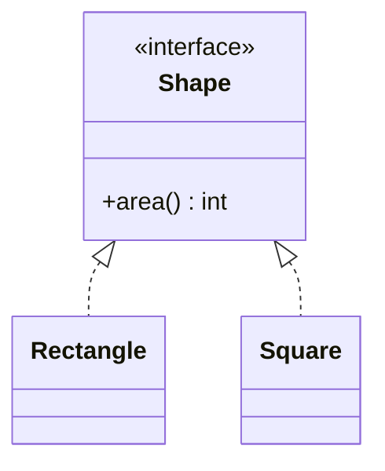

# Liskov Substitution Principle

Back to [[LLD-Index]].

## Definition

Barbara Liskov, keynote "Data Abstraction and Hierarchy" (OOPSLA 1987); formalised with Jeannette Wing (1994):

> If for each object o1 of type S there is an object o2 of type T such that for all programs P defined in terms of T, the behaviour of P is unchanged when o1 is substituted for o2, then S is a subtype of T.

Practical contract rules (Design by Contract view) for a subtype:

- **Preconditions** cannot be strengthened.
- **Postconditions** cannot be weakened.
- **Invariants** of the supertype must be preserved.
- **History constraint:** a subtype must not allow state changes the supertype forbids (e.g. mutable subtype of an immutable type).
- No new checked exceptions beyond those the base declares (Java enforces this for checked; unchecked ones are on you).

## Violating example

The classic Rectangle/Square: mathematically a square is a rectangle, behaviourally it is not.

```java
class Rectangle {
    protected int width, height;
    void setWidth(int w)  { this.width = w; }
    void setHeight(int h) { this.height = h; }
    int area() { return width * height; }
}

class Square extends Rectangle {
    @Override void setWidth(int w)  { this.width = w; this.height = w; }
    @Override void setHeight(int h) { this.width = h; this.height = h; }
}

public class LspBroken {
    static void resize(Rectangle r) {
        r.setWidth(5);
        r.setHeight(4);
        if (r.area() != 20) throw new AssertionError("Expected 20, got " + r.area());
    }
    public static void main(String[] args) {
        resize(new Rectangle());  // ok
        resize(new Square());     // fails: 16
    }
}
```

Other common violations: `UnsupportedOperationException` in an override (`Collections.unmodifiableList().add`), a `ReadOnlyFile.write()` that no-ops, an override that returns `null` where base promised non-null.

## Refactored

Drop the inheritance; model the shared capability, and use immutable values so there is no setter contract to break.

```java
interface Shape {
    int area();
}

final class Rectangle implements Shape {
    private final int width, height;
    Rectangle(int width, int height) { this.width = width; this.height = height; }
    Rectangle withWidth(int w)  { return new Rectangle(w, height); }
    Rectangle withHeight(int h) { return new Rectangle(width, h); }
    public int area() { return width * height; }
}

final class Square implements Shape {
    private final int side;
    Square(int side) { this.side = side; }
    Square withSide(int s) { return new Square(s); }
    public int area() { return side * side; }
}

public class LspFixed {
    static int totalArea(Shape... shapes) {
        int sum = 0;
        for (Shape s : shapes) sum += s.area();
        return sum;
    }
    public static void main(String[] args) {
        System.out.println(totalArea(new Rectangle(5, 4), new Square(4)));
    }
}
```



## Detecting violations in code review

- Overrides that throw `UnsupportedOperationException` or have empty bodies.
- Callers doing `if (x instanceof Sub)` before calling a base method.
- Subclass adds validation that rejects inputs the base accepted (strengthened precondition).
- Overrides that ignore arguments or return sentinel/`null` values.
- Tests written against the base class fail when run against a subclass (run the base contract test suite against every implementation).
- Inheritance chosen for code reuse where "is-a" only holds by name.

## Tradeoffs and over-application

- Strict LSP pushes you toward smaller interfaces and composition; that is usually good but adds types.
- The JDK itself trades LSP for API size (optional operations in `java.util.Collection`); documented optional behaviour is a deliberate, known compromise.
- LSP is about **behaviour clients rely on**; you only need to honour the documented contract, not incidental behaviour.

## Related patterns

[[Template-Method-Pattern]] (subclasses must respect the skeleton's contract), [[Strategy-Pattern]], [[Composite-Pattern]] (leaf vs composite `add()` is a known LSP tension), [[Composition-vs-Inheritance]], [[Interface-Segregation-Principle]].

## Interview questions

1. **Why is Square extends Rectangle wrong?** It breaks the implicit postcondition of `setWidth` (height unchanged), so code written for Rectangle misbehaves.
2. **Can a subclass throw a new exception?** Not one the client isn't prepared for; that weakens the contract.
3. **Covariant return types — LSP-safe?** Yes (return is narrower = stronger postcondition). Contravariant parameters would also be safe; Java treats differing parameter types as overloads.
4. **How to enforce LSP?** Abstract contract tests run against every implementation; document pre/postconditions.
5. **Fix for LSP violations?** Split the interface (ISP), prefer composition, or make types immutable.
