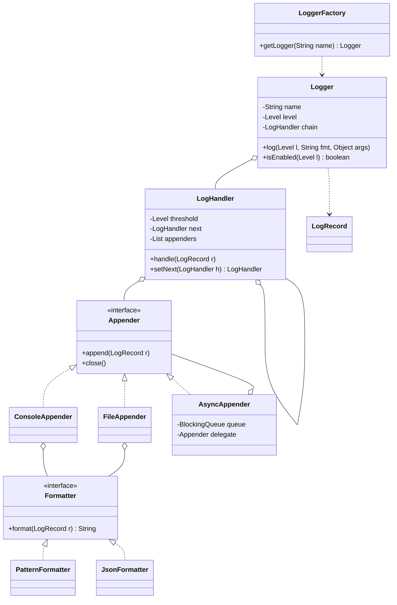

# Logger Framework LLD

Back to [[LLD-Index]].

## Clarifying questions

1. Levels needed? (Assume `TRACE < DEBUG < INFO < WARN < ERROR < FATAL`.)
2. Destinations: console, file, remote? Multiple at once?
3. Output format configurable (plain text, JSON)?
4. Per-logger (per class/package) levels, with hierarchy inheritance?
5. Must logging block the caller? Is losing logs on overload acceptable?
6. File rotation by size/time?
7. Configuration from a file, or programmatic only?

## Requirements

### Functional (in scope)

- `logger.info/debug/warn/error(msg, args...)` with lazy formatting.
- Global and per-logger minimum level.
- Multiple appenders: console, file; each with its own formatter and level threshold.
- Level-based routing using chain of responsibility (e.g. ERROR also to an error file).
- Async appender that decouples caller from I/O.

### Non-functional

- Disabled levels cost almost nothing (no string building).
- Thread-safe: concurrent log calls never interleave within a line.
- Caller threads not blocked by slow I/O when async is enabled; explicit overflow policy.
- Flush on shutdown.

### Out of scope

Config-file parsing, MDC/structured context propagation across threads, remote shipping. Follow-ups.

## Entities

| Entity | Responsibility |
|---|---|
| `Level` | Ordered enum. |
| `LogRecord` | timestamp, level, logger name, thread, message, throwable. Immutable. |
| `Logger` | Level check, record creation, hands record to the handler chain. |
| `LoggerFactory` | Returns cached logger per name. |
| `LogHandler` | Chain link: handles records meeting its level, then passes along. |
| `Appender` | Writes a formatted record to a destination. |
| `Formatter` | Record -> String. |
| `AsyncAppender` | Decorator: queue + worker thread around another appender. |

## Relationships

- `LoggerFactory` caches `Logger`s (one per name).
- `Logger` references the head of a `LogHandler` chain.
- Each `LogHandler` has a next `LogHandler` and one or more `Appender`s.
- `Appender` has a `Formatter`. `AsyncAppender` wraps an `Appender`.

## Class diagram



## Chain design choice

Two chain variants exist; state which one you use:

- **Classic CoR (stop at first handler):** each handler either handles or passes. Good when exactly one destination should receive a record.
- **Pass-through chain (used here):** every handler whose threshold is met writes, then always forwards. INFO goes to console; ERROR goes to console and the error file. This matches what logging users expect.

## Core Java code

Single file, compiles with `javac LoggerDemo.java` (Java 17+).

```java
import java.io.*;
import java.nio.charset.StandardCharsets;
import java.time.Instant;
import java.util.*;
import java.util.concurrent.*;
import java.util.concurrent.atomic.AtomicLong;

enum Level { TRACE, DEBUG, INFO, WARN, ERROR, FATAL;
    boolean atLeast(Level other) { return compareTo(other) >= 0; } }

record LogRecord(Instant time, Level level, String logger, String thread, String message, Throwable error) {}

interface Formatter { String format(LogRecord r); }

final class PatternFormatter implements Formatter {
    public String format(LogRecord r) {
        String base = r.time() + " [" + r.thread() + "] " + r.level() + " " + r.logger() + " - " + r.message();
        if (r.error() == null) return base;
        StringWriter sw = new StringWriter(); r.error().printStackTrace(new PrintWriter(sw));
        return base + System.lineSeparator() + sw;
    }
}

final class JsonFormatter implements Formatter {
    private static String esc(String s) { return s.replace("\\", "\\\\").replace("\"", "\\\"").replace("\n", "\\n"); }
    public String format(LogRecord r) {
        return "{\"ts\":\"" + r.time() + "\",\"level\":\"" + r.level() + "\",\"logger\":\"" + esc(r.logger())
             + "\",\"thread\":\"" + esc(r.thread()) + "\",\"msg\":\"" + esc(r.message()) + "\"}";
    }
}

interface Appender extends AutoCloseable {
    void append(LogRecord r);
    @Override void close();
}

final class ConsoleAppender implements Appender {
    private final Formatter f;
    ConsoleAppender(Formatter f) { this.f = f; }
    public void append(LogRecord r) {
        String line = f.format(r);
        PrintStream out = r.level().atLeast(Level.ERROR) ? System.err : System.out;
        synchronized (out) { out.println(line); }   // one println per record: no interleaving within a line
    }
    public void close() { System.out.flush(); }
}

final class FileAppender implements Appender {
    private final Formatter f;
    private final Writer w;
    FileAppender(String path, Formatter f) throws IOException {
        this.f = f;
        this.w = new BufferedWriter(new OutputStreamWriter(new FileOutputStream(path, true), StandardCharsets.UTF_8));
    }
    public synchronized void append(LogRecord r) {
        try { w.write(f.format(r)); w.write(System.lineSeparator()); if (r.level().atLeast(Level.ERROR)) w.flush(); }
        catch (IOException e) { System.err.println("FileAppender failed: " + e.getMessage()); } // never throw into app code
    }
    public synchronized void close() { try { w.flush(); w.close(); } catch (IOException ignored) { } }
}

/**
 * Decorator: callers enqueue and return; one worker drains to the delegate.
 * Overflow policy: drop records below WARN when full, block briefly for WARN and above.
 */
final class AsyncAppender implements Appender {
    private static final LogRecord POISON = new LogRecord(Instant.EPOCH, Level.TRACE, "", "", "", null);
    private final BlockingQueue<LogRecord> queue;
    private final Appender delegate;
    private final Thread worker;
    private final AtomicLong dropped = new AtomicLong();
    private volatile boolean closed;

    AsyncAppender(Appender delegate, int capacity) {
        this.delegate = delegate;
        this.queue = new ArrayBlockingQueue<>(capacity);
        this.worker = new Thread(this::drain, "async-log-worker");
        this.worker.setDaemon(true);
        this.worker.start();
    }
    public void append(LogRecord r) {
        if (closed) return;
        try {
            boolean ok = r.level().atLeast(Level.WARN) ? queue.offer(r, 100, TimeUnit.MILLISECONDS) : queue.offer(r);
            if (!ok) dropped.incrementAndGet();
        } catch (InterruptedException e) { Thread.currentThread().interrupt(); dropped.incrementAndGet(); }
    }
    private void drain() {
        try {
            while (true) {
                LogRecord r = queue.take();
                if (r == POISON) break;
                delegate.append(r);
            }
        } catch (InterruptedException e) { Thread.currentThread().interrupt(); }
    }
    public void close() {
        closed = true;
        try { queue.put(POISON); worker.join(5_000); } catch (InterruptedException e) { Thread.currentThread().interrupt(); }
        delegate.close();
    }
    long dropped() { return dropped.get(); }
}

/** Pass-through chain link: writes if threshold met, then always forwards. */
final class LogHandler {
    private final Level threshold;
    private final List<Appender> appenders;
    private LogHandler next;
    LogHandler(Level threshold, Appender... appenders) { this.threshold = threshold; this.appenders = List.of(appenders); }
    LogHandler setNext(LogHandler n) { this.next = n; return n; }
    void handle(LogRecord r) {
        if (r.level().atLeast(threshold)) for (Appender a : appenders) a.append(r);
        if (next != null) next.handle(r);
    }
    void closeAll() { appenders.forEach(Appender::close); if (next != null) next.closeAll(); }
}

final class Logger {
    private final String name;
    private volatile Level level;
    private final LogHandler chain;
    Logger(String name, Level level, LogHandler chain) { this.name = name; this.level = level; this.chain = chain; }

    boolean isEnabled(Level l) { return l.atLeast(level); }
    void setLevel(Level l) { this.level = l; }

    void log(Level l, Throwable t, String fmt, Object... args) {
        if (!isEnabled(l)) return;                        // cheap exit before any formatting
        String msg = args.length == 0 ? fmt : String.format(fmt, args);
        chain.handle(new LogRecord(Instant.now(), l, name, Thread.currentThread().getName(), msg, t));
    }
    void debug(String fmt, Object... a) { log(Level.DEBUG, null, fmt, a); }
    void info(String fmt, Object... a)  { log(Level.INFO, null, fmt, a); }
    void warn(String fmt, Object... a)  { log(Level.WARN, null, fmt, a); }
    void error(String fmt, Throwable t, Object... a) { log(Level.ERROR, t, fmt, a); }
}

/** Holds the shared chain and caches loggers by name. One instance per application, created at startup. */
final class LoggerFactory {
    private final Map<String, Logger> cache = new ConcurrentHashMap<>();
    private final LogHandler chain;
    private final Level defaultLevel;
    LoggerFactory(LogHandler chain, Level defaultLevel) { this.chain = chain; this.defaultLevel = defaultLevel; }
    Logger getLogger(String name) { return cache.computeIfAbsent(name, n -> new Logger(n, defaultLevel, chain)); }
    void shutdown() { chain.closeAll(); }
}

public class LoggerDemo {
    public static void main(String[] args) throws Exception {
        File err = File.createTempFile("errors", ".log");
        LogHandler console = new LogHandler(Level.INFO, new AsyncAppender(new ConsoleAppender(new PatternFormatter()), 1024));
        console.setNext(new LogHandler(Level.ERROR, new FileAppender(err.getPath(), new JsonFormatter())));
        LoggerFactory factory = new LoggerFactory(console, Level.DEBUG);
        Runtime.getRuntime().addShutdownHook(new Thread(factory::shutdown));

        Logger log = factory.getLogger("OrderService");
        log.debug("not printed: console threshold is INFO");
        log.info("order %s placed", "o-42");
        log.error("payment failed for %s", new IllegalStateException("gateway timeout"), "o-42");
        factory.shutdown();
        System.out.println("error file: " + err.getPath());
    }
}
```

## Patterns used and why

| Pattern | Where | Why |
|---|---|---|
| [[Chain-of-Responsibility-Pattern]] | `LogHandler` | Level-based routing; add/remove destinations by relinking. |
| [[Strategy-Pattern]] | `Formatter` | Plain vs JSON vs custom without changing appenders. |
| [[Decorator-Pattern]] | `AsyncAppender` wraps any `Appender` | Adds async behavior orthogonally; same trick for filtering or rolling. |
| [[Factory-Method-Pattern]] | `LoggerFactory.getLogger` | Central creation, caching, config injection. |
| [[Singleton-Pattern]] | One factory per app | Commonly asked; a static holder is typical in real libraries for convenience, but inject it where testability matters. |
| [[Builder-Pattern]] | Building the handler chain from config (follow-up) | Readable construction of multi-appender setups. |
| [[Observer-Pattern]] | Appenders as subscribers to records | Alternative framing of the fan-out. |

## Concurrency concerns

- `Logger.level` is `volatile` so runtime level changes are visible to all threads.
- Each appender serializes its own writes (`synchronized` on stream/writer) so lines never interleave.
- Async: bounded queue prevents OOM under log storms. You must choose an overflow policy: block (backpressure on app), drop (lose logs), or drop-by-level (used here). Expose a dropped counter.
- Shutdown: without flush-on-close, the tail of the queue is lost on exit. Poison pill + `join` with timeout drains it.
- Formatting happens on the caller thread before enqueueing. Mutable argument objects formatted later on the worker would show state from a later time; format early or capture immutable values.
- Never let an appender exception propagate to business code.

## Extensibility follow-ups

| Follow-up | How |
|---|---|
| Hierarchical loggers (`com.app` level applies to `com.app.db`) | Resolve effective level by walking name prefixes; cache result. |
| Size/time based file rotation | `RollingFileAppender` with a `RolloverPolicy` strategy. |
| MDC (request id in every line) | `ThreadLocal<Map<String,String>>` captured into `LogRecord` at creation time. |
| Send to remote collector | New appender, always wrapped in `AsyncAppender` with batching. |
| Filters (drop health-check noise) | `Filter` interface evaluated in `LogHandler` before appending. |
| Config file / hot reload | Parse config into a new chain, swap atomically (`AtomicReference<LogHandler>`). |

## Common interview pitfalls

- String concatenation before the level check (`log.debug("x=" + expensive())`); use lazy args or `isEnabled`.
- A hard static singleton with no way to reconfigure or test.
- Unbounded async queue.
- Forgetting flush/close on shutdown.
- Using classic "stop at first match" CoR so ERROR never reaches the console, then not noticing.
- Appender throwing I/O exceptions into application code.
