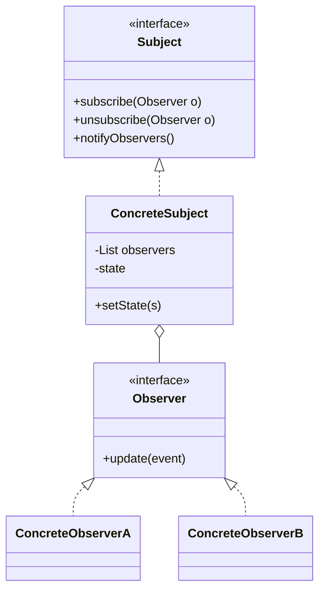

# Observer Pattern

Back to [[LLD-Index]].

## Problem

An object (subject) changes state and several other objects must react: UI widgets re-render, caches invalidate, audit logs record. If the subject calls each dependent directly, it is coupled to every concrete consumer and must be edited whenever a consumer is added.

## Motivation

- The subject keeps a list of observers typed only by an interface and calls `update(...)` on each when it changes.
- Observers subscribe and unsubscribe at runtime.
- Subject depends on an abstraction, not on consumers ([[Dependency-Inversion-Principle]]), giving low coupling ([[Cohesion-and-Coupling]]).
- Two notification styles:
  - **Push:** subject sends the changed data in the event.
  - **Pull:** subject sends only "I changed"; observers query what they need.

## Structure



## Implementation

### Java

```java
import java.util.List;
import java.util.concurrent.CopyOnWriteArrayList;

record PriceChanged(String symbol, double oldPrice, double newPrice) {}

interface PriceListener {
    void onPriceChanged(PriceChanged event);
}

final class StockTicker {
    // CopyOnWriteArrayList: iteration uses a snapshot, so listeners may
    // subscribe/unsubscribe during notification without ConcurrentModificationException.
    private final List<PriceListener> listeners = new CopyOnWriteArrayList<>();
    private final String symbol;
    private double price;

    StockTicker(String symbol, double initial) { this.symbol = symbol; this.price = initial; }

    /** Returns a handle that removes the listener; makes unsubscription hard to forget. */
    AutoCloseable subscribe(PriceListener l) {
        listeners.add(l);
        return () -> listeners.remove(l);
    }

    void unsubscribe(PriceListener l) { listeners.remove(l); }

    void setPrice(double newPrice) {
        double old = this.price;
        this.price = newPrice;
        PriceChanged ev = new PriceChanged(symbol, old, newPrice);
        for (PriceListener l : listeners) {
            try {
                l.onPriceChanged(ev);
            } catch (RuntimeException e) {
                // One faulty listener must not stop the others.
                System.err.println("listener failed: " + e.getMessage());
            }
        }
    }
}

final class Display implements PriceListener {
    public void onPriceChanged(PriceChanged e) {
        System.out.printf("[display] %s %.2f -> %.2f%n", e.symbol(), e.oldPrice(), e.newPrice());
    }
}

final class OneShotAlert implements PriceListener {
    private final StockTicker ticker;
    private final double threshold;
    OneShotAlert(StockTicker ticker, double threshold) { this.ticker = ticker; this.threshold = threshold; }
    public void onPriceChanged(PriceChanged e) {
        if (e.newPrice() > threshold) {
            System.out.println("[alert] crossed " + threshold);
            ticker.unsubscribe(this); // safe with CopyOnWriteArrayList
        }
    }
}

public class ObserverDemo {
    public static void main(String[] args) throws Exception {
        StockTicker t = new StockTicker("ACME", 100);
        AutoCloseable displaySub = t.subscribe(new Display());
        t.subscribe(new OneShotAlert(t, 105));

        t.setPrice(103);
        t.setPrice(110);   // alert fires and unsubscribes itself
        t.setPrice(120);   // only display

        displaySub.close(); // lifecycle-bound unsubscribe prevents lapsed listener leak
        t.setPrice(130);    // nobody notified
    }
}
```

### C++ (C++17)

Using `std::weak_ptr` means the subject does not keep observers alive; expired observers are pruned on notify.

```cpp
#include <algorithm>
#include <iostream>
#include <memory>
#include <string>
#include <vector>

struct PriceChanged {
    std::string symbol;
    double oldPrice;
    double newPrice;
};

class PriceListener {
public:
    virtual ~PriceListener() = default;
    virtual void onPriceChanged(const PriceChanged& e) = 0;
};

class StockTicker {
    std::string symbol_;
    double price_;
    std::vector<std::weak_ptr<PriceListener>> listeners_;
public:
    StockTicker(std::string s, double p) : symbol_(std::move(s)), price_(p) {}

    void subscribe(const std::shared_ptr<PriceListener>& l) { listeners_.push_back(l); }

    void setPrice(double p) {
        PriceChanged e{symbol_, price_, p};
        price_ = p;
        // Snapshot: listeners may subscribe during notification without invalidating our iteration.
        auto snapshot = listeners_;
        for (auto& w : snapshot) {
            if (auto l = w.lock()) l->onPriceChanged(e);
        }
        // Prune dead observers (the C++ equivalent of fixing lapsed listeners).
        listeners_.erase(std::remove_if(listeners_.begin(), listeners_.end(),
                                        [](const std::weak_ptr<PriceListener>& w) { return w.expired(); }),
                         listeners_.end());
    }
};

class Display : public PriceListener {
    std::string name_;
public:
    explicit Display(std::string n) : name_(std::move(n)) {}
    void onPriceChanged(const PriceChanged& e) override {
        std::cout << "[" << name_ << "] " << e.symbol << " " << e.oldPrice << " -> " << e.newPrice << "\n";
    }
};

int main() {
    StockTicker t("ACME", 100);
    auto a = std::make_shared<Display>("A");
    t.subscribe(a);
    {
        auto b = std::make_shared<Display>("B");
        t.subscribe(b);
        t.setPrice(101);      // A and B notified
    }                         // B destroyed here
    t.setPrice(102);          // only A; B pruned
    return 0;
}
```

## Pitfalls

1. **Lapsed listener (memory leak).** The subject holds a strong reference to every observer. An observer that is logically dead (closed window, finished request) but never unsubscribed stays reachable and keeps its whole object graph alive. Fixes: return a subscription handle and close it in the owner's lifecycle (`try-with-resources`, `@PreDestroy`, `onDestroy`); weak references (`WeakReference` in Java, `std::weak_ptr` in C++) where the lifecycle is unclear; scope subscriptions to a parent that is disposed as a unit.
2. **`ConcurrentModificationException` when unsubscribing during notify.** Iterating an `ArrayList` with for-each while a listener calls `remove(this)` breaks the fail-fast iterator. Fixes: `CopyOnWriteArrayList` (snapshot iteration; good when reads far outnumber writes, which is typical for listener lists), or copy the list before iterating. See [[Iterator-Pattern]].
3. **Ordering.** GoF makes no ordering guarantee. Do not let observer B depend on observer A having run first. If order matters, make it explicit (priority, or a single observer that orchestrates).
4. **Exceptions.** One throwing observer can abort the loop and starve the rest. Catch per listener and log.
5. **Re-entrancy and cycles.** An observer that mutates the subject triggers a nested notification; two subjects observing each other can recurse forever. Guard with a "notifying" flag or post changes to a queue.
6. **Threading.** Synchronous notify runs observers on the caller's thread and blocks it; slow observers slow the subject. Async dispatch (executor) decouples timing but loses ordering and makes errors harder to surface. Swing requires UI updates on the EDT.
7. **Update storms.** Many fine-grained changes cause many notifications; batch or coalesce.

## Tradeoffs

| Pro | Con |
|---|---|
| Subject is decoupled from concrete consumers | Control flow is implicit; harder to trace and debug |
| Add consumers at runtime | Leaks from forgotten subscriptions |
| Broadcast to any number of observers | No ordering guarantee; cascading updates |
| Supports push or pull | Synchronous notify couples latency of subject to slowest observer |

## When to use

- A change in one object must trigger updates in a set of others that is unknown or changes at runtime.
- UI models and views (MVC), domain events inside one process, cache invalidation, seat-availability updates in [[BookMyShow-LLD]], log appenders in [[Logger-Framework-LLD]].

## When NOT to use

- Exactly one fixed consumer: call it directly.
- Cross-process or durable delivery is required: use a message broker (pub/sub), not in-memory observers.
- Strict ordering or transactional consistency across consumers is required: an explicit orchestrator is clearer.

## Real-world example

- `java.beans.PropertyChangeSupport` / `PropertyChangeListener`: `addPropertyChangeListener`, `firePropertyChange(name, old, new)` delivering a `PropertyChangeEvent`.
- Swing / AWT event listeners: `ActionListener`, `JButton.addActionListener`.
- `java.util.Observable` / `Observer` exist but are deprecated since Java 9 (not serializable, class not interface, weak event model).
- `java.util.concurrent.Flow` (Java 9): `Publisher`, `Subscriber`, `Subscription`, `Processor` — Reactive Streams interfaces adding back-pressure via `Subscription.request(n)`. `SubmissionPublisher` is the JDK implementation, delivering asynchronously via an `Executor`.

## Pattern comparisons

- **Observer vs Pub/Sub:** In Observer, the subject knows its observers (holds references) and calls them, usually synchronously in-process. In Pub/Sub, publishers and subscribers know only a topic/channel on a broker (Kafka, Redis, an event bus); they are fully decoupled in identity, often in time (async, durable) and space (different processes). Pub/Sub adds filtering, persistence, and delivery semantics; it also adds a broker to operate.
- **Observer vs Command:** observers react to events; a [[Command-Pattern]] object *is* a request. Event handlers are often implemented as commands.
- **Observer vs Chain of Responsibility:** Observer broadcasts to all; [[Chain-of-Responsibility-Pattern]] passes to handlers until one handles it.

## Interview questions

1. **How do you avoid memory leaks with observers?** Unsubscribe tied to lifecycle (return a closeable handle), weak references where ownership is unclear, and review long-lived subjects holding short-lived observers.
2. **A listener unsubscribes itself inside `update` and you get `ConcurrentModificationException`. Fix?** Use `CopyOnWriteArrayList` or iterate a copy.
3. **Push vs pull model?** Push sends data (efficient, but subject decides the payload shape). Pull sends a reference (observers fetch what they need, but may read inconsistent later state).
4. **Is notification order guaranteed?** No; design observers to be independent.
5. **Why was `java.util.Observable` deprecated?** It is a class (forces inheritance), `setChanged` is protected, it is not thread-safe in a useful way, and the event model is too thin. Replacements: `PropertyChangeSupport`, `Flow`, or custom listener interfaces.
6. **How does `Flow` differ from classic Observer?** Asynchronous, with back-pressure: subscribers request `n` items, so a fast publisher cannot overwhelm a slow subscriber.
7. **Sync or async notify?** Sync is simple and ordered but blocks the subject; async isolates latency but needs error handling and loses ordering.
