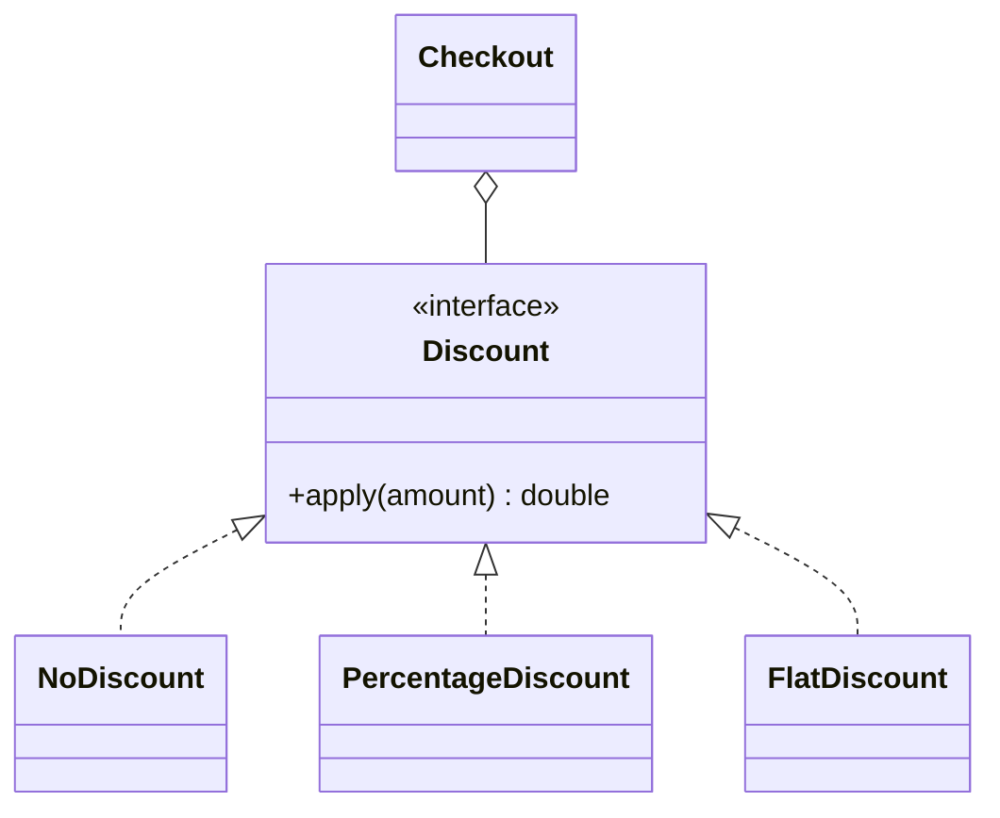

# Open-Closed Principle

Back to [[LLD-Index]].

## Definition

Bertrand Meyer, *Object-Oriented Software Construction* (1988):

> Software entities (classes, modules, functions) should be open for extension, but closed for modification.

Meyer's original mechanism was implementation inheritance. Robert C. Martin (1996) reframed it around **polymorphism over abstract interfaces**: add new behaviour by adding new code (a new implementation), not by editing existing, tested code.

## Violating example

Every new discount type requires editing `DiscountCalculator` and retesting all branches.

```java
class DiscountCalculator {
    double apply(String type, double amount) {
        switch (type) {
            case "NONE":     return amount;
            case "SEASONAL": return amount * 0.9;
            case "CLEARANCE":return amount * 0.5;
            default: throw new IllegalArgumentException("Unknown: " + type);
        }
    }
}
```

## Refactored

```java
import java.util.Map;

interface Discount {
    double apply(double amount);
}

class NoDiscount implements Discount {
    public double apply(double amount) { return amount; }
}

class PercentageDiscount implements Discount {
    private final double pct;
    PercentageDiscount(double pct) { this.pct = pct; }
    public double apply(double amount) { return amount * (1 - pct); }
}

class FlatDiscount implements Discount {          // added later, no existing code edited
    private final double off;
    FlatDiscount(double off) { this.off = off; }
    public double apply(double amount) { return Math.max(0, amount - off); }
}

class Checkout {
    private final Discount discount;
    Checkout(Discount discount) { this.discount = discount; }
    double total(double amount) { return discount.apply(amount); }
}

public class OcpDemo {
    public static void main(String[] args) {
        Map<String, Discount> registry = Map.of(
            "NONE", new NoDiscount(),
            "SEASONAL", new PercentageDiscount(0.10),
            "FLAT50", new FlatDiscount(50));
        System.out.println(new Checkout(registry.get("SEASONAL")).total(200));
    }
}
```

The registry (or a factory) is the one place that still changes — OCP pushes change to the composition root, it does not eliminate it.



## Detecting violations in code review

- `switch`/`if-else` chains on a type code or `instanceof`, duplicated in several places.
- A PR adding a feature touches a central class plus its tests every time (shotgun edits).
- Enum-based dispatch where each new enum value requires editing N methods.
- Boolean flag parameters that toggle behaviour (`render(boolean pdf)`).

## Tradeoffs and over-application

- You can only be closed against change you **anticipate**. Guessing wrong adds abstractions no one extends (see [[DRY-KISS-YAGNI]]).
- Rule of thumb: tolerate the first `switch`; abstract when the second variant or second duplicated switch appears.
- Indirection hurts readability; a closed set of variants (e.g. sealed hierarchy + exhaustive `switch`) is sometimes clearer and compiler-checked.

## Related patterns

[[Strategy-Pattern]], [[Decorator-Pattern]], [[Template-Method-Pattern]], [[Factory-Method-Pattern]], [[Observer-Pattern]], [[Chain-of-Responsibility-Pattern]].

## Interview questions

1. **How is OCP achieved in Java?** Depend on an interface/abstract class; add new implementations; select via DI, factory or registry.
2. **Meyer vs Martin OCP?** Meyer: extend via inheritance, keep original class frozen. Martin: extend via polymorphic interfaces.
3. **Does OCP mean code is never modified?** No; bug fixes and the composition root change. It means feature additions don't require editing stable modules.
4. **Is a `switch` always an OCP violation?** No. A single switch in a factory is acceptable; repeated switches on the same type code are the smell.
5. **Relation to LSP?** OCP relies on substitutable implementations; an LSP violation breaks the extension point ([[Liskov-Substitution-Principle]]).
