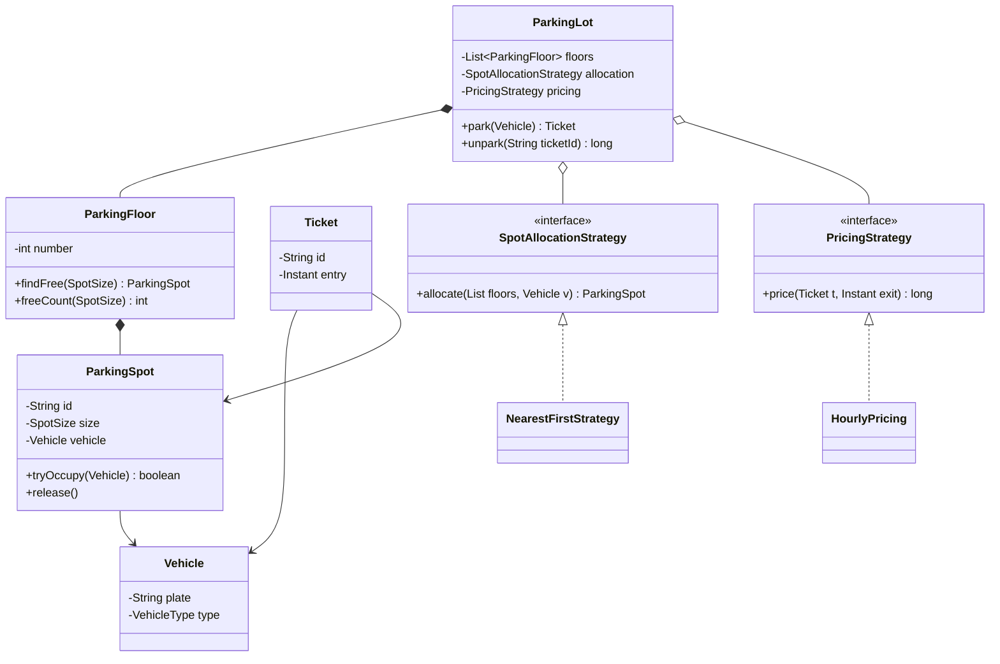

# Parking Lot LLD

Back to [[LLD-Index]].

## Clarifying questions

Ask these before drawing anything:

1. How many floors and entry/exit gates? Is there more than one gate? (Multiple gates means concurrent allocation.)
2. Which vehicle types: motorcycle, car, truck? Can a small vehicle take a larger spot?
3. How is a spot chosen: nearest to entry, first free, by floor preference?
4. How is pricing done: flat, hourly, per vehicle type, slabbed (first hour X, then Y)?
5. Payment: in scope as a real integration or just an interface?
6. Do we need a display board showing free spots per floor/type?
7. Reservations, EV charging, monthly passes: in scope?

## Requirements

### Functional (in scope)

- Park a vehicle: assign a compatible free spot, issue a ticket with entry time.
- Unpark: compute fee from ticket, accept payment, free the spot.
- Support vehicle types `MOTORCYCLE`, `CAR`, `TRUCK` and spot sizes `SMALL`, `MEDIUM`, `LARGE`.
- Pluggable spot allocation strategy and pricing strategy.
- Query free spot counts per floor and size.

### Non-functional

- Two gates must never assign the same spot (correctness under concurrency).
- Allocation should be O(log n) or O(1) per request, not a full scan in the hot path.
- New vehicle types, spot types, and pricing rules added without editing existing classes ([[Open-Closed-Principle]]).

### Out of scope

Reservations, real payment gateway, license-plate recognition, persistence. Mention them as follow-ups.

## Entities

| Entity | Responsibility |
|---|---|
| `ParkingLot` | Facade: entry point for park/unpark. Owns floors and strategies. |
| `ParkingFloor` | Holds spots grouped by size, tracks free spots. |
| `ParkingSpot` | Id, size, floor, current vehicle. |
| `Vehicle` | Plate + type. Knows which spot sizes it fits. |
| `Ticket` | Id, vehicle, spot, entry time. |
| `SpotAllocationStrategy` | Picks a spot for a vehicle. |
| `PricingStrategy` | Computes fee from ticket and exit time. |
| `PaymentProcessor` | Interface for charging. |

## Relationships

- `ParkingLot` *composes* `ParkingFloor`s, which *compose* `ParkingSpot`s (spots do not exist outside a floor).
- `ParkingLot` *aggregates* strategies (injected, replaceable) - see [[Dependency-Injection]].
- `Ticket` *associates* a `Vehicle` and a `ParkingSpot`.
- `Vehicle` fits a set of `SpotSize`s (a motorcycle fits all; a truck only `LARGE`).

## Class diagram



## Core Java code

Single file, compiles with `javac ParkingLotDemo.java` (Java 17+).

```java
import java.time.Duration;
import java.time.Instant;
import java.util.*;
import java.util.concurrent.ConcurrentHashMap;
import java.util.concurrent.ConcurrentLinkedDeque;
import java.util.concurrent.atomic.AtomicReference;
import java.util.concurrent.atomic.AtomicLong;

enum SpotSize { SMALL, MEDIUM, LARGE }

enum VehicleType {
    MOTORCYCLE(EnumSet.of(SpotSize.SMALL, SpotSize.MEDIUM, SpotSize.LARGE)),
    CAR(EnumSet.of(SpotSize.MEDIUM, SpotSize.LARGE)),
    TRUCK(EnumSet.of(SpotSize.LARGE));

    private final EnumSet<SpotSize> fits;
    VehicleType(EnumSet<SpotSize> fits) { this.fits = fits; }
    // Ordered smallest-first so we do not waste large spots.
    List<SpotSize> preferredSizes() { return new ArrayList<>(fits); }
}

record Vehicle(String plate, VehicleType type) {}

final class ParkingSpot {
    private final String id;
    private final SpotSize size;
    private final int floor;
    private final AtomicReference<Vehicle> vehicle = new AtomicReference<>();

    ParkingSpot(String id, SpotSize size, int floor) { this.id = id; this.size = size; this.floor = floor; }

    /** CAS guarantees two gates cannot occupy the same spot. */
    boolean tryOccupy(Vehicle v) { return vehicle.compareAndSet(null, v); }
    void release() { vehicle.set(null); }
    boolean isFree() { return vehicle.get() == null; }
    String id() { return id; }
    SpotSize size() { return size; }
    int floor() { return floor; }
}

final class ParkingFloor {
    private final int number;
    // Free lists per size: O(1) poll instead of scanning all spots.
    private final Map<SpotSize, ConcurrentLinkedDeque<ParkingSpot>> free = new EnumMap<>(SpotSize.class);

    ParkingFloor(int number, Map<SpotSize, Integer> capacity) {
        this.number = number;
        for (SpotSize s : SpotSize.values()) free.put(s, new ConcurrentLinkedDeque<>());
        capacity.forEach((size, count) -> {
            for (int i = 0; i < count; i++)
                free.get(size).add(new ParkingSpot("F" + number + "-" + size + "-" + i, size, number));
        });
    }

    /** Returns an occupied spot or null. */
    ParkingSpot claim(SpotSize size, Vehicle v) {
        ConcurrentLinkedDeque<ParkingSpot> q = free.get(size);
        ParkingSpot s;
        while ((s = q.pollFirst()) != null) {
            if (s.tryOccupy(v)) return s;
        }
        return null;
    }

    void giveBack(ParkingSpot s) { s.release(); free.get(s.size()).addFirst(s); }
    int freeCount(SpotSize size) { return free.get(size).size(); }
    int number() { return number; }
}

record Ticket(String id, Vehicle vehicle, ParkingSpot spot, Instant entry) {}

interface SpotAllocationStrategy {
    Optional<ParkingSpot> allocate(List<ParkingFloor> floors, Vehicle v);
}

/** Lowest floor first, smallest fitting size first. */
final class NearestFirstStrategy implements SpotAllocationStrategy {
    public Optional<ParkingSpot> allocate(List<ParkingFloor> floors, Vehicle v) {
        for (ParkingFloor f : floors)
            for (SpotSize size : v.type().preferredSizes()) {
                ParkingSpot s = f.claim(size, v);
                if (s != null) return Optional.of(s);
            }
        return Optional.empty();
    }
}

interface PricingStrategy { long price(Ticket t, Instant exit); } // amount in minor units (paise/cents)

/** Rounds up to whole hours; rate per vehicle type. */
final class HourlyPricing implements PricingStrategy {
    private final Map<VehicleType, Long> ratePerHour;
    HourlyPricing(Map<VehicleType, Long> ratePerHour) { this.ratePerHour = ratePerHour; }
    public long price(Ticket t, Instant exit) {
        long minutes = Math.max(1, Duration.between(t.entry(), exit).toMinutes());
        long hours = (minutes + 59) / 60;
        return hours * ratePerHour.get(t.vehicle().type());
    }
}

interface PaymentProcessor { boolean charge(String ticketId, long amount); }

final class ParkingLot {
    private final List<ParkingFloor> floors;
    private final SpotAllocationStrategy allocation;
    private final PricingStrategy pricing;
    private final PaymentProcessor payments;
    private final Map<String, Ticket> active = new ConcurrentHashMap<>();
    private final Map<Integer, ParkingFloor> byNumber = new HashMap<>();
    private final AtomicLong seq = new AtomicLong();

    ParkingLot(List<ParkingFloor> floors, SpotAllocationStrategy a, PricingStrategy p, PaymentProcessor pay) {
        this.floors = List.copyOf(floors); this.allocation = a; this.pricing = p; this.payments = pay;
        for (ParkingFloor f : floors) byNumber.put(f.number(), f);
    }

    Ticket park(Vehicle v) {
        ParkingSpot spot = allocation.allocate(floors, v)
                .orElseThrow(() -> new IllegalStateException("Lot full for " + v.type()));
        Ticket t = new Ticket("T" + seq.incrementAndGet(), v, spot, Instant.now());
        active.put(t.id(), t);
        return t;
    }

    long unpark(String ticketId, Instant exit) {
        Ticket t = active.get(ticketId);
        if (t == null) throw new IllegalArgumentException("Unknown or already closed ticket");
        long fee = pricing.price(t, exit);
        if (!payments.charge(ticketId, fee)) throw new IllegalStateException("Payment failed");
        if (active.remove(ticketId, t)) byNumber.get(t.spot().floor()).giveBack(t.spot());
        return fee;
    }
}

public class ParkingLotDemo {
    public static void main(String[] args) {
        Map<SpotSize, Integer> cap = Map.of(SpotSize.SMALL, 2, SpotSize.MEDIUM, 2, SpotSize.LARGE, 1);
        ParkingLot lot = new ParkingLot(
                List.of(new ParkingFloor(0, cap), new ParkingFloor(1, cap)),
                new NearestFirstStrategy(),
                new HourlyPricing(Map.of(VehicleType.MOTORCYCLE, 1000L, VehicleType.CAR, 2000L, VehicleType.TRUCK, 5000L)),
                (id, amt) -> true);
        Ticket t = lot.park(new Vehicle("KA01AB1234", VehicleType.CAR));
        System.out.println("Parked at " + t.spot().id());
        System.out.println("Fee: " + lot.unpark(t.id(), t.entry().plus(Duration.ofMinutes(95))));
    }
}
```

## Patterns used and why

| Pattern | Where | Why |
|---|---|---|
| [[Strategy-Pattern]] | `SpotAllocationStrategy`, `PricingStrategy` | Allocation and pricing rules change per business; swap without touching `ParkingLot`. |
| [[Facade-Pattern]] | `ParkingLot` | Gates call two methods; internal floors/spots hidden. |
| [[Factory-Method-Pattern]] | Vehicle/spot creation (follow-up) | Centralize creation when types grow. |
| [[Singleton-Pattern]] | Often requested for `ParkingLot` | Prefer a single instance wired via [[Dependency-Injection]]; a hard singleton hurts testing. |
| [[Observer-Pattern]] | Display boards (follow-up) | Floors publish free-count changes; boards subscribe. |

## Concurrency concerns

- **Double assignment:** two gates pick the same spot. Solved by removing the spot from a concurrent free list (`pollFirst` is atomic) plus CAS in `tryOccupy` as a second guard.
- **Double unpark / double payment:** `active.remove(id, t)` is atomic; only one caller returns the spot. In production, make payment idempotent keyed by ticket id.
- **Free-count reads** are approximate under concurrency (`ConcurrentLinkedDeque.size()` is O(n) and weakly consistent). For a display board, maintain an `AtomicInteger` per floor/size instead.
- **Distributed lot (many servers):** in-memory CAS is insufficient; use a DB row-level conditional update (`UPDATE spot SET vehicle=? WHERE id=? AND vehicle IS NULL`).

## Extensibility follow-ups

| Interviewer asks | How the design absorbs it |
|---|---|
| Add EV spots with chargers | New `SpotSize`/spot subclass `EvSpot`; vehicle type `EV_CAR` lists it first in preferred sizes. |
| Weekend / slab pricing | New `PricingStrategy` implementation, or a composite that picks by day. No change to `ParkingLot`. |
| Allocate nearest to a specific gate | `GateAwareStrategy` using per-gate distance-sorted spot heaps. |
| Reservations | `Reservation` entity; allocation strategy skips reserved spots; spot gets `RESERVED` state (see [[State-Pattern]]). |
| Display boards | [[Observer-Pattern]] on floor counts. |
| Monthly pass | `PricingStrategy` decorator that returns 0 for pass holders ([[Decorator-Pattern]]). |

## Common interview pitfalls

- Modeling every spot type as a deep inheritance tree when an enum plus data suffices (see [[Composition-vs-Inheritance]]).
- Scanning all spots on every park call; use per-size free lists.
- Putting pricing logic inside `Ticket` or `Vehicle` (violates [[Single-Responsibility-Principle]]).
- Ignoring concurrent gates entirely, or wrapping the whole lot in one `synchronized` (correct but serializes all gates).
- Using `double` for money; use minor units in `long` or `BigDecimal`.
- Forgetting the "lot full" path and the "lost ticket" path.
