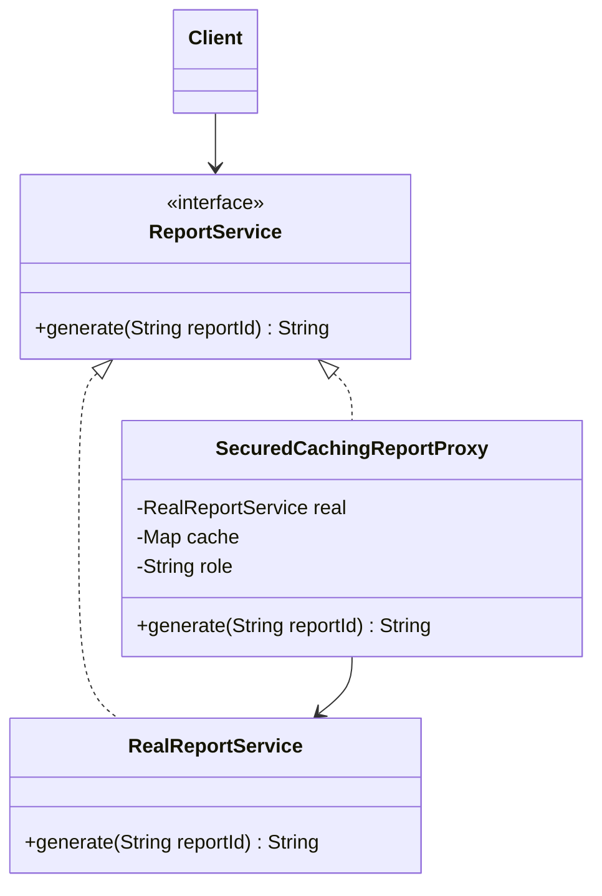

# Proxy Pattern

Back to [[LLD-Index]].

## Problem

A real object is expensive to create (large image, DB connection), lives remotely, needs access checks, or would benefit from caching. You want to add that control *without* changing the real class or its clients.

## Motivation

A proxy implements the same interface as the **real subject** and stands in for it. Common kinds:

| Kind | What it controls |
|---|---|
| Virtual proxy | Lazy creation of an expensive object |
| Protection proxy | Authorization before delegation |
| Remote proxy | Hides network calls (RMI stubs, gRPC client stubs) |
| Caching proxy | Returns stored results ([[LRU-Cache-LLD]]) |
| Smart reference / logging | Ref-counting, metrics, auditing, rate limiting ([[Rate-Limiter-LLD]]) |

Clients are unaware: they hold the interface type.

## Structure



## Implementation

### Static proxy (virtual + protection + caching)

```java
// ProxyDemo.java
import java.lang.reflect.InvocationHandler;
import java.lang.reflect.Method;
import java.lang.reflect.Proxy;
import java.util.Map;
import java.util.concurrent.ConcurrentHashMap;

interface ReportService {
    String generate(String reportId);
}

class RealReportService implements ReportService {
    RealReportService() { System.out.println("[real] expensive init (connect to warehouse)"); }
    public String generate(String reportId) {
        System.out.println("[real] computing " + reportId);
        return "REPORT(" + reportId + ")";
    }
}

class SecuredCachingReportProxy implements ReportService {
    private volatile RealReportService real;                 // virtual: created lazily
    private final Map<String, String> cache = new ConcurrentHashMap<>();
    private final String role;

    SecuredCachingReportProxy(String role) { this.role = role; }

    private RealReportService real() {
        RealReportService r = real;
        if (r == null) {
            synchronized (this) {
                r = real;
                if (r == null) { r = new RealReportService(); real = r; }
            }
        }
        return r;
    }

    @Override
    public String generate(String reportId) {
        if (!"ADMIN".equals(role)) throw new SecurityException("role " + role + " not allowed"); // protection
        return cache.computeIfAbsent(reportId, id -> real().generate(id));                      // caching
    }
}

// Dynamic proxy: one generic handler works for any interface
class TimingHandler implements InvocationHandler {
    private final Object target;
    TimingHandler(Object target) { this.target = target; }

    @Override
    public Object invoke(Object proxy, Method method, Object[] args) throws Throwable {
        long start = System.nanoTime();
        try {
            return method.invoke(target, args);
        } catch (java.lang.reflect.InvocationTargetException e) {
            throw e.getCause();                              // unwrap the real exception
        } finally {
            System.out.println("[timing] " + method.getName() + " took " + (System.nanoTime() - start) / 1_000 + " us");
        }
    }

    @SuppressWarnings("unchecked")
    static <T> T wrap(T target, Class<T> iface) {
        return (T) Proxy.newProxyInstance(iface.getClassLoader(), new Class<?>[]{iface}, new TimingHandler(target));
    }
}

public class ProxyDemo {
    public static void main(String[] args) {
        ReportService admin = new SecuredCachingReportProxy("ADMIN");
        System.out.println("proxy created, real not yet initialised");
        System.out.println(admin.generate("Q3"));
        System.out.println(admin.generate("Q3"));            // served from cache

        try {
            new SecuredCachingReportProxy("VIEWER").generate("Q3");
        } catch (SecurityException e) {
            System.out.println("denied: " + e.getMessage());
        }

        ReportService timed = TimingHandler.wrap(admin, ReportService.class);
        System.out.println(timed.generate("Q4"));
    }
}
```

## Tradeoffs

| Pro | Con |
|---|---|
| Adds control transparently; client and real subject unchanged | Extra latency/indirection; remote proxies can hide network failure modes (the "fallacies of distributed computing") |
| Lazy loading saves startup cost | Caching proxies need invalidation and bounded size |
| Centralised cross-cutting concerns (security, metrics) | JDK dynamic proxies only work on interfaces; reflective invocation is slower than direct calls |
| | Self-invocation bypasses the proxy (see Spring AOP below) |

## When to use

- Lazy initialisation of heavy resources.
- Access control, auditing, rate limiting, metrics around an existing service.
- Remote invocation stubs.
- Caching results of pure/expensive calls.
- Framework-level interception (transactions, retries) via dynamic proxies.

## When NOT to use

- The concern is adding optional, client-chosen features that stack: use [[Decorator-Pattern]].
- You need a different interface: use [[Adapter-Pattern]].
- Hot paths where indirection overhead or reflection matters and the control is not needed.

## Real-world example

- `java.lang.reflect.Proxy.newProxyInstance(loader, interfaces, handler)` creates runtime proxies that route every call to an `InvocationHandler`.
- **Spring AOP**: `@Transactional`, `@Cacheable`, `@Async` are implemented with proxies. Spring uses a JDK dynamic proxy when the bean implements an interface, and a CGLIB subclass proxy otherwise. Spring Boot defaults to CGLIB (`spring.aop.proxy-target-class=true`). Consequence: a `this.method()` call inside the bean bypasses the proxy, so the annotation has no effect. CGLIB cannot proxy `final` classes/methods.
- Hibernate/JPA lazy associations return proxy objects that load on first access (`LazyInitializationException` when the session is closed).
- Java RMI stubs and gRPC generated client stubs are remote proxies.

## Pattern comparisons

| | [[Decorator-Pattern]] | Proxy |
|---|---|---|
| Intent | Add behaviour | Control access |
| Composition set by | Client, explicitly and stackable | Framework/factory, hidden from client |
| Real object lifecycle | Passed in, already exists | Often created/managed by the proxy (virtual/remote) |
| Examples | `BufferedInputStream`, `Collections.synchronizedList` | Spring `@Transactional` proxy, Hibernate lazy proxy, RMI stub |

Versus [[Adapter-Pattern]]: an adapter changes the interface, a proxy preserves it. Versus [[Facade-Pattern]]: a facade simplifies many objects, a proxy stands in for one.

## Interview questions

1. **Proxy vs Decorator?** Same structure, different intent: a proxy controls access (and often owns the subject's lifecycle), while a decorator adds responsibilities the client composes.
2. **JDK dynamic proxy vs CGLIB?** JDK proxies implement interfaces at runtime via `java.lang.reflect.Proxy`. CGLIB generates a subclass of the target class, so it works without interfaces but not on `final` classes/methods.
3. **Why does `@Transactional` not work on a self-call?** The call `this.foo()` goes directly to the target object, not through the Spring proxy, so no interceptor runs. Fix it by calling through another bean, injecting the proxy, or using AspectJ weaving.
4. **How is a virtual proxy made thread-safe?** Lazy init with double-checked locking on a `volatile` field (as above) or a holder/`computeIfAbsent`. See [[Singleton-Pattern]].
5. **What does `InvocationHandler.invoke` do with checked exceptions?** `Method.invoke` wraps target exceptions in `InvocationTargetException`. Unwrap and rethrow the cause, or clients see an `UndeclaredThrowableException`.
6. **Give an example of a remote proxy risk.** It makes a network call look local, so callers may forget timeouts, retries and partial failure. Expose these in the API or document them.
