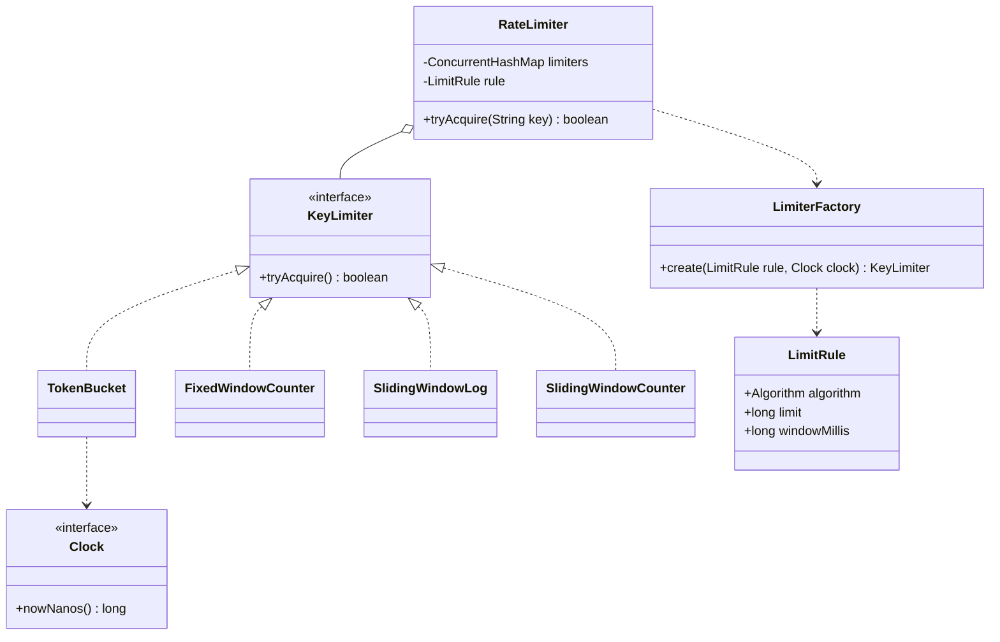

# Rate Limiter LLD

Back to [[LLD-Index]].

## Clarifying questions

1. Limit by what key: user id, API key, IP, endpoint, or a combination?
2. Single process or shared across many servers? (LLD usually: single process, then discuss distributed.)
3. Should bursts be allowed? (Token bucket yes; sliding window log no.)
4. What happens on reject: HTTP 429, queue, or degrade?
5. Different limits per tier (free vs paid)?
6. Is exact accuracy required, or is approximate acceptable for lower memory?

## Requirements

### Functional (in scope)

- `tryAcquire(key)` returns allow/deny immediately (non-blocking).
- Per-key limits configured by rule (capacity, window/refill rate).
- Algorithms: token bucket, fixed window counter, sliding window log, sliding window counter.
- Algorithm chosen by configuration.

### Non-functional

- O(1) decision per request for bucket and counters; sliding log O(log n) or amortized O(1) per request, O(limit) memory per key.
- Thread-safe under concurrent requests for the same key.
- Idle keys should not leak memory forever.
- Testable time: inject a clock.

### Out of scope

Distributed coordination (Redis/Lua), request queuing, network-level limiting. Covered as follow-ups.

## Algorithm comparison

| Algorithm | Burst behavior | Memory per key | Accuracy | Notes |
|---|---|---|---|---|
| Token bucket | Allows bursts up to capacity, then steady rate | O(1) | Exact for its model | Most common for APIs. |
| Leaky bucket | Smooths output to constant rate | O(queue) | Exact | Better for shaping than for rejecting. |
| Fixed window | Up to 2x limit across a window boundary | O(1) | Boundary spike | Simplest. |
| Sliding window log | No boundary spike | O(limit) | Exact | Stores every timestamp. |
| Sliding window counter | Small boundary error | O(1) | Approximate (weights previous window) | Good memory/accuracy trade-off. |

## Entities

| Entity | Responsibility |
|---|---|
| `RateLimiter` | Facade: key -> limiter lookup, `tryAcquire(key)`. |
| `LimitRule` | capacity, window or refill rate, algorithm. |
| `KeyLimiter` (strategy) | Per-key algorithm state and decision. |
| `LimiterFactory` | Builds a `KeyLimiter` from a rule. |
| `Clock` | Time source (injectable for tests). |

## Class diagram



## Core Java code

Single file, compiles with `javac RateLimiterDemo.java` (Java 17+).

```java
import java.util.ArrayDeque;
import java.util.Deque;
import java.util.Map;
import java.util.concurrent.ConcurrentHashMap;
import java.util.concurrent.TimeUnit;

interface Clock { long nowNanos(); }

enum Algorithm { TOKEN_BUCKET, FIXED_WINDOW, SLIDING_LOG, SLIDING_COUNTER }

/** limit = max requests (or bucket capacity) per windowMillis. */
record LimitRule(Algorithm algorithm, long limit, long windowMillis) {}

interface KeyLimiter { boolean tryAcquire(); long lastSeenNanos(); }

/** Refill continuously at limit/window; capacity = limit. Lazy refill on each call: no timer threads. */
final class TokenBucket implements KeyLimiter {
    private final long capacity;
    private final double refillPerNano;
    private final Clock clock;
    private double tokens;
    private long lastRefill;

    TokenBucket(long capacity, long windowMillis, Clock clock) {
        this.capacity = capacity;
        this.refillPerNano = (double) capacity / TimeUnit.MILLISECONDS.toNanos(windowMillis);
        this.clock = clock;
        this.tokens = capacity;
        this.lastRefill = clock.nowNanos();
    }
    public synchronized boolean tryAcquire() {
        long now = clock.nowNanos();
        tokens = Math.min(capacity, tokens + (now - lastRefill) * refillPerNano);
        lastRefill = now;
        if (tokens >= 1.0) { tokens -= 1.0; return true; }
        return false;
    }
    public synchronized long lastSeenNanos() { return lastRefill; }
}

final class FixedWindowCounter implements KeyLimiter {
    private final long limit, windowNanos;
    private final Clock clock;
    private long windowStart, count, lastSeen;

    FixedWindowCounter(long limit, long windowMillis, Clock clock) {
        this.limit = limit; this.windowNanos = TimeUnit.MILLISECONDS.toNanos(windowMillis); this.clock = clock;
        this.windowStart = clock.nowNanos();
    }
    public synchronized boolean tryAcquire() {
        long now = clock.nowNanos(); lastSeen = now;
        if (now - windowStart >= windowNanos) { windowStart = now - ((now - windowStart) % windowNanos); count = 0; }
        if (count < limit) { count++; return true; }
        return false;
    }
    public synchronized long lastSeenNanos() { return lastSeen; }
}

/** Exact: keep timestamps of accepted requests inside the window. */
final class SlidingWindowLog implements KeyLimiter {
    private final long limit, windowNanos;
    private final Clock clock;
    private final Deque<Long> log = new ArrayDeque<>();
    private long lastSeen;

    SlidingWindowLog(long limit, long windowMillis, Clock clock) {
        this.limit = limit; this.windowNanos = TimeUnit.MILLISECONDS.toNanos(windowMillis); this.clock = clock;
    }
    public synchronized boolean tryAcquire() {
        long now = clock.nowNanos(); lastSeen = now;
        while (!log.isEmpty() && now - log.peekFirst() >= windowNanos) log.pollFirst();
        if (log.size() < limit) { log.addLast(now); return true; }
        return false;
    }
    public synchronized long lastSeenNanos() { return lastSeen; }
}

/**
 * Approximation: estimated = prevCount * (1 - elapsedFractionOfCurrent) + currCount.
 * O(1) memory, assumes requests in the previous window were uniformly spread.
 */
final class SlidingWindowCounter implements KeyLimiter {
    private final long limit, windowNanos;
    private final Clock clock;
    private long currStart, currCount, prevCount, lastSeen;

    SlidingWindowCounter(long limit, long windowMillis, Clock clock) {
        this.limit = limit; this.windowNanos = TimeUnit.MILLISECONDS.toNanos(windowMillis); this.clock = clock;
        this.currStart = clock.nowNanos();
    }
    public synchronized boolean tryAcquire() {
        long now = clock.nowNanos(); lastSeen = now;
        long elapsed = now - currStart;
        if (elapsed >= windowNanos) {
            long windowsPassed = elapsed / windowNanos;
            prevCount = windowsPassed == 1 ? currCount : 0;
            currCount = 0;
            currStart += windowsPassed * windowNanos;
            elapsed = now - currStart;
        }
        double weight = 1.0 - (double) elapsed / windowNanos;
        double estimated = prevCount * weight + currCount;
        if (estimated < limit) { currCount++; return true; }
        return false;
    }
    public synchronized long lastSeenNanos() { return lastSeen; }
}

final class LimiterFactory {
    static KeyLimiter create(LimitRule r, Clock c) {
        return switch (r.algorithm()) {
            case TOKEN_BUCKET -> new TokenBucket(r.limit(), r.windowMillis(), c);
            case FIXED_WINDOW -> new FixedWindowCounter(r.limit(), r.windowMillis(), c);
            case SLIDING_LOG -> new SlidingWindowLog(r.limit(), r.windowMillis(), c);
            case SLIDING_COUNTER -> new SlidingWindowCounter(r.limit(), r.windowMillis(), c);
        };
    }
}

final class RateLimiter {
    private final Map<String, KeyLimiter> limiters = new ConcurrentHashMap<>();
    private final LimitRule rule;
    private final Clock clock;

    RateLimiter(LimitRule rule, Clock clock) { this.rule = rule; this.clock = clock; }

    boolean tryAcquire(String key) {
        // computeIfAbsent is atomic: exactly one limiter per key even under a race.
        return limiters.computeIfAbsent(key, k -> LimiterFactory.create(rule, clock)).tryAcquire();
    }

    /** Call periodically to drop idle keys and bound memory. */
    void evictIdle(long idleNanos) {
        long now = clock.nowNanos();
        limiters.entrySet().removeIf(e -> now - e.getValue().lastSeenNanos() > idleNanos);
    }
}

public class RateLimiterDemo {
    static final class FakeClock implements Clock {
        long t = 0; public long nowNanos() { return t; }
        void advanceMillis(long ms) { t += TimeUnit.MILLISECONDS.toNanos(ms); }
    }
    public static void main(String[] args) {
        FakeClock clock = new FakeClock();
        for (Algorithm a : Algorithm.values()) {
            RateLimiter rl = new RateLimiter(new LimitRule(a, 3, 1000), clock);
            StringBuilder sb = new StringBuilder(a + ": ");
            for (int i = 0; i < 5; i++) sb.append(rl.tryAcquire("user1") ? "Y" : "N");
            clock.advanceMillis(1000);
            sb.append(" after 1s -> ").append(rl.tryAcquire("user1") ? "Y" : "N");
            System.out.println(sb);
        }
    }
}
```

Demo output: the first three algorithms print `YYYNN after 1s -> Y`. Sliding window counter prints `-> N` because exactly at the window boundary the previous window still carries weight 1.0 (3 prior requests). That is the approximation working as designed, not a bug.

## Patterns used and why

| Pattern | Where | Why |
|---|---|---|
| [[Strategy-Pattern]] | `KeyLimiter` implementations | Same contract, different accuracy/memory/burst trade-offs. |
| [[Factory-Method-Pattern]] | `LimiterFactory` | Maps config to algorithm; callers never `new` a concrete limiter. |
| [[Proxy-Pattern]] / [[Decorator-Pattern]] | `RateLimitedService` wrapping a real service | Enforce limits transparently at the call boundary. |
| [[Chain-of-Responsibility-Pattern]] | Multiple limits (per-IP, then per-user, then global) | Each handler may reject; request continues only if all allow. |
| [[Dependency-Injection]] | `Clock` | Deterministic tests without `Thread.sleep`. |

## Concurrency concerns

- Per-key `synchronized` keeps contention limited to requests for the same key.
- `computeIfAbsent` prevents two limiters being created for one key.
- `evictIdle` can race with a request that just fetched the limiter: the removed limiter still answers that one call, and the next call creates a fresh one, briefly granting extra capacity. Acceptable for most APIs; if not, use `remove(key, value)` only after checking under the limiter's lock.
- Lock-free token bucket: store `(tokens, timestamp)` in an `AtomicLong` pair or `AtomicReference` of an immutable state and CAS. Worth mentioning, rarely required.
- Use `System.nanoTime()` (monotonic), never `currentTimeMillis()` (wall clock can jump).

## Extensibility follow-ups

| Follow-up | How |
|---|---|
| Distributed limiter across N servers | Move state to Redis; implement `KeyLimiter` that runs an atomic Lua script (token bucket or sliding counter). Local interface unchanged. |
| Per-tier limits | `RuleResolver` maps key/tier to `LimitRule`; map stores limiter per (key, rule). |
| Return retry-after | Extend result to `Decision(allowed, retryAfterNanos)`; token bucket computes `(1 - tokens) / refillRate`. |
| Weighted requests (cost > 1) | `tryAcquire(int permits)`. |
| Blocking acquire | `acquire()` that sleeps until next token; leaky-bucket style shaping. |
| Hot key memory | Sliding log is O(limit) per key; switch that rule to sliding counter. |

## Common interview pitfalls

- Using a background thread to refill every bucket: does not scale with key count. Refill lazily on access.
- Fixed window without explaining the 2x boundary burst.
- Non-atomic check-then-increment on shared counters.
- Wall-clock time; timestamps going backwards break windows.
- Unbounded map of keys (memory leak from many IPs).
- Forgetting to say what the client receives on rejection (429 + Retry-After).
