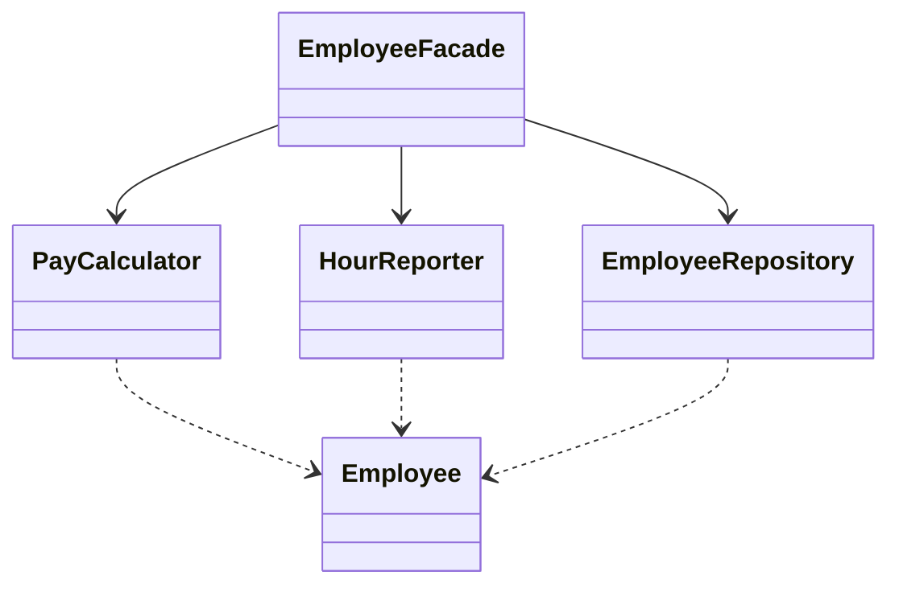

# Single Responsibility Principle

Back to [[LLD-Index]].

## Definition

Robert C. Martin (the "S" in SOLID, early 2000s; refined in *Clean Architecture*, 2017):

> A module should be responsible to one, and only one, actor.

The older phrasing is "a class should have only one reason to change". The "reason to change" is a **stakeholder or actor** (finance, ops, DBA), not "does one thing". A class with 10 methods can obey SRP if all 10 change for the same reason; a class with 2 methods can violate it if they serve different actors.

## Violating example

`Employee` serves three actors: finance (pay), HR/reporting (report format), and DBAs (persistence). A change for one risks breaking the others.

```java
import java.util.ArrayList;
import java.util.List;

class Employee {
    private final String name;
    private final double hourlyRate;
    private final int hours;
    private static final List<String> DB = new ArrayList<>();

    Employee(String name, double hourlyRate, int hours) {
        this.name = name; this.hourlyRate = hourlyRate; this.hours = hours;
    }

    // Finance actor
    double calculatePay() { return hourlyRate * regularHours(); }

    // HR / reporting actor
    String reportHours() { return name + " worked " + regularHours() + "h"; }

    // DBA actor
    void save() { DB.add(name + "," + hourlyRate + "," + hours); }

    // Shared helper: finance changes overtime rule -> HR report silently changes
    private int regularHours() { return Math.min(hours, 40); }
}
```

## Refactored

```java
import java.util.ArrayList;
import java.util.List;

final class Employee {                       // pure data
    final String name; final double hourlyRate; final int hours;
    Employee(String name, double hourlyRate, int hours) {
        this.name = name; this.hourlyRate = hourlyRate; this.hours = hours;
    }
}

class PayCalculator {                         // finance
    double calculatePay(Employee e) { return e.hourlyRate * Math.min(e.hours, 40); }
}

class HourReporter {                          // HR
    String report(Employee e) { return e.name + " worked " + e.hours + "h"; }
}

class EmployeeRepository {                    // persistence
    private final List<String> rows = new ArrayList<>();
    void save(Employee e) { rows.add(e.name + "," + e.hourlyRate + "," + e.hours); }
}

class EmployeeFacade {                        // optional convenience entry point
    private final PayCalculator pay = new PayCalculator();
    private final HourReporter reporter = new HourReporter();
    private final EmployeeRepository repo = new EmployeeRepository();
    double pay(Employee e) { return pay.calculatePay(e); }
    String report(Employee e) { return reporter.report(e); }
    void save(Employee e) { repo.save(e); }
}

public class SrpDemo {
    public static void main(String[] args) {
        Employee e = new Employee("Asha", 10.0, 45);
        EmployeeFacade f = new EmployeeFacade();
        System.out.println(f.pay(e) + " | " + f.report(e));
        f.save(e);
    }
}
```

The facade (see [[Facade-Pattern]]) keeps a single call site without re-merging responsibilities.



## Detecting violations in code review

- Class name ends in `Manager`, `Util`, `Helper`, `Processor`, `Service` with no qualifier.
- Imports span unrelated layers (JDBC + HTTP + PDF + business logic in one file).
- Merge conflicts on the same file from different teams.
- Methods grouped into unrelated clusters that touch disjoint fields (low cohesion, see [[Cohesion-and-Coupling]]).
- Tests need to mock a DB just to test a calculation.
- Describing the class requires "and" ("parses **and** validates **and** saves").

## Tradeoffs and over-application

- Splitting per method yields many anemic classes and scattered logic ("class explosion").
- Split by **actor/change axis**, not by verb. If two responsibilities always change together, keep them together.
- More classes means more wiring; use [[Dependency-Injection]] or a facade.

## Related patterns

[[Facade-Pattern]], [[Strategy-Pattern]] (extract varying algorithm), [[Decorator-Pattern]] (extract cross-cutting concerns like logging), [[Open-Closed-Principle]].

## Interview questions

1. **What does "reason to change" mean?** A change request originating from a single actor/stakeholder; SRP groups code that changes for the same actor.
2. **Is SRP "a class should do one thing"?** No. That is a function-level heuristic. SRP is about change sources.
3. **How do you fix a God class?** Identify actors, cluster methods/fields by actor, extract classes, keep a facade if callers need one entry point.
4. **Can SRP be violated at the method level?** Yes — a method mixing I/O, validation and computation; extract each step.
5. **Downside of strict SRP?** Fragmentation, indirection, harder navigation; balance with cohesion.
