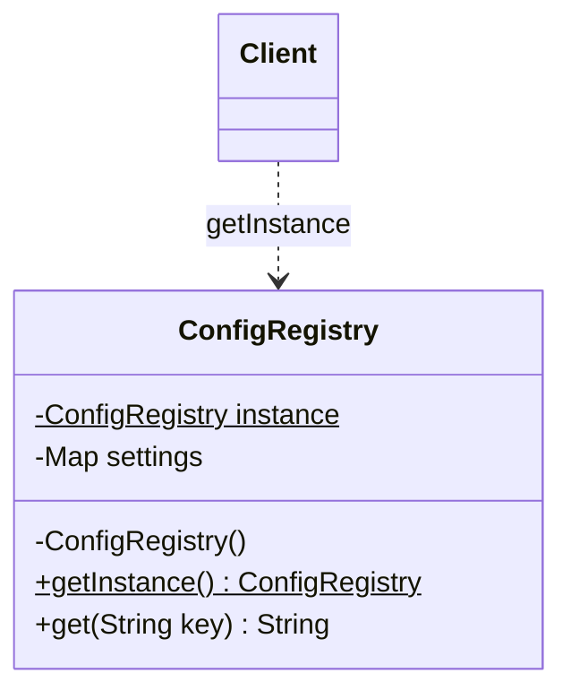

# Singleton Pattern

Back to [[LLD-Index]].

## Problem

Some resources must have exactly one instance per process (or per classloader): a configuration registry, a connection pool, a logger root ([[Logger-Framework-LLD]]), a hardware handle. Multiple instances would waste resources or cause inconsistent state.

## Motivation

- Private constructor so nobody else can call `new`.
- Static accessor returning the single instance.
- The hard parts are **lazy initialisation under concurrency** and **defending against reflection, serialization and cloning**.
- In modern code, prefer letting a DI container manage one instance ([[Dependency-Injection]]) over a hard-coded global.

## Structure



## Implementation

### 1. Eager initialisation

```java
// EagerSingleton.java
public final class EagerSingleton {
    private static final EagerSingleton INSTANCE = new EagerSingleton(); // created at class init
    private EagerSingleton() {}
    public static EagerSingleton getInstance() { return INSTANCE; }
}
```

Thread-safe because the JVM runs class initialisation (`<clinit>`) exactly once under a lock (JLS 12.4.2). Downside: created even if never used, and constructor exceptions surface as `ExceptionInInitializerError`.

### 2. Lazy, synchronized method

```java
// LazySyncSingleton.java
public final class LazySyncSingleton {
    private static LazySyncSingleton instance;
    private LazySyncSingleton() {}
    public static synchronized LazySyncSingleton getInstance() {
        if (instance == null) instance = new LazySyncSingleton();
        return instance;
    }
}
```

Correct but acquires a monitor on *every* call, even after initialisation.

### 3. Double-checked locking (DCL) with `volatile`

```java
// DclSingleton.java
public final class DclSingleton {
    private static volatile DclSingleton instance; // volatile is REQUIRED
    private DclSingleton() {}

    public static DclSingleton getInstance() {
        DclSingleton local = instance;          // one volatile read on the fast path
        if (local == null) {                    // 1st check: no lock
            synchronized (DclSingleton.class) {
                local = instance;
                if (local == null) {            // 2nd check: under lock
                    local = new DclSingleton();
                    instance = local;
                }
            }
        }
        return local;
    }
}
```

**Why `volatile`:** `instance = new DclSingleton()` is roughly three steps: (a) allocate memory, (b) run the constructor, (c) publish the reference. Without a happens-before edge, the compiler/CPU may reorder so (c) becomes visible before (b). A second thread doing the unsynchronized first check can then see a non-null reference to a **partially constructed object**. Under the Java Memory Model (Java 5+, JSR-133), a `volatile` write happens-before every subsequent read of that field, which forbids this reordering and guarantees safe publication. Before Java 5, DCL was broken even with `volatile`.

### 4. Bill Pugh / initialization-on-demand holder (recommended lazy form)

```java
// HolderSingleton.java
public final class HolderSingleton {
    private HolderSingleton() {}
    private static final class Holder {
        static final HolderSingleton INSTANCE = new HolderSingleton();
    }
    public static HolderSingleton getInstance() { return Holder.INSTANCE; }
}
```

`Holder` is not initialised until `getInstance()` first touches it. Class-init locking gives thread safety with no `synchronized` or `volatile` on the hot path.

### 5. Enum singleton (Effective Java item 3)

```java
// EnumSingleton.java
public enum EnumSingleton {
    INSTANCE;
    private int counter;
    public synchronized int next() { return ++counter; }
}
```

Protected against reflection (`Constructor.newInstance` throws `IllegalArgumentException: Cannot reflectively create enum objects`) and serialization (enums serialize by name and resolve to the existing constant). Limitations: eager, cannot extend another class, awkward if lazy init or subclassing is needed.

### 6. Breaking a singleton and defending it

```java
// SingletonAttacks.java
import java.io.*;
import java.lang.reflect.Constructor;

class Guarded implements Serializable, Cloneable {
    private static final long serialVersionUID = 1L;
    private static volatile boolean created = false;
    private static final Guarded INSTANCE = new Guarded();

    private Guarded() {
        // Reflection defence: second constructor call fails
        synchronized (Guarded.class) {
            if (created) throw new IllegalStateException("Singleton already constructed");
            created = true;
        }
    }

    static Guarded getInstance() { return INSTANCE; }

    // Serialization defence: replace the deserialized copy with the real instance
    protected Object readResolve() { return INSTANCE; }

    // Cloning defence
    @Override protected Object clone() throws CloneNotSupportedException {
        throw new CloneNotSupportedException("Singleton");
    }
}

public class SingletonAttacks {
    public static void main(String[] args) throws Exception {
        Guarded a = Guarded.getInstance();

        // 1. Reflection
        try {
            Constructor<Guarded> c = Guarded.class.getDeclaredConstructor();
            c.setAccessible(true);
            c.newInstance();
            System.out.println("reflection: BROKEN");
        } catch (java.lang.reflect.InvocationTargetException e) {
            System.out.println("reflection: blocked -> " + e.getCause().getMessage());
        }

        // 2. Serialization
        ByteArrayOutputStream bos = new ByteArrayOutputStream();
        try (ObjectOutputStream out = new ObjectOutputStream(bos)) { out.writeObject(a); }
        Guarded b;
        try (ObjectInputStream in = new ObjectInputStream(new ByteArrayInputStream(bos.toByteArray()))) {
            b = (Guarded) in.readObject();
        }
        System.out.println("serialization same instance: " + (a == b));

        // 3. Cloning
        try {
            a.clone();
            System.out.println("clone: BROKEN");
        } catch (CloneNotSupportedException e) {
            System.out.println("clone: blocked");
        }
    }
}
```

| Attack | How it breaks | Defence |
|---|---|---|
| Reflection | `setAccessible(true)` + `newInstance()` calls private ctor | Throw from ctor if instance exists; or use enum |
| Serialization | `readObject` creates a new object bypassing the ctor | `readResolve()` returning the instance; or enum |
| Cloning | `clone()` copies fields into a new object | Don't implement `Cloneable`, or override `clone()` to throw |
| Multiple classloaders | Each loader has its own static field | Load via a shared parent classloader |

### C++: Meyers singleton (thread-safe since C++11)

```cpp
// meyers_singleton.cpp  (g++ -std=c++17 meyers_singleton.cpp)
#include <iostream>
#include <mutex>
#include <string>
#include <unordered_map>

class Config {
public:
    static Config& instance() {
        // C++11 [stmt.dcl]/4 ("magic statics"): initialization of a function-local
        // static is thread-safe; concurrent callers block until init completes.
        static Config inst;
        return inst;
    }

    Config(const Config&) = delete;            // no copy
    Config& operator=(const Config&) = delete; // no copy-assign
    Config(Config&&) = delete;                 // no move
    Config& operator=(Config&&) = delete;

    void set(const std::string& k, const std::string& v) {
        std::lock_guard<std::mutex> g(mu_);    // init is thread-safe; member access is not
        data_[k] = v;
    }
    std::string get(const std::string& k) {
        std::lock_guard<std::mutex> g(mu_);
        auto it = data_.find(k);
        return it == data_.end() ? "" : it->second;
    }

private:
    Config() = default;
    ~Config() = default;
    std::mutex mu_;
    std::unordered_map<std::string, std::string> data_;
};

int main() {
    Config::instance().set("env", "prod");
    std::cout << Config::instance().get("env") << "\n";
    std::cout << (&Config::instance() == &Config::instance()) << "\n"; // 1
}
```

Notes: destruction order of statics across translation units is unspecified at exit (the "static deinitialization order" problem); accessing one singleton from another's destructor can touch a destroyed object. Pre-C++11 compilers did not guarantee thread-safe local statics.

## Tradeoffs

| Pro | Con |
|---|---|
| Controlled single instance, lazy options | Global mutable state; hidden dependencies in method bodies |
| Saves resources for heavy objects | Hard to unit test / mock (static access); state leaks between tests |
| Simple global access | Violates [[Single-Responsibility-Principle]] (manages own lifecycle + business logic) |
| | Concurrency bottleneck if methods are synchronized |
| | "One per JVM" is really "one per classloader"; in a cluster there are N |

## When to use

- Truly process-wide, stateless or thread-safe resources: runtime handle, logger factory, metrics registry.
- Expensive shared resources where duplication is harmful (pool, cache) *and* no DI container is available.

## When NOT to use

- To avoid passing dependencies around: inject them instead.
- For mutable business state (user session, cart).
- When you need one instance per cluster (use a distributed lock/leader election; the pattern does not cover this).
- When tests need isolated instances.

## Real-world example

- `java.lang.Runtime.getRuntime()`: eager singleton per JVM.
- `java.awt.Desktop.getDesktop()`, `java.awt.Toolkit.getDefaultToolkit()`.
- Spring beans default to **singleton scope**: one instance per `ApplicationContext`, managed by the container, not by a private constructor.
- `Collections.emptyList()` returns a shared immutable instance.

## Pattern comparisons

| | GoF Singleton | Static utility class | DI singleton scope |
|---|---|---|---|
| Instance | One object | No object (static methods) | One object per container |
| Polymorphism / interfaces | Yes (can implement interface) | No | Yes |
| Lazy init | Possible | Class-load time | Container-controlled (lazy/eager) |
| State | Can hold state | Static fields | Can hold state |
| Testability | Poor (global access) | Poor | Good (inject a mock) |
| Use for | Legacy/global resources | Pure stateless functions (`Math`, `Collections`) | Default choice in modern apps |

## Interview questions

1. **Why is `volatile` needed in DCL?** It prevents reordering of reference publication before constructor completion and gives happens-before visibility, so no thread sees a half-built object.
2. **Best way to implement a singleton in Java?** Enum for simplicity and robustness. Use the holder idiom if you need lazy init or a class hierarchy.
3. **Is the holder idiom thread-safe? Why?** Yes. JVM class initialisation is performed once under an initialisation lock (JLS 12.4.2).
4. **How can a singleton be broken?** Reflection, serialization, cloning, multiple classloaders. Defend with a ctor guard, `readResolve`, a throwing `clone`, or an enum.
5. **Why are singletons considered an anti-pattern?** Global state, hidden coupling, hard to test, lifecycle mixed with logic. DI singleton scope gives one instance without these drawbacks.
6. **Singleton in a distributed system?** The pattern guarantees one instance per classloader/process only. Cluster-wide uniqueness needs coordination (leader election, distributed lock).
7. **Is the Meyers singleton thread-safe?** Initialization is, since C++11 (magic statics). Member function access still needs its own synchronisation.
8. **Singleton vs static class?** A singleton is an object: it can implement interfaces, be passed as a dependency, be lazily created and be replaced in tests (if accessed via an interface). A static class cannot.
