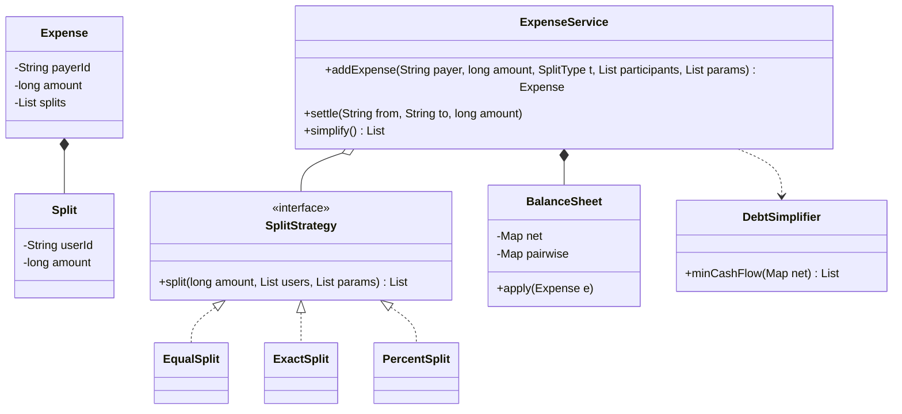

# Splitwise LLD

Back to [[LLD-Index]].

## Clarifying questions

1. Split types: equal, exact amounts, percentages, shares? All in scope?
2. Single payer per expense or multiple payers?
3. Groups, or only person-to-person?
4. Currency: single currency? Rounding rules for amounts that do not divide evenly?
5. Is "simplify debts" required (minimize number of transactions)?
6. Edit/delete expenses? Settle-up payments?

## Requirements

### Functional (in scope)

- Users and groups.
- Add expense: payer, amount, participants, split type (`EQUAL`, `EXACT`, `PERCENT`).
- Validate splits (exact sums to total; percents sum to 100).
- Show balances: per user net, and pairwise who-owes-whom.
- Record settlement payment.
- Simplify debts: produce a minimal-ish list of transfers settling everyone.

### Non-functional

- Money stored as integer minor units (paise/cents), never `double`.
- Rounding remainder distributed deterministically so totals always balance to zero.
- New split types added without changing `ExpenseService` ([[Open-Closed-Principle]]).

### Out of scope

Multi-currency conversion, receipts/images, activity feed persistence. Follow-ups.

## Entities

| Entity | Responsibility |
|---|---|
| `User` | id, name. |
| `Group` | members, expenses. |
| `Expense` | payer, total, list of `Split`, type, description. |
| `Split` | user + amount owed (computed). |
| `SplitStrategy` | Turns input (participants + params) into `Split`s and validates. |
| `BalanceSheet` | Net balance per user, pairwise ledger. |
| `DebtSimplifier` | Computes settlement transfers. |
| `ExpenseService` | Facade. |

## Relationships

- `Group` aggregates `User`s and composes `Expense`s.
- `Expense` composes `Split`s.
- `ExpenseService` uses a `SplitStrategy` chosen by type (factory/registry) and updates `BalanceSheet`.

## Class diagram



## Debt simplification: greedy min cash flow

1. Compute each user's **net** balance: `paid - owed`. Positive = creditor, negative = debtor. Sum is 0.
2. Put creditors in a max-heap by amount, debtors in a max-heap by amount owed.
3. Repeatedly pop the largest creditor `c` and largest debtor `d`; transfer `x = min(c, d)`; push back whichever has a remainder.
4. Each step zeroes at least one person, so at most `n - 1` transfers. Time O(n log n).

Caveat: finding the **true minimum** number of transfers is NP-hard (it reduces to partitioning users into the maximum number of zero-sum subsets). The greedy gives at most `n - 1` transfers, which is what interviewers expect; mention the exact problem and that exponential DP over subsets works for small n.

Also note: simplification may create transfers between people who never transacted directly. Splitwise-style apps typically restrict simplification to within a group. > TODO: verify current Splitwise product behavior before stating it as fact.

## Core Java code

Single file, compiles with `javac SplitwiseDemo.java` (Java 17+).

```java
import java.util.*;

enum SplitType { EQUAL, EXACT, PERCENT }

record Split(String userId, long amount) {}

record Expense(String id, String payerId, long amount, SplitType type, List<Split> splits, String note) {}

record Transfer(String from, String to, long amount) {}

interface SplitStrategy {
    /** params meaning depends on strategy: ignored (EQUAL), amounts (EXACT), basis points out of 10000 (PERCENT). */
    List<Split> split(long amount, List<String> users, List<Long> params);
}

final class EqualSplit implements SplitStrategy {
    public List<Split> split(long amount, List<String> users, List<Long> params) {
        if (users.isEmpty()) throw new IllegalArgumentException("no participants");
        long base = amount / users.size(), rem = amount % users.size();
        List<Split> out = new ArrayList<>();
        for (int i = 0; i < users.size(); i++) out.add(new Split(users.get(i), base + (i < rem ? 1 : 0)));
        return out; // first `rem` users absorb one extra minor unit each
    }
}

final class ExactSplit implements SplitStrategy {
    public List<Split> split(long amount, List<String> users, List<Long> params) {
        if (params.size() != users.size()) throw new IllegalArgumentException("one amount per user");
        long sum = params.stream().mapToLong(Long::longValue).sum();
        if (sum != amount) throw new IllegalArgumentException("exact amounts sum to " + sum + " not " + amount);
        List<Split> out = new ArrayList<>();
        for (int i = 0; i < users.size(); i++) out.add(new Split(users.get(i), params.get(i)));
        return out;
    }
}

/** Percent in basis points (2550 = 25.50%) to avoid floating point. */
final class PercentSplit implements SplitStrategy {
    public List<Split> split(long amount, List<String> users, List<Long> bps) {
        if (bps.size() != users.size()) throw new IllegalArgumentException("one percent per user");
        if (bps.stream().mapToLong(Long::longValue).sum() != 10_000) throw new IllegalArgumentException("percents must total 100");
        List<Split> out = new ArrayList<>();
        long assigned = 0;
        for (int i = 0; i < users.size(); i++) {
            long share = (i == users.size() - 1) ? amount - assigned : amount * bps.get(i) / 10_000;
            assigned += share;
            out.add(new Split(users.get(i), share));
        }
        return out; // last user absorbs rounding remainder so total is exact
    }
}

final class BalanceSheet {
    // net[u] > 0: u should receive; < 0: u owes.
    private final Map<String, Long> net = new HashMap<>();
    // owes[a][b] = amount a owes b (kept one-directional: only one of owes[a][b], owes[b][a] is non-zero).
    private final Map<String, Map<String, Long>> owes = new HashMap<>();

    void apply(Expense e) {
        for (Split s : e.splits()) {
            if (s.userId().equals(e.payerId())) continue;
            transfer(s.userId(), e.payerId(), s.amount());
        }
    }
    /** debtor now owes creditor `amt` more. Settlement is transfer(creditor, debtor, amt) reversed. */
    void transfer(String debtor, String creditor, long amt) {
        net.merge(debtor, -amt, Long::sum);
        net.merge(creditor, amt, Long::sum);
        long reverse = owes.getOrDefault(creditor, Map.of()).getOrDefault(debtor, 0L);
        if (reverse >= amt) { put(creditor, debtor, reverse - amt); }
        else { put(creditor, debtor, 0); put(debtor, creditor, owes.getOrDefault(debtor, Map.of()).getOrDefault(creditor, 0L) + amt - reverse); }
    }
    private void put(String a, String b, long v) {
        Map<String, Long> m = owes.computeIfAbsent(a, k -> new HashMap<>());
        if (v == 0) m.remove(b); else m.put(b, v);
    }
    Map<String, Long> net() { return Collections.unmodifiableMap(net); }
    Map<String, Map<String, Long>> pairwise() { return owes; }
}

final class DebtSimplifier {
    static List<Transfer> minCashFlow(Map<String, Long> net) {
        Comparator<Map.Entry<String, Long>> byAmountDesc = (a, b) -> Long.compare(b.getValue(), a.getValue());
        PriorityQueue<Map.Entry<String, Long>> creditors = new PriorityQueue<>(byAmountDesc);
        PriorityQueue<Map.Entry<String, Long>> debtors = new PriorityQueue<>(byAmountDesc); // stores amount owed as positive
        net.forEach((u, v) -> {
            if (v > 0) creditors.add(new AbstractMap.SimpleEntry<>(u, v));
            else if (v < 0) debtors.add(new AbstractMap.SimpleEntry<>(u, -v));
        });
        List<Transfer> out = new ArrayList<>();
        while (!creditors.isEmpty() && !debtors.isEmpty()) {
            var c = creditors.poll(); var d = debtors.poll();
            long x = Math.min(c.getValue(), d.getValue());
            out.add(new Transfer(d.getKey(), c.getKey(), x));
            if (c.getValue() > x) creditors.add(new AbstractMap.SimpleEntry<>(c.getKey(), c.getValue() - x));
            if (d.getValue() > x) debtors.add(new AbstractMap.SimpleEntry<>(d.getKey(), d.getValue() - x));
        }
        return out;
    }
}

final class ExpenseService {
    private final Map<SplitType, SplitStrategy> strategies = new EnumMap<>(SplitType.class);
    private final BalanceSheet sheet = new BalanceSheet();
    private final List<Expense> expenses = new ArrayList<>();
    private long seq = 0;

    ExpenseService() {
        strategies.put(SplitType.EQUAL, new EqualSplit());
        strategies.put(SplitType.EXACT, new ExactSplit());
        strategies.put(SplitType.PERCENT, new PercentSplit());
    }

    synchronized Expense addExpense(String payer, long amount, SplitType type, List<String> users, List<Long> params, String note) {
        if (amount <= 0) throw new IllegalArgumentException("amount must be positive");
        List<Split> splits = strategies.get(type).split(amount, users, params);
        Expense e = new Expense("E" + (++seq), payer, amount, type, List.copyOf(splits), note);
        expenses.add(e);
        sheet.apply(e);
        return e;
    }
    /** from pays to: reduces what `from` owes `to`. */
    synchronized void settle(String from, String to, long amount) { sheet.transfer(to, from, amount); }
    synchronized Map<String, Long> balances() { return new TreeMap<>(sheet.net()); }
    synchronized List<Transfer> simplify() { return DebtSimplifier.minCashFlow(sheet.net()); }
}

public class SplitwiseDemo {
    public static void main(String[] args) {
        ExpenseService s = new ExpenseService();
        s.addExpense("A", 30_000, SplitType.EQUAL, List.of("A", "B", "C"), List.of(), "dinner");
        s.addExpense("B", 10_000, SplitType.EXACT, List.of("A", "C"), List.of(4_000L, 6_000L), "cab");
        s.addExpense("C", 20_000, SplitType.PERCENT, List.of("A", "B"), List.of(5_000L, 5_000L), "tickets");
        System.out.println(s.balances());
        System.out.println(s.simplify());
    }
}
```

## Patterns used and why

| Pattern | Where | Why |
|---|---|---|
| [[Strategy-Pattern]] | `SplitStrategy` | Each split type has its own validation and math; adding `SHARES` is one new class. |
| [[Factory-Method-Pattern]] | Strategy registry keyed by `SplitType` | Decouples request parsing from concrete strategy. |
| [[Observer-Pattern]] | Notify participants on new expense (follow-up) | Keeps notifications out of the ledger. |
| [[Command-Pattern]] | Expense as an event (follow-up) | Edit/delete = apply inverse; ledger can be rebuilt by replay. |
| [[Facade-Pattern]] | `ExpenseService` | Single entry point for controllers. |

## Concurrency concerns

- Balance updates for one expense touch multiple users; they must be atomic together. Here: one lock per service (or per group in a multi-group version).
- In a DB: wrap expense insert + balance updates in one transaction, or store only expenses (append-only) and derive balances, which removes update contention entirely.
- Simplification reads a consistent snapshot of balances; compute from a copy taken under the lock.

## Extensibility follow-ups

| Follow-up | How |
|---|---|
| Split by shares (2:1:1) | `ShareSplit` strategy; same remainder rule as percent. |
| Multiple payers | `Expense` gets `List<Payment>`; `BalanceSheet.apply` credits each payer then debits splits. Net math unchanged. |
| Edit/delete expense | Apply inverse transfers, or rebuild from event log. |
| Multi-currency | Store currency per expense; balances per currency; convert only at settle time. |
| Groups | `Group` owns its own `BalanceSheet`; simplification per group. |
| Exact minimum transfers | Bitmask DP over subsets with zero sum; O(2^n * n), only for small groups. |

## Common interview pitfalls

- Using `double` for money; totals drift and never reach zero.
- Losing the rounding remainder (e.g. 100 / 3) so splits do not sum to the total.
- Tracking only pairwise debts without net balances, making simplification awkward.
- Claiming the greedy algorithm always yields the true minimum number of transactions.
- A `switch (splitType)` inside `addExpense` instead of strategies.
- Forgetting validation: percents not summing to 100, exact amounts mismatched, payer not in group.
