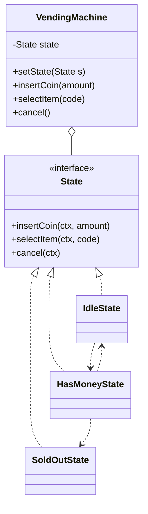
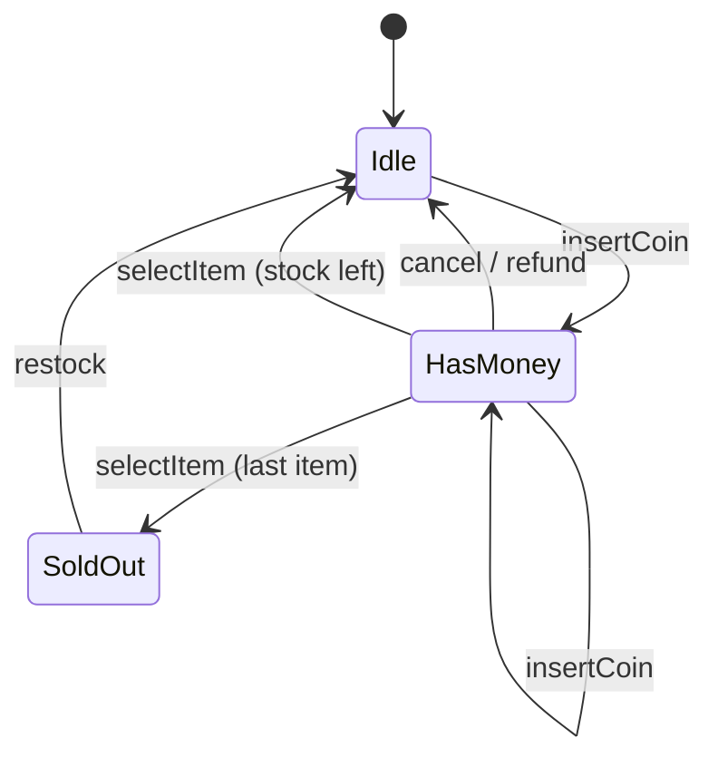

# State Pattern

Back to [[LLD-Index]].

## Problem

An object's response to the same method depends on its current mode: a vending machine ignores `dispense()` until paid, an order cannot `ship()` before `pay()`, an elevator door cannot `open()` while moving. Implemented with a `status` enum, every method becomes a `switch (status)`, transition rules are scattered across methods, and adding a state edits all of them.

## Motivation

- Model each state as a class implementing the same interface (one method per event).
- The **context** delegates every event to its current state object.
- The state object performs the behaviour and decides the **next state**, calling `context.setState(...)`.
- Adding a state means adding a class; illegal events are rejected in one place per state.
- This is an object-oriented finite state machine.

## Structure





## Implementation

### Java

```java
import java.util.HashMap;
import java.util.Map;

interface State {
    void insertCoin(VendingMachine m, int amount);
    void selectItem(VendingMachine m, String code);
    void cancel(VendingMachine m);
    default void restock(VendingMachine m, String code, int qty) {
        m.addStock(code, qty);
    }
    String name();
}

final class IdleState implements State {
    static final IdleState INSTANCE = new IdleState();   // stateless -> shareable
    public void insertCoin(VendingMachine m, int amount) {
        m.addBalance(amount);
        m.setState(HasMoneyState.INSTANCE);
    }
    public void selectItem(VendingMachine m, String code) { System.out.println("Insert coin first"); }
    public void cancel(VendingMachine m) { System.out.println("Nothing to cancel"); }
    public String name() { return "IDLE"; }
}

final class HasMoneyState implements State {
    static final HasMoneyState INSTANCE = new HasMoneyState();
    public void insertCoin(VendingMachine m, int amount) { m.addBalance(amount); }
    public void selectItem(VendingMachine m, String code) {
        int price = m.priceOf(code);
        if (price < 0 || m.stockOf(code) == 0) { System.out.println("Unavailable: " + code); return; }
        if (m.balance() < price) { System.out.println("Need " + (price - m.balance()) + " more"); return; }
        m.dispense(code, price);
        m.setState(m.totalStock() == 0 ? SoldOutState.INSTANCE : IdleState.INSTANCE);
    }
    public void cancel(VendingMachine m) {
        m.refund();
        m.setState(IdleState.INSTANCE);
    }
    public String name() { return "HAS_MONEY"; }
}

final class SoldOutState implements State {
    static final SoldOutState INSTANCE = new SoldOutState();
    public void insertCoin(VendingMachine m, int amount) { System.out.println("Sold out, returning " + amount); }
    public void selectItem(VendingMachine m, String code) { System.out.println("Sold out"); }
    public void cancel(VendingMachine m) { System.out.println("Nothing to cancel"); }
    @Override public void restock(VendingMachine m, String code, int qty) {
        m.addStock(code, qty);
        m.setState(IdleState.INSTANCE);
    }
    public String name() { return "SOLD_OUT"; }
}

final class VendingMachine {
    private State state = SoldOutState.INSTANCE;
    private int balance;
    private final Map<String, Integer> stock = new HashMap<>();
    private final Map<String, Integer> prices = new HashMap<>();

    VendingMachine price(String code, int p) { prices.put(code, p); return this; }

    // Events: delegate to current state
    void insertCoin(int amount) { state.insertCoin(this, amount); }
    void selectItem(String code) { state.selectItem(this, code); }
    void cancel() { state.cancel(this); }
    void restock(String code, int qty) { state.restock(this, code, qty); }

    // Package-private operations used by states
    void setState(State s) { System.out.println("  " + state.name() + " -> " + s.name()); state = s; }
    void addBalance(int a) { balance += a; }
    int balance() { return balance; }
    int priceOf(String code) { return prices.getOrDefault(code, -1); }
    int stockOf(String code) { return stock.getOrDefault(code, 0); }
    int totalStock() { return stock.values().stream().mapToInt(Integer::intValue).sum(); }
    void addStock(String code, int qty) { stock.merge(code, qty, Integer::sum); }
    void dispense(String code, int price) {
        stock.merge(code, -1, Integer::sum);
        balance -= price;
        System.out.println("Dispensed " + code + ", change " + balance);
        balance = 0;
    }
    void refund() { System.out.println("Refund " + balance); balance = 0; }
}

public class StateDemo {
    public static void main(String[] args) {
        VendingMachine vm = new VendingMachine().price("A1", 30);
        vm.insertCoin(10);        // Sold out, returning 10
        vm.restock("A1", 1);      // SOLD_OUT -> IDLE
        vm.selectItem("A1");      // Insert coin first
        vm.insertCoin(20);        // IDLE -> HAS_MONEY
        vm.selectItem("A1");      // Need 10 more
        vm.insertCoin(20);
        vm.selectItem("A1");      // Dispensed A1, change 10 ; HAS_MONEY -> SOLD_OUT
    }
}
```

### C++ (C++17)

```cpp
#include <iostream>
#include <memory>
#include <string>

class TrafficLight;

class LightState {
public:
    virtual ~LightState() = default;
    virtual void next(TrafficLight& light) = 0;
    virtual void emergency(TrafficLight& light);
    virtual std::string name() const = 0;
};

class TrafficLight {
    std::unique_ptr<LightState> state_;
public:
    explicit TrafficLight(std::unique_ptr<LightState> s) : state_(std::move(s)) {}
    void setState(std::unique_ptr<LightState> s) {
        std::cout << state_->name() << " -> " << s->name() << "\n";
        state_ = std::move(s);   // old state destroyed; caller must not touch 'this' state afterwards
    }
    void next() { state_->next(*this); }
    void emergency() { state_->emergency(*this); }
};

class Red : public LightState {
public:
    void next(TrafficLight& l) override;
    std::string name() const override { return "RED"; }
};
class Green : public LightState {
public:
    void next(TrafficLight& l) override;
    std::string name() const override { return "GREEN"; }
};
class Yellow : public LightState {
public:
    void next(TrafficLight& l) override { l.setState(std::make_unique<Red>()); }
    std::string name() const override { return "YELLOW"; }
};

void Red::next(TrafficLight& l) { l.setState(std::make_unique<Green>()); }
void Green::next(TrafficLight& l) { l.setState(std::make_unique<Yellow>()); }
void LightState::emergency(TrafficLight& l) { l.setState(std::make_unique<Red>()); }

int main() {
    TrafficLight light(std::make_unique<Red>());
    light.next();       // RED -> GREEN
    light.next();       // GREEN -> YELLOW
    light.emergency();  // YELLOW -> RED
    light.next();       // RED -> GREEN
    return 0;
}
```

Note: in the C++ version `setState` destroys the state object whose method is still on the stack. That is legal as long as the method does nothing with `this` after the call (as here). Alternatives: keep stateless singletons, or return the next state from the method and let the context swap it.

## Tradeoffs

| Pro | Con |
|---|---|
| Removes `switch(state)` from every method | Class per state; overkill for 2-3 states |
| Transition logic localized per state | Transitions spread across classes; the full FSM is not visible in one place (keep a diagram) |
| New states added without editing others (mostly) | States coupled to each other (they name successors) |
| Stateless states can be shared singletons | Context must expose internals to states (package-private helpers) |

Alternative: a **table-driven FSM** (`Map<State, Map<Event, State>>`, or Java `enum` with abstract methods). Better when transitions are data (configurable workflows) and behaviour per state is small.

## When to use

- Behaviour depends on a mode and there are many events x states with distinct rules.
- Lifecycle entities: orders, payments, tickets, bookings, elevator ([[Elevator-System-LLD]]), parking spot/ticket status ([[Parking-Lot-LLD]]), TCP connection.
- Illegal transitions must be rejected explicitly.

## When NOT to use

- Two or three states with trivial rules: an enum and a guard clause are clearer.
- Transitions are configured at runtime by business users: use a table-driven or workflow engine.
- The "state" is really an interchangeable algorithm chosen by the client: that is [[Strategy-Pattern]].

## Real-world example

- TCP connection states (`LISTEN`, `SYN_RECEIVED`, `ESTABLISHED`, ...) — the GoF book's original example (`TCPConnection` delegating to `TCPState`).
- Java `enum` with constant-specific method bodies is a compact State implementation commonly used for order/workflow status.
- Spring Statemachine provides a framework for state machines. > TODO: confirm specific API names before citing further.

## Pattern comparisons

- **Strategy vs State:** same structure (context delegates to interface). Strategy: client chooses, strategies unaware of each other, rarely changes during an operation. State: the state objects change the context's state themselves in response to events, and know successors. Ask "who triggers the switch?"
- **State vs Command:** events hitting a state machine are often modelled as [[Command-Pattern]] objects (queued, logged).

## Interview questions

1. **Why State over a switch on an enum?** Each new state touches one class instead of every method; illegal transitions handled per state; easier to test per state.
2. **Where should transition logic live?** In state classes (decentralized, GoF default) or in the context/table (centralized). Centralize when transitions are data-driven or need a single audit point.
3. **Can states be singletons?** Yes if stateless; per-context data lives in the context and is passed in.
4. **How do you handle an invalid event?** Default implementation throws `IllegalStateException` or no-ops with a message; override only valid events.
5. **How to persist a state machine?** Persist the state name/enum; on load map it back to the state object.
6. **Concurrency?** Events must be serialized per context (lock, actor, single-threaded queue) or transitions race.
