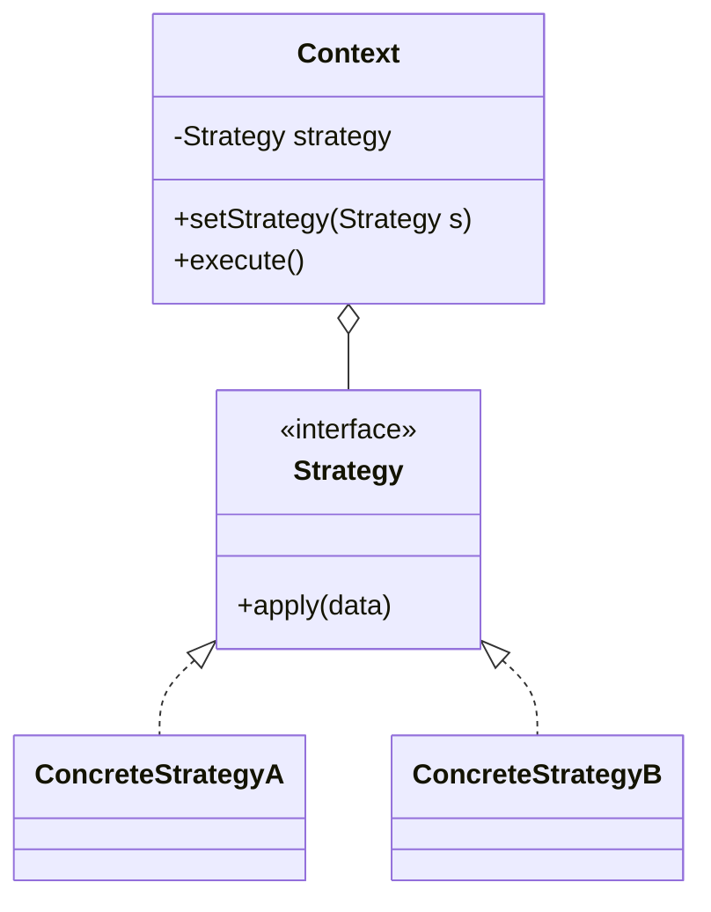

# Strategy Pattern

Back to [[LLD-Index]].

## Problem

A class needs one of several variants of an algorithm (pricing rule, sort order, compression codec, payment route). Hard-coding them as `if/else` or `switch` on a type flag means every new variant edits the same class, the branches share state they should not, and the variants cannot be unit-tested in isolation.

## Motivation

- Pull each variant into its own class that implements a common interface.
- The **context** holds a reference to the interface and delegates the varying step to it.
- New variants are added without touching the context: this is [[Open-Closed-Principle]] applied through composition ([[Composition-vs-Inheritance]]).
- The strategy is chosen by the caller, a config file, or a factory ([[Factory-Method-Pattern]]), and is often injected ([[Dependency-Injection]]).
- In Java 8+ and C++11+, a strategy with one method is usually a lambda / `std::function`.

## Structure



Participants: `Strategy` (algorithm contract), `ConcreteStrategy` (one algorithm), `Context` (uses a strategy, does not know which one).

## Implementation

### Java

```java
import java.math.BigDecimal;
import java.math.RoundingMode;
import java.util.List;

interface DiscountStrategy {
    BigDecimal apply(BigDecimal subtotal);
}

final class NoDiscount implements DiscountStrategy {
    public BigDecimal apply(BigDecimal subtotal) { return subtotal; }
}

final class PercentageDiscount implements DiscountStrategy {
    private final BigDecimal percent;
    PercentageDiscount(int percent) {
        if (percent < 0 || percent > 100) throw new IllegalArgumentException("percent");
        this.percent = BigDecimal.valueOf(percent);
    }
    public BigDecimal apply(BigDecimal subtotal) {
        BigDecimal off = subtotal.multiply(percent).divide(BigDecimal.valueOf(100), 2, RoundingMode.HALF_UP);
        return subtotal.subtract(off);
    }
}

final class FlatDiscount implements DiscountStrategy {
    private final BigDecimal amount;
    FlatDiscount(BigDecimal amount) { this.amount = amount; }
    public BigDecimal apply(BigDecimal subtotal) {
        BigDecimal r = subtotal.subtract(amount);
        return r.signum() < 0 ? BigDecimal.ZERO : r;
    }
}

final class Checkout {
    private DiscountStrategy discount;
    Checkout(DiscountStrategy discount) { this.discount = discount; }
    void setDiscount(DiscountStrategy discount) { this.discount = discount; }

    BigDecimal total(List<BigDecimal> prices) {
        BigDecimal subtotal = prices.stream().reduce(BigDecimal.ZERO, BigDecimal::add);
        return discount.apply(subtotal);
    }
}

public class StrategyDemo {
    public static void main(String[] args) {
        List<BigDecimal> cart = List.of(new BigDecimal("40.00"), new BigDecimal("60.00"));
        Checkout checkout = new Checkout(new NoDiscount());
        System.out.println(checkout.total(cart));               // 100.00

        checkout.setDiscount(new PercentageDiscount(10));
        System.out.println(checkout.total(cart));               // 90.00

        checkout.setDiscount(new FlatDiscount(new BigDecimal("25")));
        System.out.println(checkout.total(cart));               // 75.00

        // Lambda as strategy (functional interface)
        checkout.setDiscount(s -> s.compareTo(new BigDecimal("50")) > 0 ? s.subtract(BigDecimal.ONE) : s);
        System.out.println(checkout.total(cart));               // 99.00
    }
}
```

### C++ (C++17)

```cpp
#include <functional>
#include <iostream>
#include <memory>
#include <numeric>
#include <vector>

class DiscountStrategy {
public:
    virtual ~DiscountStrategy() = default;
    virtual double apply(double subtotal) const = 0;
};

class NoDiscount : public DiscountStrategy {
public:
    double apply(double subtotal) const override { return subtotal; }
};

class PercentageDiscount : public DiscountStrategy {
    double percent_;
public:
    explicit PercentageDiscount(double p) : percent_(p) {}
    double apply(double subtotal) const override { return subtotal * (1.0 - percent_ / 100.0); }
};

class Checkout {
    std::unique_ptr<DiscountStrategy> discount_;
public:
    explicit Checkout(std::unique_ptr<DiscountStrategy> d) : discount_(std::move(d)) {}
    void setDiscount(std::unique_ptr<DiscountStrategy> d) { discount_ = std::move(d); }
    double total(const std::vector<double>& prices) const {
        double subtotal = std::accumulate(prices.begin(), prices.end(), 0.0);
        return discount_->apply(subtotal);
    }
};

// Lightweight alternative: std::function as strategy
class CheckoutFn {
    std::function<double(double)> discount_;
public:
    explicit CheckoutFn(std::function<double(double)> d) : discount_(std::move(d)) {}
    double total(double subtotal) const { return discount_(subtotal); }
};

int main() {
    std::vector<double> cart{40.0, 60.0};
    Checkout c(std::make_unique<NoDiscount>());
    std::cout << c.total(cart) << "\n";                   // 100
    c.setDiscount(std::make_unique<PercentageDiscount>(10));
    std::cout << c.total(cart) << "\n";                   // 90

    CheckoutFn f([](double s) { return s > 50 ? s - 5 : s; });
    std::cout << f.total(100) << "\n";                    // 95
    return 0;
}
```

(Money as `double` is for brevity in C++; production code uses integer minor units or a decimal type.)

## Tradeoffs

| Pro | Con |
|---|---|
| Adds variants without editing the context (OCP) | More classes; trivial variants are better as lambdas |
| Each algorithm is unit-testable in isolation | Clients must know the strategies exist to choose one |
| Replaces conditionals with polymorphism | Context and strategy must agree on a data contract; a wide interface leaks unused params to some strategies |
| Swappable at runtime | Strategy objects add an indirection (negligible in almost all cases) |

## When to use

- Several algorithms for the same task, selected by config, user choice, or input.
- A class has a growing `switch` over a "mode" flag that is not really object state.
- You want to test algorithms independently or A/B them.

## When NOT to use

- Only one or two variants that will not grow: a plain `if` is simpler ([[DRY-KISS-YAGNI]]).
- The behaviour changes because the object's own state changes and the variant chooses the next variant: that is [[State-Pattern]].
- The variants share most steps and differ in one or two: consider [[Template-Method-Pattern]].

## Real-world example

- `java.util.Comparator<T>` is the canonical strategy: `Collections.sort(list, comparator)` and `List.sort(Comparator)` delegate ordering to the supplied object. `Comparator.comparing(...).thenComparing(...)` composes strategies.
- `java.util.concurrent.RejectedExecutionHandler` passed to `ThreadPoolExecutor` (`AbortPolicy`, `CallerRunsPolicy`, `DiscardPolicy`, `DiscardOldestPolicy`).
- In C++, the STL passes comparators as template parameters (`std::sort(first, last, comp)`, `std::map<K, V, Compare>`): compile-time strategy.

## Pattern comparisons

- **Strategy vs State:** identical class diagram. In Strategy the *client* picks the algorithm and strategies do not know each other. In [[State-Pattern]] the *states* drive transitions and usually know their successors.
- **Strategy vs Template Method:** Strategy varies the whole algorithm via composition at runtime. [[Template-Method-Pattern]] fixes the skeleton in a base class and varies steps via inheritance at compile time.
- **Command vs Strategy:** a [[Command-Pattern]] object represents *what* to do (a request, often with receiver and parameters, possibly undoable, queued). A strategy represents *how* to do a fixed task. Both are "objects wrapping a function"; intent differs.

## Interview questions

1. **How is Strategy different from just passing a lambda?** It is the same idea; a lambda is a strategy when the interface has one method. Use named classes when the strategy has configuration, multiple methods, or needs a name for logging/config.
2. **Who chooses the strategy?** The client, a factory keyed by config, or a DI container. The context should not.
3. **How do you avoid the client knowing all strategies?** Registry/factory mapping keys (e.g. `"PERCENT"`) to strategy instances; client passes the key.
4. **Are strategies stateful?** Prefer stateless so a single instance can be shared across threads; if stateful, create one per context.
5. **How does Strategy support OCP?** New behaviour = new class; `Checkout` is closed for modification.
6. **Strategy vs State in one line?** Strategy: client selects, strategies independent. State: object transitions itself between states.
