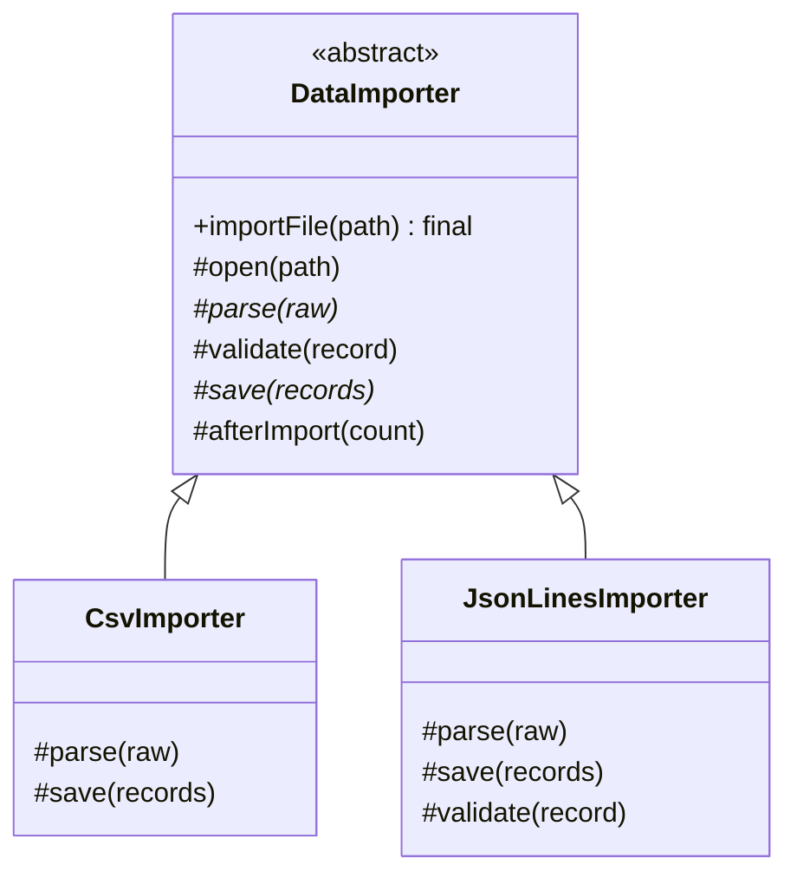

# Template Method Pattern

Back to [[LLD-Index]].

## Problem

Several classes run the same multi-step process (open resource -> read -> parse -> validate -> close) and differ in only one or two steps. Copy-pasting the process duplicates the invariant parts ([[DRY-KISS-YAGNI]]) and lets the copies drift (one forgets to close the resource).

## Motivation

- A base class defines a `final` **template method** that fixes the order of steps.
- Steps are either **abstract** (subclass must implement), **concrete** (shared), or **hooks** (default no-op or default value, subclass may override).
- "Hollywood principle": the base class calls the subclass, not the other way around.
- Invariant parts (resource handling, logging, error handling) live once.

## Structure



## Implementation

### Java

```java
import java.util.ArrayList;
import java.util.List;
import java.util.Map;

abstract class ReportGenerator {

    /** Template method: final so subclasses cannot reorder or skip steps. */
    public final String generate(List<Map<String, Object>> rows) {
        List<Map<String, Object>> filtered = new ArrayList<>();
        for (Map<String, Object> r : rows) {
            if (include(r)) filtered.add(r);           // hook
        }
        StringBuilder out = new StringBuilder();
        out.append(header());                          // abstract
        for (Map<String, Object> r : filtered) {
            out.append(formatRow(r));                  // abstract
        }
        out.append(footer(filtered.size()));           // hook with default
        return out.toString();
    }

    protected abstract String header();
    protected abstract String formatRow(Map<String, Object> row);

    /** Hook: include everything by default. */
    protected boolean include(Map<String, Object> row) { return true; }

    /** Hook: default footer. */
    protected String footer(int count) { return ""; }
}

final class CsvReport extends ReportGenerator {
    protected String header() { return "name,score\n"; }
    protected String formatRow(Map<String, Object> r) { return r.get("name") + "," + r.get("score") + "\n"; }
}

final class HtmlReport extends ReportGenerator {
    private final int minScore;
    HtmlReport(int minScore) { this.minScore = minScore; }
    protected String header() { return "<table>\n"; }
    protected String formatRow(Map<String, Object> r) {
        return "  <tr><td>" + r.get("name") + "</td><td>" + r.get("score") + "</td></tr>\n";
    }
    @Override protected boolean include(Map<String, Object> r) { return (Integer) r.get("score") >= minScore; }
    @Override protected String footer(int count) { return "</table>\n<!-- " + count + " rows -->\n"; }
}

public class TemplateMethodDemo {
    public static void main(String[] args) {
        List<Map<String, Object>> rows = List.of(
                Map.of("name", "ana", "score", 91),
                Map.of("name", "bo", "score", 55));
        System.out.print(new CsvReport().generate(rows));
        System.out.print(new HtmlReport(60).generate(rows));
    }
}
```

### Same idea with composition (callback style)

Template Method via inheritance can be replaced by passing the varying step as a function; the fixed skeleton stays in one class. This is how Spring's `JdbcTemplate` works.

```java
import java.util.function.Function;

final class Timed {
    static <T> T run(String label, java.util.function.Supplier<T> body) {
        long start = System.nanoTime();
        try {
            return body.get();
        } finally {
            System.out.println(label + " took " + (System.nanoTime() - start) / 1_000 + "us");
        }
    }
}

public class CallbackTemplateDemo {
    public static void main(String[] args) {
        Function<Integer, Integer> square = x -> x * x;
        int r = Timed.run("square", () -> square.apply(12));
        System.out.println(r); // 144
    }
}
```

## Tradeoffs

| Pro | Con |
|---|---|
| Invariant steps written once; order enforced | Inheritance-based: tight coupling to base class, one axis of variation per hierarchy |
| Hooks give controlled extension points | Fragile base class: changing the skeleton affects all subclasses |
| Easy to read: the algorithm is in one method | Subclasses can violate expectations of steps ([[Liskov-Substitution-Principle]]) |
| Framework-friendly (inversion of control) | Combinatorial explosion if two steps vary independently (CSV x filtered x ...) |

## When to use

- Multiple implementations share a fixed sequence and vary in a few steps.
- Frameworks that need to call user code at defined points (lifecycle methods).
- You must guarantee a step always runs (cleanup, auditing) regardless of subclass.

## When NOT to use

- Steps vary independently along multiple axes: compose [[Strategy-Pattern]] objects instead ([[Composition-vs-Inheritance]]).
- The variation must change at runtime: inheritance is fixed at construction.
- Only one implementation exists: YAGNI.

## Real-world example

- `javax.servlet.http.HttpServlet.service(HttpServletRequest, HttpServletResponse)` inspects the HTTP method and dispatches to `doGet`, `doPost`, `doPut`, `doDelete`, ...; subclasses override only the `doXxx` methods they support. Defaults return 405 / 400.
- `java.util.AbstractList`: implement `get(int)` and `size()` and you get `iterator()`, `indexOf`, `contains`, `equals`, `hashCode`, `subList` built on them. Override `set`, `add(int, E)`, `remove(int)` to make it modifiable. Similarly `java.io.InputStream.read(byte[], int, int)` is built on abstract `read()`.
- Spring `JdbcTemplate`: the template handles connection acquisition, statement creation, exception translation and resource release; callers supply callbacks (`RowMapper`, `PreparedStatementCreator`, `ResultSetExtractor`). This is template method via composition rather than inheritance.
- JUnit lifecycle: `@BeforeEach` / test / `@AfterEach` run in a fixed order the framework controls.

## Pattern comparisons

- **Strategy vs Template Method:** Template Method uses inheritance to vary *steps* of a fixed algorithm, chosen at compile time by subclassing. [[Strategy-Pattern]] uses composition to swap the *whole* algorithm (or a step) at runtime. Template Method is "is-a"; Strategy is "has-a". Callback-style templates (JdbcTemplate) are the bridge: fixed skeleton, strategy objects for steps.
- **Template Method vs Factory Method:** [[Factory-Method-Pattern]] is often a step inside a template method, specialized for creating the object the skeleton uses.

## Interview questions

1. **Why make the template method `final`?** So subclasses cannot change the order or skip invariant steps.
2. **Abstract step vs hook?** Abstract steps must be implemented; hooks have a default (often no-op) and are optional.
3. **What is the Hollywood principle?** "Don't call us, we'll call you": base/framework controls flow and calls subclass code.
4. **Downside compared with Strategy?** Inheritance coupling, no runtime swap, class explosion with multiple varying steps.
5. **Name a JDK example.** `AbstractList` (`get`/`size` -> everything else), `HttpServlet.service` -> `doGet`, `InputStream.read(byte[],int,int)` -> `read()`.
6. **How does JdbcTemplate relate?** It fixes the JDBC boilerplate skeleton and takes the varying part as callbacks: template method implemented with composition.
