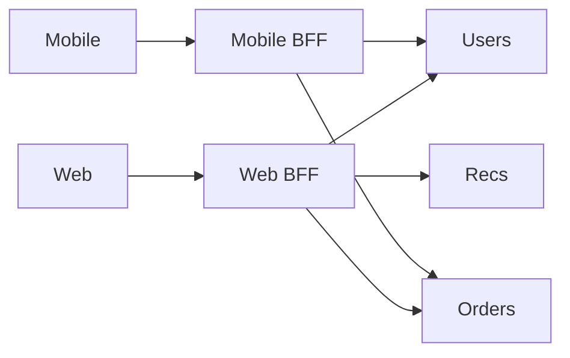

# Backend for Frontend

## Problem

A single general-purpose API forces the mobile app to make many round trips and download fields it never shows, while the web app needs different shapes. Shared endpoints accrete client-specific flags until nobody can change them safely.

## Solution

Put a thin service in front of the domain services for each client experience (web, mobile, partner). Each BFF is owned by the team that owns the client, calls downstream services in parallel, and returns exactly the shape the screen needs. Domain logic stays in the downstream services; the BFF only composes, adapts, and handles client concerns such as session cookies.



## Example

```typescript
// web-bff/src/routes/dashboard.ts  (Express, Node 20+)
import express from "express";
const router = express.Router();
const svc = (path: string, token: string) =>
  fetch(`${process.env.CORE_URL}${path}`, {
    headers: { authorization: `Bearer ${token}` },
    signal: AbortSignal.timeout(800),
  }).then((r) => { if (!r.ok) throw new Error(`${path} ${r.status}`); return r.json(); });

router.get("/dashboard", async (req, res) => {
  const token = req.session.accessToken;           // cookie session lives only in the BFF
  const [user, orders, recs] = await Promise.allSettled([
    svc(`/users/${req.session.userId}`, token),
    svc(`/orders?user=${req.session.userId}&limit=5`, token),
    svc(`/recommendations?user=${req.session.userId}`, token),
  ]);
  if (user.status === "rejected") return res.status(502).json({ error: "user unavailable" });
  res.json({
    name: user.value.displayName,
    recentOrders: orders.status === "fulfilled" ? orders.value.items.map((o: any) => ({ id: o.id, total: o.total })) : [],
    recommendations: recs.status === "fulfilled" ? recs.value.slice(0, 4) : [],  // optional panel degrades
  });
});
export default router;
```

## Tradeoffs

- Fewer round trips and tailored payloads versus more services to deploy and monitor.
- Risk of duplicated logic across BFFs if business rules leak into them.

## Failure modes

- Business rules creep into the BFF and diverge between web and mobile.
- No timeouts on fan-out calls, so one slow service stalls every screen.
- A BFF becomes a shared general API again as other clients start using it.

## Security implications

- The BFF is a natural place to keep tokens server-side (cookie session to the browser, bearer token downstream), reducing token exposure in the browser.
- It must enforce authorization for every aggregated call; do not assume downstream services re-check what the BFF filtered.
- See [[Pattern-Token-Exchange]] for scoping downstream tokens.

## When to use

- Several distinct clients with different data needs, or SPAs where you want tokens kept out of the browser.

## When not to use

- One client, or a small team that cannot own an extra service.

Back to [[Patterns-Index]].
