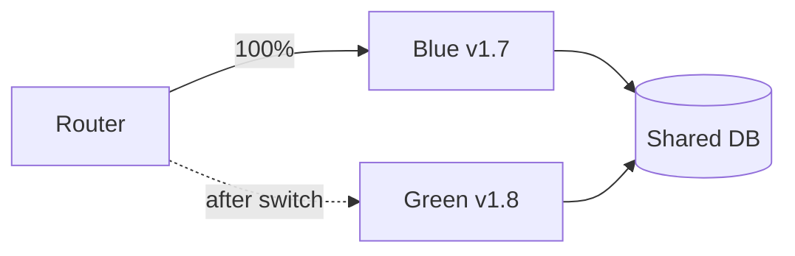

# Blue-Green Deployment

## Problem

In-place deployments leave a window where the service is partially updated or down, and rolling back means redeploying the old version under pressure.

## Solution

Run two identical environments. Blue serves production; green receives the new version. Smoke-test green with production config, then flip the router (load balancer target, DNS, or Kubernetes Service selector) to green. Blue stays warm for instant rollback until confidence is high. Database changes must be backward compatible with both versions (expand, migrate, contract).



## Example

```yaml
# Kubernetes: two Deployments, one Service. Switching = changing the selector.
apiVersion: apps/v1
kind: Deployment
metadata: { name: api-green }
spec:
  replicas: 3
  selector: { matchLabels: { app: api, color: green } }
  template:
    metadata: { labels: { app: api, color: green } }
    spec:
      containers:
        - name: api
          image: registry.example.com/api:1.8.0
          readinessProbe: { httpGet: { path: /health, port: 8000 } }
---
apiVersion: v1
kind: Service
metadata: { name: api }
spec:
  selector: { app: api, color: blue }    # flip to green after smoke tests pass
  ports: [{ port: 80, targetPort: 8000 }]
# Switch:   kubectl patch service api -p '{"spec":{"selector":{"app":"api","color":"green"}}}'
# Rollback: same command with color=blue
```

## Tradeoffs

- Near-instant cutover and rollback, at the cost of double capacity during deploys.
- All users move at once, so a bug that passes smoke tests hits everyone (canary limits this).
- Stateful components (DB, queues) are shared and cannot be flipped.

## Failure modes

- Non-backward-compatible schema migration breaks blue, making rollback impossible.
- Long-lived connections (WebSockets) stay on blue after the switch.
- Green not warmed (caches, JIT, connection pools) and latency spikes at cutover.

## Security implications

- Idle environment must receive the same patches and secrets rotation; a forgotten blue with old credentials is attack surface.
- Restrict who can flip traffic and audit the switch.

## When to use

- Services where fast rollback matters and capacity can be doubled briefly.

## When not to use

- Tight budgets with large fleets, or schema changes that cannot be made backward compatible.

Back to [[Patterns-Index]].
