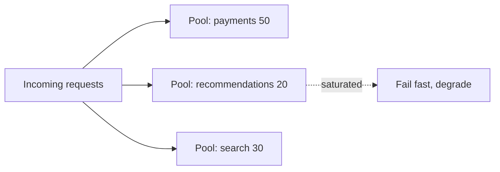

# Bulkhead

## Problem

All outbound calls share one thread pool or connection pool. When one dependency slows down, its calls hold every worker, and requests that do not even touch that dependency start failing. Likewise one noisy tenant can starve everyone else.

## Solution

Like watertight compartments in a ship, partition resources: separate pools, semaphores, or concurrency limits per dependency, per endpoint class, or per tenant tier. When a compartment fills, calls into it are rejected fast (or queued briefly) while other compartments keep working. At the infrastructure level, the same idea means separate deployments or node pools for critical and non-critical workloads.



## Example

```python
import asyncio
from contextlib import asynccontextmanager

class BulkheadFull(Exception): ...

class Bulkhead:
    def __init__(self, name: str, max_concurrent: int, max_wait_s: float = 0.05):
        self.name, self.sem, self.max_wait = name, asyncio.Semaphore(max_concurrent), max_wait_s

    @asynccontextmanager
    async def slot(self):
        try:
            await asyncio.wait_for(self.sem.acquire(), timeout=self.max_wait)
        except asyncio.TimeoutError:
            raise BulkheadFull(f"{self.name} saturated")   # fail fast, do not queue forever
        try:
            yield
        finally:
            self.sem.release()

recs_bulkhead = Bulkhead("recommendations", max_concurrent=20)
payments_bulkhead = Bulkhead("payments", max_concurrent=50)

async def product_page(client, pid: str):
    product = await client.get(f"/products/{pid}")
    try:
        async with recs_bulkhead.slot():
            recs = await client.get(f"/recs/{pid}", timeout=0.5)
    except (BulkheadFull, Exception):
        recs = None                                        # optional panel degrades alone
    return {"product": product, "recs": recs}
```

## Tradeoffs

- Contains failures versus lower peak utilization (idle capacity in one compartment cannot help another).
- Limits require tuning and revisiting as traffic changes.

## Failure modes

- Limits set so high they never trigger, or so low they reject normal traffic.
- Shared downstream resource (one DB) still couples compartments.
- Rejections not surfaced in metrics, so saturation is invisible.

## Security implications

- Per-tenant bulkheads limit the impact of abusive or compromised tenants and some DoS patterns.
- Keep security-critical paths (auth, audit logging) in their own compartment so load elsewhere cannot starve them.

## When to use

- Services with several dependencies of different criticality; multi-tenant platforms.

## When not to use

- Simple services with one dependency, where a timeout and circuit breaker suffice.

Back to [[Patterns-Index]].
