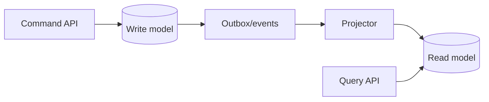

# CQRS

## Problem

A single normalized model serves both complex writes with invariants and many differently shaped reads. Queries need many joins, writes are slowed by read indexes, and read and write scaling requirements differ widely.

## Solution

Command Query Responsibility Segregation: commands go through a write model that enforces invariants and emits events; one or more read models (denormalized tables, search indexes, caches) are built from those events and serve queries. Read models are eventually consistent and can be rebuilt from the event history or the write store.



## Example

```python
# Command side: enforces invariants, emits events (via outbox)
def add_item(conn, cart_id: str, sku: str, qty: int) -> None:
    if qty <= 0:
        raise ValueError("qty must be positive")
    with conn:
        conn.execute("INSERT INTO cart_items(cart_id, sku, qty) VALUES (?,?,?) "
                     "ON CONFLICT(cart_id, sku) DO UPDATE SET qty = qty + excluded.qty",
                     (cart_id, sku, qty))
        conn.execute("INSERT INTO outbox(type, payload) VALUES ('ItemAdded', json_object("
                     "'cart_id', ?, 'sku', ?, 'qty', ?))", (cart_id, sku, qty))

# Projection: consumes events, maintains a denormalized read model
def project(read_conn, event: dict) -> None:
    if event["type"] == "ItemAdded":
        p = event["payload"]
        price = read_conn.execute("SELECT price_cents FROM catalog WHERE sku=?", (p["sku"],)).fetchone()[0]
        with read_conn:
            read_conn.execute(
                "INSERT INTO cart_summary(cart_id, item_count, total_cents) VALUES (?,?,?) "
                "ON CONFLICT(cart_id) DO UPDATE SET item_count = item_count + excluded.item_count, "
                "total_cents = total_cents + excluded.total_cents",
                (p["cart_id"], p["qty"], p["qty"] * price))

# Query side: one cheap lookup, no joins
def get_cart_summary(read_conn, cart_id: str):
    return read_conn.execute("SELECT item_count, total_cents FROM cart_summary WHERE cart_id=?",
                             (cart_id,)).fetchone()
```

## Tradeoffs

- Independently optimized and scaled reads and writes, at the cost of eventual consistency and more moving parts.
- Projections must be idempotent and replayable.
- Debugging spans two models.

## Failure modes

- Projection lag makes users think writes failed.
- Non-idempotent projections double-count on redelivery.
- Schema changes to events break old projections during replay.

## Security implications

- Read models often denormalize data across permission boundaries; enforce authorization on the query side too, not only on commands.
- Event streams retain history, including PII; plan for erasure (crypto-shredding or redaction).

## When to use

- Read and write loads or shapes differ sharply; collaborative domains; systems already event-driven.

## When not to use

- Simple CRUD, small apps, or teams without operational experience with async pipelines.

Back to [[Patterns-Index]].
