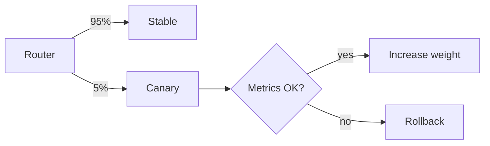

# Canary Release

## Problem

Tests and staging cannot reproduce production traffic, data, and scale. A bad release rolled out to everyone at once turns an undetected bug into a full outage.

## Solution

Route a small percentage of traffic (for example 1%, then 5%, 25%, 100%) to the new version. At each step compare the canary's error rate, latency, and key business metrics against the stable version over a fixed window. Promote automatically when metrics are within thresholds; roll back automatically when they are not. Tools: Argo Rollouts, Flagger, or weighted load-balancer targets.



## Example

```yaml
# Argo Rollouts canary with automated analysis
apiVersion: argoproj.io/v1alpha1
kind: Rollout
metadata: { name: api }
spec:
  replicas: 10
  strategy:
    canary:
      steps:
        - setWeight: 5
        - analysis: { templates: [{ templateName: error-rate }] }
        - setWeight: 25
        - pause: { duration: 10m }
        - analysis: { templates: [{ templateName: error-rate }] }
        - setWeight: 100
  # selector/template omitted for brevity
---
apiVersion: argoproj.io/v1alpha1
kind: AnalysisTemplate
metadata: { name: error-rate }
spec:
  metrics:
    - name: http-5xx-ratio
      interval: 1m
      count: 5
      failureLimit: 1
      successCondition: result[0] < 0.01      # threshold is a team choice
      provider:
        prometheus:
          address: http://prometheus:9090
          query: |
            sum(rate(http_requests_total{app="api",track="canary",code=~"5.."}[2m]))
            / sum(rate(http_requests_total{app="api",track="canary"}[2m]))
```

## Tradeoffs

- Limits blast radius and uses real traffic as the test, at the cost of slower rollouts and a dependency on good metrics.
- Small canary slices need enough traffic to be statistically meaningful.

## Failure modes

- Metrics too coarse (overall 5xx) to catch a broken feature used by few users.
- Canary shares a DB migration that already broke the stable version.
- Sticky sessions not handled, so a user flips between versions mid-flow.

## Security implications

- A canary receives real user data; it must meet the same security bar as stable.
- Automated promotion should never skip security gates (image signing, vulnerability scan) that ran in CI.

## When to use

- High-traffic services with solid metrics and automated rollback.

## When not to use

- Low-traffic services where a 5% slice sees almost no requests; use blue-green plus synthetic checks instead.

Back to [[Patterns-Index]].
