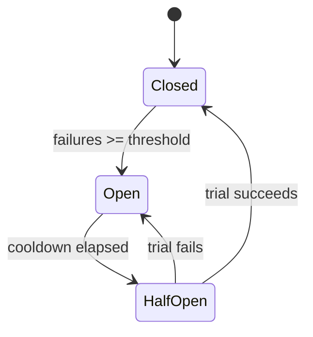

# Circuit Breaker

## Problem

When a downstream service is slow or down, callers keep sending requests that wait for timeouts. Threads and connections pile up, the caller itself becomes unresponsive, and the failure cascades upstream. The struggling dependency also gets no room to recover.

## Solution

Wrap calls in a breaker with three states. Closed: calls pass through and failures are counted. Open: after a failure threshold, calls fail immediately (or use a fallback) for a cooldown. Half-open: after the cooldown, a limited number of trial calls go through; success closes the breaker, failure reopens it.



## Example

```python
import time, threading

class CircuitOpen(Exception): ...

class CircuitBreaker:
    def __init__(self, failure_threshold=5, reset_timeout_s=30.0):
        self.threshold, self.reset_timeout = failure_threshold, reset_timeout_s
        self.failures, self.state, self.opened_at = 0, "closed", 0.0
        self.lock = threading.Lock()

    def call(self, fn, *args, **kwargs):
        with self.lock:
            if self.state == "open":
                if time.monotonic() - self.opened_at < self.reset_timeout:
                    raise CircuitOpen("dependency unavailable")
                self.state = "half_open"            # allow a trial request
        try:
            result = fn(*args, **kwargs)
        except Exception:
            with self.lock:
                self.failures += 1
                if self.state == "half_open" or self.failures >= self.threshold:
                    self.state, self.opened_at = "open", time.monotonic()
            raise
        with self.lock:
            self.failures, self.state = 0, "closed"
        return result

payments_breaker = CircuitBreaker(failure_threshold=5, reset_timeout_s=30)
# payments_breaker.call(requests.post, url, json=body, timeout=2)
```

## Tradeoffs

- Fast failure and dependency protection versus rejecting some requests that might have succeeded.
- Thresholds need tuning per dependency; count-based versus rate-based windows behave differently at low traffic.

## Failure modes

- No timeout on the wrapped call, so the breaker never sees failures quickly.
- One breaker shared across unrelated endpoints: one bad endpoint blocks all.
- Half-open lets a flood of requests through instead of a few trials.
- Client errors (4xx) counted as dependency failures.

## Security implications

- Breakers limit amplification during attacks on dependencies, but fallbacks must not bypass security (e.g. skipping a fraud check when it is open should be a deliberate, reviewed decision, not a default).
- Emit state changes as metrics and alerts; an open breaker is an incident signal.

## When to use

- Remote calls to dependencies that can fail or slow down independently.

## When not to use

- In-process calls, or batch jobs where waiting and retrying later is fine.

Back to [[Patterns-Index]].
