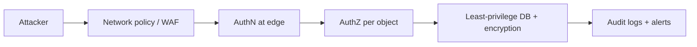

# Defense in Depth

## Problem

Any single control will eventually fail: a WAF rule is bypassed, a developer forgets an authorization check, a dependency ships a vulnerability, credentials leak. If that one control was all that stood between an attacker and the data, one mistake becomes a breach.

## Solution

Stack independent controls at each layer (network, identity, application, data, monitoring) so an attacker must defeat several, and so failures are detected. Controls should fail independently: two checks that share the same bug or the same secret are one layer, not two.



## Example

```yaml
# One request path, several independent layers (Kubernetes + app examples)
# 1. Network: only the ingress may reach the API pods
apiVersion: networking.k8s.io/v1
kind: NetworkPolicy
metadata: { name: api-ingress-only }
spec:
  podSelector: { matchLabels: { app: api } }
  ingress:
    - from: [{ namespaceSelector: { matchLabels: { name: ingress } } }]
      ports: [{ port: 8000 }]
---
# 2. Workload: non-root, read-only FS, no privilege escalation
apiVersion: apps/v1
kind: Deployment
metadata: { name: api }
spec:
  template:
    spec:
      containers:
        - name: api
          image: registry.example.com/api@sha256:<digest>   # pinned digest
          securityContext:
            runAsNonRoot: true
            readOnlyRootFilesystem: true
            allowPrivilegeEscalation: false
            capabilities: { drop: ["ALL"] }
# 3. App: authn at the edge + authz per object in code
# 4. Data: DB role with least privilege, encryption at rest, row-level security
# 5. Detection: audit logs shipped off-host, alerts on auth anomalies
```

## Tradeoffs

- Each layer adds cost, latency, or operational complexity; choose layers by threat model, not by checklist.
- Too many overlapping controls can create alert fatigue and false confidence.

## Failure modes

- Layers that are not independent (same credential unlocks all of them).
- Controls that exist but are not monitored, so a failure goes unnoticed.
- Relying on perimeter controls and skipping in-app authorization ("it's internal").

## Security implications

- This is the security pattern; its main risk is misjudging independence. Map each control to the threat it stops and test each layer separately (e.g. prove the app rejects unauthorized access even with the network open).
- This repository applies it to Markdown rendering: see [[ADR-006-Sanitized-Markdown-Rendering]].

## When to use

- Every production system handling user data or credentials.

## When not to use

- Do not use it as an excuse to add controls without a threat they address; low-risk internal prototypes need proportionate controls.

Back to [[Patterns-Index]].
