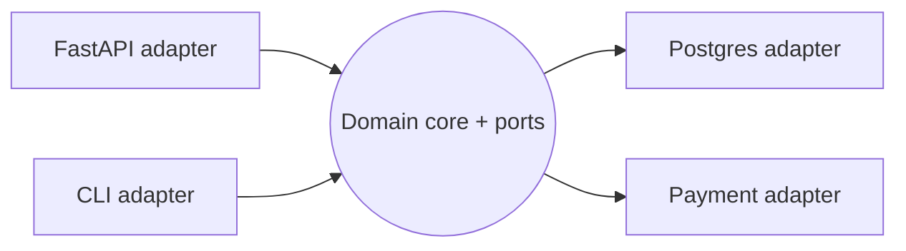

# Hexagonal Architecture

## Problem

Business rules tangled with ORM calls, HTTP handlers, and SDK clients are hard to test (every test needs a database) and hard to change (switching a payment provider touches the core).

## Solution

Also called ports and adapters. The domain core defines interfaces (ports) for what it needs (`OrderRepository`, `PaymentGateway`) and what it offers (use cases). Adapters implement ports for specific technologies (Postgres, Stripe, FastAPI). Dependencies point inward: adapters depend on the core, never the reverse. Tests drive the core with in-memory adapters.



## Example

```python
from dataclasses import dataclass
from typing import Protocol

# ---- core (no framework imports) ----
@dataclass
class Order:
    id: str
    amount_cents: int
    paid: bool = False

class OrderRepository(Protocol):
    def get(self, order_id: str) -> Order: ...
    def save(self, order: Order) -> None: ...

class PaymentGateway(Protocol):
    def charge(self, amount_cents: int, ref: str) -> bool: ...

class PayOrder:                                   # use case
    def __init__(self, repo: OrderRepository, payments: PaymentGateway):
        self.repo, self.payments = repo, payments
    def __call__(self, order_id: str) -> Order:
        order = self.repo.get(order_id)
        if order.paid:
            return order                          # idempotent
        if not self.payments.charge(order.amount_cents, ref=order.id):
            raise RuntimeError("payment declined")
        order.paid = True
        self.repo.save(order)
        return order

# ---- adapters ----
class InMemoryOrders:
    def __init__(self): self.rows: dict[str, Order] = {}
    def get(self, oid): return self.rows[oid]
    def save(self, o): self.rows[o.id] = o

class FakePayments:
    def charge(self, amount_cents, ref): return amount_cents < 100_000

# test: no DB, no network
repo = InMemoryOrders(); repo.save(Order("o1", 5_000))
assert PayOrder(repo, FakePayments())("o1").paid
```

## Tradeoffs

- Fast, isolated tests and swappable infrastructure, at the cost of more interfaces and mapping code.
- Overkill for CRUD apps with little domain logic.

## Failure modes

- Ports designed around one vendor's API leak that vendor into the core.
- Anemic core: all logic ends up in adapters anyway.
- Layer-violating imports creep in without an import-linting rule.

## Security implications

- Validation and authorization belong in the core use cases (or at the inbound adapter consistently), so every entry point (HTTP, CLI, queue) gets the same checks.
- Adapters are where secrets live (DB credentials, API keys); keep them out of the core and out of logs.

## When to use

- Domain-heavy services, systems expected to outlive their frameworks or vendors.

## When not to use

- Thin CRUD services, scripts, prototypes.

Back to [[Patterns-Index]].
