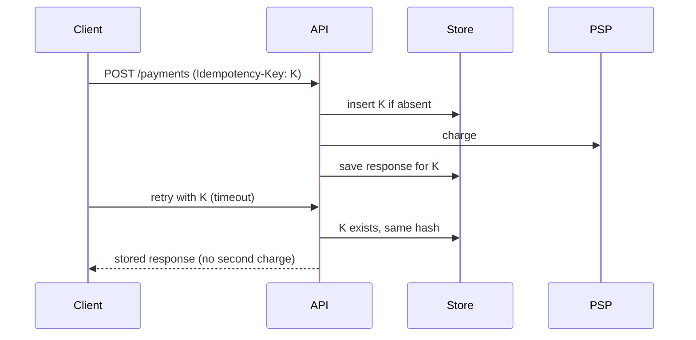

# Idempotency Keys

## Problem

Networks time out after the server has already acted. A client that retries `POST /payments` cannot tell whether the first attempt succeeded, so naive retries double-charge customers or create duplicate orders.

## Solution

The client generates a unique key (UUIDv4) per logical operation and sends it in an `Idempotency-Key` header. The server stores the key with a hash of the request and the eventual response. A repeat with the same key and body returns the stored response; the same key with a different body is rejected; a concurrent duplicate waits or gets `409`. Keys expire after a retention window.



## Example

```python
import hashlib, json
from fastapi import FastAPI, Header, HTTPException, Request

app = FastAPI()
# Table: idempotency(key TEXT PRIMARY KEY, req_hash TEXT, status TEXT, response JSONB, created_at)

@app.post("/payments")
async def create_payment(request: Request, idempotency_key: str = Header(...)):
    body = await request.body()
    req_hash = hashlib.sha256(body).hexdigest()
    with db.transaction():
        inserted = db.execute(
            "INSERT INTO idempotency(key, req_hash, status) VALUES (:k, :h, 'in_progress') "
            "ON CONFLICT (key) DO NOTHING RETURNING key", {"k": idempotency_key, "h": req_hash}
        ).fetchone()
    if not inserted:
        row = db.execute("SELECT req_hash, status, response FROM idempotency WHERE key=:k",
                         {"k": idempotency_key}).fetchone()
        if row.req_hash != req_hash:
            raise HTTPException(422, "Idempotency-Key reused with a different request")
        if row.status == "in_progress":
            raise HTTPException(409, "Request with this key is still processing")
        return row.response                       # replay stored result
    result = charge_card(json.loads(body))        # the side effect, done once
    db.execute("UPDATE idempotency SET status='done', response=:r WHERE key=:k",
               {"r": json.dumps(result), "k": idempotency_key})
    return result
```

## Tradeoffs

- Requires durable storage and a retention/cleanup job.
- Adds a write per request on the hot path.
- Only as strong as the side effect: the downstream call must also be idempotent or transactional with the key record.

## Failure modes

- Crash between the side effect and storing the response leaves the key `in_progress` forever; add a timeout and a reconciliation path.
- Keys scoped globally instead of per client let one tenant collide with another.
- Clients generating a new key on every retry defeat the mechanism.

## Security implications

- Scope keys per authenticated principal so one user cannot replay or probe another's results.
- Do not store full card data or secrets in the stored response.
- Rate-limit key creation to avoid storage exhaustion.

## When to use

- Payments, order creation, provisioning, any POST that clients will retry.

## When not to use

- Naturally idempotent operations (PUT of a full resource, DELETE by id) that already converge on retry.

Back to [[Patterns-Index]].
